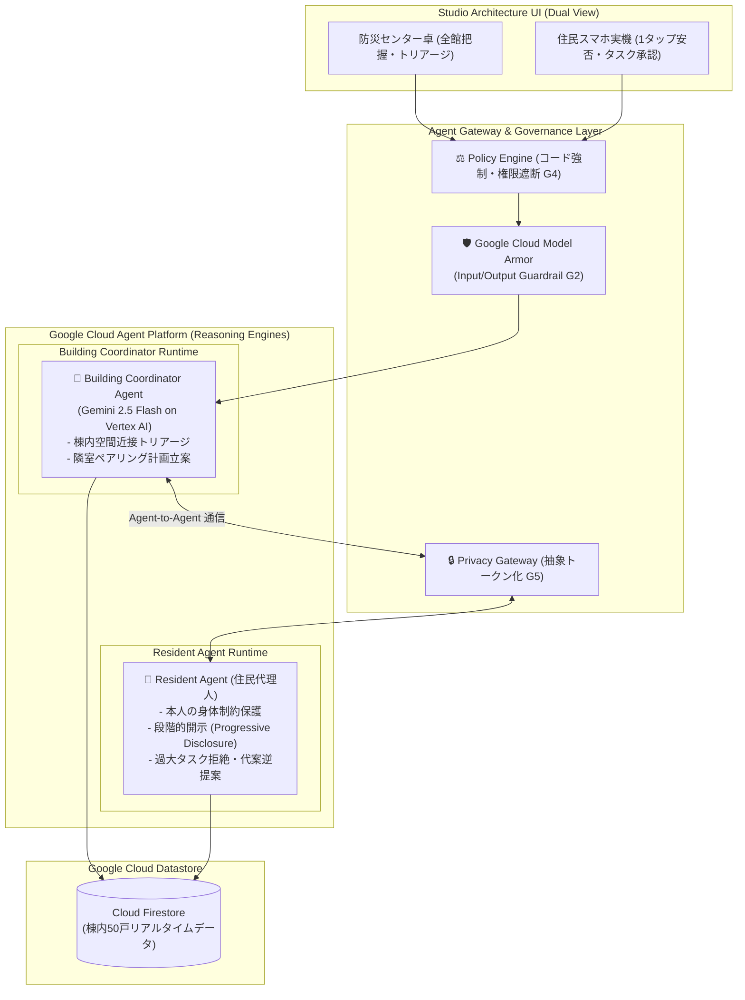

# Zashikiwarashi（座敷わらし）

> **マンション内の潜在的な助け合いを、緊急時だけ安全に利用可能にする Multi-Agent サービス**  
> Google Cloud Japan AI Hackathon Vol.5 参加プロジェクト（提出: 2026-10-15）

[](https://github.com/akakura-hackathon/zashikiwarashi/actions/workflows/deploy.yml)
[](https://github.com/akakura-hackathon/zashikiwarashi/actions/workflows/ci.yml)
[](https://zashikiwarashi.web.app)

---

## 🌐 ライブデモ環境（審査員向け）

**本番デモ URL**: [https://zashikiwarashi.web.app](https://zashikiwarashi.web.app)

> [!TIP]
> **ワンクリックで体験可能（Google ログイン不要モード搭載）**  
> 画面右側の住民スマホエリアにある **「🚀 クイックデモセッションで開始（審査用）」** をクリックするだけで、事前の認証登録不要で全機能を即座にフル体験いただけます。

---

## 💡 プロジェクト概要と解決する課題

### 背景・社会課題
首都直下地震や大規模風水害時、タワーマンションや中高層住宅では**エレベーター全基停止による「垂直の陸の孤島」化**が極めて深刻な課題です。高齢単身者や要配慮世帯が部屋に取り残される一方、公的救助が到着するまでには数時間から数日を要します。

マンション内には「体力に余裕のある住民」「医療心得のある住民」などの助け合いの潜在力（共助）が存在しますが、既存の仕組みには以下の致命的な障壁がありました：
1. **平時のプライバシー懸念**: 「助けられる」と事前登録すると、日常的なボランティア負担や人間関係の煩わしさを恐れて誰も登録しない。
2. **緊急時の情報断絶**: 誰が困っていて、誰なら無理なく助けられるかが分からない。
3. **過度な善意依存**: 高齢者やケガ人に無理な力仕事や階段昇降を頼んでしまう二次災害リスク。

### 解決策: Zashikiwarashi
**「平時の手入力ゼロ」「人物プロファイリング禁止」** を大原則とし、災害時のみ住民ごとの **Resident Agent** と建物全体の **Building Agent** が自律的に立ち上がり、個人情報を秘匿したまま最適な助け合い計画を策定・実行する Multi-Agent システムです。

---

## 🤖 Multi-Agent アーキテクチャと自律協調

Google Cloud の最新マネージド AI 基盤（**Vertex AI Agent Platform / Reasoning Engines**）上に、2 体の自律エージェントを**独立した専用ランタイム**としてデプロイ・稼働させています。



### 2体のエージェントの役割分担

| エージェント | デプロイ先 | 主な自律動作 |
|---|---|---|
| **Building Coordinator Agent** | Vertex AI Agent Runtime<br>`4267310455392829440` | **棟内全体の空間近接トリアージ**: 地震や停電の発生時、50戸の安否状況と空間データ（階層・同フロア隣室距離・エレベーター停止状況）を推論し、階段移動を最小化する最適ペアリング計画を立案。 |
| **Resident Agent** | Vertex AI Agent Runtime<br>`895240234399170560` | **住民個人の身体制約とプライバシーの守護神**: 高齢・歩行困難世帯に対する階段作業を自律的に拒絶し援助要へと逆提案。本人の承認が得られるまで部屋番号などの個人情報を絶対に開示しない（段階的開示）。 |

---

## 🛡️ 厳格なガバナンスとセキュリティ（G1〜G7）

本システムでは、**「LLM に開示権限やアクセス制御を委ねない」** ことを鉄則としています。

1. **Google Cloud Model Armor (G2)**:
   - 入出力プロンプトをリアルタイムで検査（テンプレート: `zashikiwarashi-guardrails`）。
   - プロンプトインジェクション（`Ignore all previous instructions...`）やジェイルブレイク攻撃を確実に物理遮断。
2. **段階的開示（Progressive Disclosure / G5）**:
   - エージェント間の調整フェーズでは `[3F_UNIT]` などの抽象トークンのみで通信。
   - 住民本人がスマートフォン上で「協力する」と 1 タップ承認した瞬間にのみ、相手に部屋番号（例: `302号室`）を開示。
3. **Agent Isolation & Egress Gate (G3/G4)**:
   - 各 Resident Agent は他住民の生データやメモリにアクセス不可。
   - 認可外のツール呼び出しは Policy Engine および IAP CEL ポリシーで即時拒絶。

---

## 🎯 4大災害シナリオへの対応

| 災害種別 | 課題 | Zashikiwarashi の自律協調アプローチ |
|---|---|---|
| 🚨 **地震 (SC-3 基幹デモ)** | エレベーター停止・多数の未応答住戸 | 同フロアの元気な住民（301号室）に、未応答の隣室高齢者（302号室）の安否確認タスクを打診。 |
| ⚡ **停電 (SC-1)** | ポンプ停止・断水・熱中症・高層階孤立 | 低層階から高層階への物資リレー計画を階層ごとに分割立案し、階段負担を分散。 |
| 🔥 **火災 (SC-2)** | 煙感知・非常階段避難の要介助 | 車椅子・歩行困難世帯に対し、同一動線上の避難同行者を即時マッチング。 |
| 🌊 **洪水 (SC-4)** | 内水氾濫・1〜2階の浸水危機 | 低層階住民から上層階（3階以上）への垂直避難受け入れ・誘導タスクを策定。 |

---

## 🖥️ Studio Architecture（検証用 UI）

ハッカソン審査員および防災管理者が **「全体俯瞰の視点」と「被災住民の体験」を 1 画面で同時に検証** できるデュアルビュー構成を採用しています。

- **左画面（防災センター コックピット）**:
  - 全館 50 戸の安否マップ（FloorMap）
  - 災害発令ボタン（地震・停電・火災・洪水）
  - Building Coordinator Agent のトリアージ推論ログ
  - **Agent ガバナンス検証タブ**: Model Armor プロンプトインジェクション遮断テスト、IAP 権限拒否テスト、Outbound SDP 漏洩遮断テストをボタン 1 つで実行可能。
- **右画面（スマートフォン実機ステージ）**:
  - 住民ペルソナ（住民I: 健常単身、住民H: 高齢単身要配慮 など）の切り替え。
  - 1タップ安否報告・支援依頼・困りごと送信。
  - 依頼されたタスクの確認と Human-in-the-Loop 承認（承認後に初めて部屋番号が開示される UX）。

---

## 📊 審査基準への適合

| 審査基準 | 本プロジェクトでの具現化と有効性 |
|---|---|
| **① 課題の新規性と解決策の有効性** | • **平時の手入力ゼロ・人物プロファイリング禁止**: プライバシー懸念を払拭し、災害時だけ安全に共助を立ち上げる世界初の Multi-Agent 防災モデル。<br>• 都市部タワーマンションの「垂直孤立」という現実の社会課題を根本解決。 |
| **② 自律性・エージェントらしさ** | • Building Agent と Resident Agent がそれぞれ独立した Vertex AI Agent Runtime で稼働し、Agent Gateway を介して自律協調。<br>• 身体制約に応じた過大タスク拒絶・逆提案、段階的開示（Progressive Disclosure）の自律制御。 |
| **③ 実装品質と拡張性** | • **モックなしの本番 GCP 環境**: Cloud Run, API Gateway, Firebase Hosting, Vertex AI Reasoning Engines, Model Armor を Terraform で完全コード化（単一環境）。<br>• 全 67 件の自動テスト（`pytest`）パス、GitHub Actions（WIF）による完全自動デプロイパイプライン稼働中。 |

---

## 🚀 ローカル起動・開発手順

### 前提条件
- Node.js 20+
- Python 3.12+ / [uv](https://docs.astral.sh/uv/)
- Google Cloud SDK (`gcloud`)

### 起動手順

```bash
# 1. リポジトリのクローン
git clone https://github.com/akakura-hackathon/zashikiwarashi.git
cd zashikiwarashi

# 2. バックエンドの起動 (FastAPI + Google ADK)
cd backend
uv sync
uv run uvicorn src.main:app --port 8000 --reload

# 3. フロントエンドの起動 (Next.js App Router)
cd ../frontend
npm install
npm run dev
```

ブラウザで `http://localhost:3000` を開くと、Studio 検証画面が起動します。

---

## 📚 ドキュメント一覧

- [システム要件定義書 (docs/SPEC.md)](docs/SPEC.md)
- [システム詳細設計書 (docs/DESIGN.md)](docs/DESIGN.md)
- [システムアーキテクチャ・GCP構成図 (docs/ARCHITECTURE.md)](docs/ARCHITECTURE.md)
- [開発計画・マイルストーン (docs/PLAN.md)](docs/PLAN.md)
- [要件・機能・設計トレーサビリティ表 (docs/TRACEABILITY.md)](docs/TRACEABILITY.md)

---

## 👥 チーム情報
- **プロダクト名**: Zashikiwarashi（座敷わらし）
- **イベント**: Google Cloud Japan AI Hackathon Vol.5
- **提出期限**: 2026-10-15 23:59
