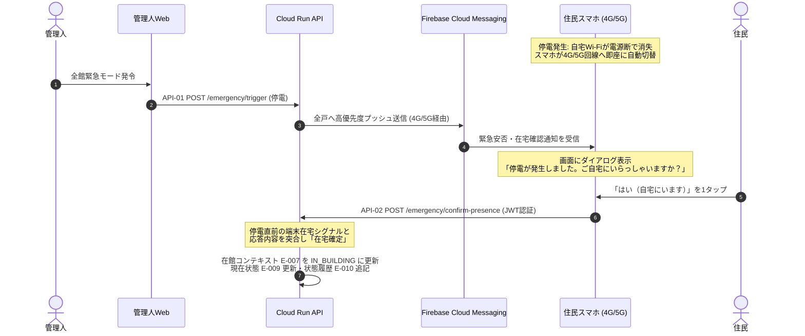

# Zashikiwarashi — システムアーキテクチャ設計書

*Version 1.0 / Hackathon MVP & Production Blueprint*
*Google Cloudおよび外部実在APIを活用したデータ収集・生活文脈分析・Multi-Agent協調基盤の完全設計*

---

## 1. システム全体構成図

本システムは、日常の追加ハードウェア購入や手入力を一切要求せず、住民の既存スマートフォン、マンション既設設備、および電力スマートメーターからデータを収集し、Google Cloud上で在館コンテキスト（DESIGN.md E-007）へ安全に抽象化してMulti-Agent協調を実行するサーバーレス・イベント駆動型アーキテクチャ。

```mermaid
flowchart TD
  subgraph Clients [クライアント & 外部システム層（追加機器購入0円）]
    App[住民スマートフォン<br>iOS / Android / Flutter<br>・FCM v1プッシュ受信<br>・Human Approval / 1タップ応答<br>・端末在宅シグナル送信]
    AdminWeb[管理人Webコンソール<br>Next.js / React]
    CalendarAPI[Google Calendar API v3<br>OAuth 2.0認可コードフロー]
    PowerAPI[スマートメーターAPI<br>一般社団法人 電力データ管理協会]
    Intercom[集合インターホン盤<br>オートロック解錠Webhook]
  end

  subgraph Ingestion [認証 & 受信層 Edge / Gateway]
    Auth[Firebase Authentication<br>Google OAuth / JWTカスタムクレーム]
    RunIngest[Cloud Run: API Ingestion<br>FastAPI / Python<br>Webhook & クライアントREST API]
  end

  subgraph EventBus [非同期メッセージング層]
    PubSub[Cloud Pub/Sub<br>・presence-events<br>・power-metrics<br>・emergency-alerts]
    FCM[Firebase Cloud Messaging<br>HTTP v1 API<br>・4G/5G高優先度プッシュ通知<br>・安否1タップ応答 / Human Approval]
  end

  subgraph DataLayer [データ永続化層]
    Firestore[(Cloud Firestore)<br>・建物・空間グラフ E-001〜004<br>・住民・世帯・在館 E-005〜007<br>・緊急状態・Issue・Task E-008〜016]
    BigQuery[(BigQuery)<br>・電力時系列データ<br>・在館判定の入力]
    SecretMgr[Secret Manager<br>APIキー・OAuth証明書暗号化保持]
  end

  subgraph AgentLayer [プライバシー & Multi-Agent実行層]
    subgraph PrivacyGate [Privacy Gateway]
      DLP[Sensitive Data Protection<br>旧 Cloud DLP<br>氏名/電話番号/居室番号自動マスキング]
    end

    subgraph Compute [Agent Runtime Cloud Run]
      ResidentAgent[Resident Agent Service<br>住民IDごとにContext分離実行]
      BuildingAgent[Building Agent Coordinator<br>全体最適・空間タスク分割]
      PolicyEngine[Policy Engine<br>児童保護・未承認アクション物理遮断]
    end

    VertexAI[Vertex AI / Gemini Enterprise<br>・Gemini 3.8 Flash 高速推論・抽象化<br>・Gemini 3.1 Pro 構造化計画生成]
  end

  subgraph Audit [監査 & 監視層]
    Logging[Cloud Logging / Cloud Audit Logs<br>改ざん不能な追記専用ログ]
  end

  %% クライアント接続
  App -->|JWT認証| Auth
  App -->|在宅シグナル/安否フラグ送信| RunIngest
  AdminWeb -->|緊急モード発令| RunIngest
  CalendarAPI -->|OAuth不在予定同期| RunIngest
  PowerAPI -->|30分値Webhook| RunIngest
  Intercom -->|解錠ログWebhook| RunIngest

  %% 受信からイベントバス
  RunIngest --> PubSub
  RunIngest --> Firestore

  %% イベント配信
  PubSub --> Firestore
  PubSub --> BigQuery
  PubSub --> BuildingAgent

  %% Agent協議 & AI
  BuildingAgent <--> ResidentAgent
  ResidentAgent --> PrivacyGate
  PrivacyGate --> DLP
  DLP --> VertexAI
  BuildingAgent --> PolicyEngine
  PolicyEngine --> VertexAI
  VertexAI --> BuildingAgent

  %% プッシュ通知
  BuildingAgent --> FCM
  FCM -->|4G/5G経由| App

  %% 監査ログ
  BuildingAgent --> Logging
  ResidentAgent --> Logging
  SecretMgr -.->|秘密情報注入| RunIngest
  SecretMgr -.->|秘密情報注入| Compute
```

---

## 2. 外部API・クライアント連携詳細仕様

### 2.1 住民スマートフォン（iOS / Android クライアント）

- **クライアント技術**: Flutter（iOS / AndroidのネイティブOSセンサーAPIへPlatform Channel経由でアクセス）。
- **追加ハードウェア出費**: **0円**（住民が日常利用している端末のみ）。
- **日常の手入力**: **完全ゼロ**（普段通り生活するだけ）。

**端末在宅シグナルの送信仕様:**

端末から収集する各シグナルは、OS権限制約に準拠してバックグラウンドで取得し、Cloud Runへは `presence: true/false` の1ビット値のみPOSTする。GPS座標やSSID文字列などの生データは端末外に出さない。

各シグナルのOS制約と対応策の詳細は [DESIGN.md §3.3.2](DESIGN.md#332-端末在宅シグナルクライアントサイド自動取得) を参照。

| シグナル | 送信データ | MVPでの扱い |
| :--- | :--- | :--- |
| 自宅Wi-Fi接続状態 | `presence: true/false` | **オプトイン**（位置権限への抵抗が高いため） |
| 夜間充電状態 | `sleep_mode: true/false` | **オプトイン** |
| 直近歩行活動 | `active: true/false` | **オプトイン** |
| 敷地内ジオフェンス | `on_premises: true/false` | **オプトイン**（停電時フォールバック用） |

> **MVPの最小構成**: Google Calendar連携のみを必須とし、端末シグナルはすべてオプトイン。デモではダミーデータで代替可能。

### 2.2 Google Calendar API v3 連携

- **公式仕様**: [Google Calendar API v3](https://developers.google.com/calendar/api/v3/reference)
- **認証方式**: OAuth 2.0（認可コードフロー）。スコープは最小権限の `calendar.events.readonly`。
- **データ処理パイプライン**:
  1. 初回連携時に取得したリフレッシュトークンを **Secret Manager** に暗号化保存。
  2. Cloud Runが日次バッチ（または緊急発令時）に `freeBusy:query` および `events.list`（`eventTypes=workingLocation`）を実行。
  3. 会議名や参加者等の生テキストは**即時破棄**し、「終日外出・出張」「直近の拘束有無（`busy` / `free`）」「勤務場所（在宅勤務 / オフィス）」から在館コンテキスト（E-007）の presence_state・expires_at を更新する。これらの元情報そのものは保存しない。

### 2.3 電力スマートメーター API 連携

- **一次情報**: [経済産業省：電力データ活用](https://www.meti.go.jp/) / [一般社団法人 電力データ管理協会](https://www.d-fep.or.jp/)
- **前提条件**: 日本全国で原則100%導入完了済みのスマートメーター（全戸既設・追加工事ゼロ）。
- **認証方式**: 相互TLS (mTLS) ＋ OAuth 2.0 Client Credentials。
- **データ処理パイプライン**:
  1. 電力データ管理協会配信サーバーから、各住戸の30分値電力実績（kWh）がWebhookでCloud RunへPOSTされる。
  2. Cloud Runが署名検証後、**Cloud Pub/Sub** (`power-metrics` トピック) に投入。
  3. BigQueryに蓄積されるとともに、待機電力（冷蔵庫等）のみか活動電力かを判定し、スマホを置いて外出した場合の不在検知（在館コンテキスト E-007 の入力）に利用。

### 2.4 マンション集合インターホン盤 連携

- **対象設備**: マンション既設のIP集合インターホン制御盤（アイホン、パナソニック等）。
- **連携方式**: マンション共用ネットワークのローカルゲートウェイから、HTTPS Webhookでエントランスオートロック解錠イベント（住戸番号＋タイムスタンプ）を受信し、帰宅確定シグナルとする。

---

## 3. Google Cloud 構成コンポーネント詳細

### 3.1 認証 & セキュリティ基盤

- **Firebase Authentication**:
  - Google OAuth / 電話番号SMS認証。
  - カスタムクレーム（JWT）に `role: resident | admin`、`building_id`、住民は `resident_id`・`unit_id`（E-005 / E-002）を保持。部屋番号は Unit から引き、クレームには載せない。
- **Secret Manager**:
  - 電力データ管理協会APIのmTLS証明書、Google OAuth Client Secret、FCMサービストークンを集中管理。

### 3.2 Ingestion & メッセージング層

- **Cloud Run (API Ingestion)**:
  - Python FastAPI による高スケーラブルなサーバーレスコンテナ。
  - クライアント通信および外部Webhookの終端。停電・地震発生直後のアクセススパイクを自動スケールアウトで吸収。
- **Cloud Pub/Sub**:
  - `presence-events`（在宅シグナル用）
  - `power-metrics`（電力データ用）
  - `emergency-alerts`（緊急モード発動用）
  - システム間を疎結合化し、データ消失を防止。
- **Firebase Cloud Messaging (FCM HTTP v1 API)**:
  - 4G/5G回線経由で高優先度データメッセージを配信。
  - 有事の「安否1タップ応答ダイアログ」や「支援打診（Human Approval）画面」を即時プッシュ。

### 3.3 データ永続化層

- **Cloud Firestore (NoSQL Document DB)**:
  - ER図（DESIGN.md §7）の E-001〜E-016 を保持する。コレクション分割・インデックス・セキュリティルールは L3 で定義する（未決、DESIGN.md §7.3）。
  - 他住民の世帯プロファイル（E-006）・在館コンテキスト（E-007）は、Resident Agent・クライアントから読み取れないようにする。
- **BigQuery**:
  - 30分電力データの時系列。在館判定の入力として使う（生活リズムの推定・蓄積には使わない）。

### 3.4 プライバシー & Multi-Agent 実行基盤

Agent・コンポーネントのID（AG-xx）は DESIGN.md §5.1 と同じ。

- **Sensitive Data Protection (旧 Cloud DLP)**（AG-03 Privacy Gateway の中核）:
  - Resident AgentからBuilding AgentおよびLLMへ渡るすべてのメッセージを自動検査。
  - 日本の住所、電話番号、人名、居室番号（3〜4桁の数字）を検知し、`[MASKED_ROOM]`、`[MASKED_NAME]` に強制置換。
- **Policy Engine (Cloud Run決定論的ガードレール)**（AG-04）:
  - 児童保護ポリシー（私室連れ込み禁止、防犯ラウンジ限定）、本人未承認（TaskEvent `APPROVED` 無し）のTask実行と部屋番号開示の遮断をコードレベルで強制。
- **Vertex AI / Gemini Enterprise**:
  - **Gemini 3.8 Flash**（2026年9月GA、最新最速モデル）: Resident Agent間のメッセージ抽象化・リアルタイム意図解釈。
  - **Gemini 3.1 Pro**（100万トークンコンテキスト高度推論モデル）: 空間グラフと多者間制約を最適化する協力計画（Coordination Plan）の構造化生成（JSON Schema厳格指定）。

### 3.5 監査・説明責任基盤

- **Cloud Logging & Cloud Audit Logs**:
  - Agent間の協議履歴、参照されたデータ項目、Human Approvalのタイムスタンプを改ざん不能な追記専用（Append-only）ログとして記録。事後の説明責任（Explainability）を担保。
  - 住民が閲覧する監査情報は Firestore の AuditEvent（E-016）に持つ。Cloud Logging は運用・改ざん検知用の二次記録とする。

---

## 4. 大規模停電時のフォールバック・データフロー

落雷等により全戸のWi-Fiルーターが一斉に電源喪失した際の、完全フェイルオーバー動作。



1. **Wi-Fi消失と4G/5G切替**: ルーター電源喪失と同時にスマホがキャリア回線へ切替。
2. **FCM緊急プッシュ配信**: 管理人発令から1秒以内に、Cloud RunからFCMを通じて全住民スマホへ高優先度通知を配信。
3. **1タップでの在宅確定**: 住民が画面の「はい」を1タップした瞬間に在宅が確定し、Building Agentの支援候補プールへ投入される。

---

## 5. アーキテクチャ総合評価

| 評価軸 | 技術的根拠・設計上の優位性 |
| :--- | :--- |
| **実現可能性** | 実在する公式API（Google Cloud, Apple NetworkExtension/CoreMotion/CoreLocation, Android ConnectivityManager/ActivityRecognition, 電力データ管理協会）のみで構成。架空仕様はゼロ |
| **住民の導入障壁** | 追加IoT機器の購入ゼロ（0円）。MVPではGoogle Calendar連携のみ必須、端末シグナルはオプトイン |
| **最新AI整合性** | 2026年現行の **Gemini 3.8 Flash / Gemini 3.1 Pro** を採用 |
| **プライバシー保護** | 端末からは1ビット値のみ送信。Sensitive Data Protectionによる個人情報遮断。Firestore Rulesによる他室データの物理隔離。Human-in-the-Loopの強制 |
| **耐障害性** | 停電時も4G/5G＋FCMプッシュ応答により、Wi-Fi喪失に完全耐性を持つ多層フォールバック |

---

## 相互参照

- **課題・ユーザー・要件** → [SPEC.md](SPEC.md)
- **データモデル・エージェント設計** → [DESIGN.md](DESIGN.md)
- **タスク分解・マイルストーン** → [PLAN.md](PLAN.md)
- **ID一覧・対応表** → [TRACEABILITY.md](TRACEABILITY.md)
