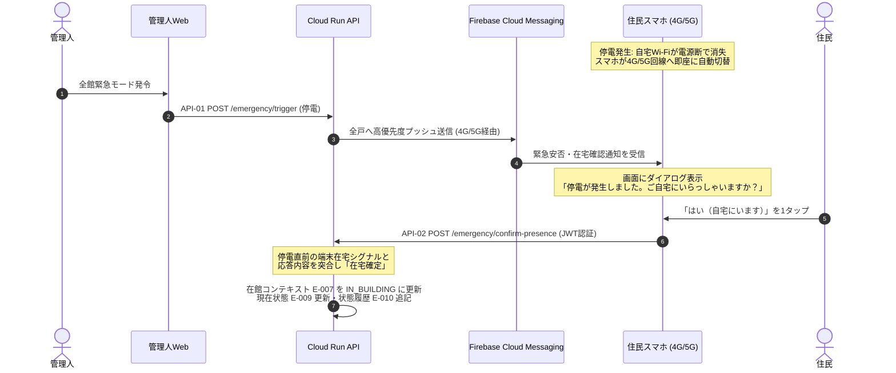

# Zashikiwarashi — システムアーキテクチャ設計書

*Version 1.0 / Hackathon MVP & Production Blueprint*
*Google Cloudおよび外部実在APIを活用したデータ収集・生活文脈分析・Multi-Agent協調基盤の完全設計*

---

## 1. システム全体構成図

本システムは、日常の追加ハードウェア購入や手入力を一切要求せず、住民の既存スマートフォン、マンション既設設備、および電力スマートメーターからデータを収集し、Google Cloud上で在館コンテキスト（DESIGN.md E-007）へ安全に抽象化してMulti-Agent協調を実行するサーバーレス・イベント駆動型アーキテクチャ。

Agent の実行と通信は Agent Runtime・Agent Gateway・Model Armor で統制し、Agent の動作は Cloud Trace で追跡する（§3.4、§3.5。FN-10 / FN-11）。

```mermaid
flowchart TD
  subgraph Clients [クライアント & 外部システム層（追加機器購入0円）]
    App[住民スマートフォン<br>iOS / Android / Flutter<br>・FCM v1プッシュ受信<br>・Human Approval / 1タップ応答<br>・端末在宅シグナル送信]
    AdminWeb[管理人Webコンソール<br>Next.js / React]
    CalendarAPI[Google Calendar API v3<br>OAuth 2.0認可コードフロー]
    PowerAPI[スマートメーターAPI<br>一般社団法人 電力データ管理協会]
    Intercom[集合インターホン盤<br>オートロック解錠Webhook]
  end

  subgraph Ingestion [認証 & 受信層 Edge / Gateway]
    Auth[Firebase Authentication<br>Google OAuth / JWTカスタムクレーム]
    RunIngest[Cloud Run: API Ingestion<br>FastAPI / Python<br>Webhook & クライアントREST API]
  end

  subgraph EventBus [非同期メッセージング層]
    PubSub[Cloud Pub/Sub<br>・presence-events<br>・power-metrics<br>・emergency-alerts]
    FCM[Firebase Cloud Messaging<br>HTTP v1 API<br>・4G/5G高優先度プッシュ通知<br>・安否1タップ応答 / Human Approval]
  end

  subgraph DataLayer [データ永続化層]
    Firestore[(Cloud Firestore)<br>・建物・空間グラフ E-001〜004<br>・住民・世帯・在館 E-005〜007<br>・緊急状態・Issue・Task E-008〜016]
    BigQuery[(BigQuery)<br>・電力時系列データ<br>・在館判定の入力]
    SecretMgr[Secret Manager<br>APIキー・OAuth証明書暗号化保持]
  end

  subgraph Governance [Agent ガバナンス層（制御ポイント G1〜G6）]
    AGWIn[G1 Agent Gateway Ingress<br>CLIENT_TO_AGENT]
    ModelArmor[G2 Model Armor<br>インジェクション・ジェイルブレイク検査<br>＋ SDP フィルタ（部屋番号・氏名）]
    SDP[Sensitive Data Protection<br>検査テンプレート<br>カスタム infoType：部屋番号・氏名]
    AGWOut[G3 Agent Gateway Egress<br>AGENT_TO_ANYWHERE<br>A2A・MCP・Gemini の全件]
    IAP[G4 IAP エージェントポリシー<br>Agent Identity × CEL]
    Registry[G6 Agent Registry<br>未登録の宛先は拒否]
  end

  subgraph AgentLayer [プライバシー & Multi-Agent実行層]
    subgraph AgentRuntime [Agent Runtime（Agent Gateway 配下）]
      BuildingAgent[Building Agent Coordinator<br>全体最適・空間タスク分割]
      ResidentAgent[Resident Agent<br>住民IDごとにセッション分離<br>Privacy Gateway：回答を抽象トークン化]
    end

    subgraph ToolSvc [ツールサービス Cloud Run / MCP]
      Tools[ツール群<br>候補抽出・打診送信・イベント記録]
      PolicyEngine[G5 Policy Engine<br>児童保護・未承認アクション物理遮断]
    end

    VertexAI[Vertex AI / Gemini Enterprise<br>・Gemini 3.8 Flash 高速推論・抽象化<br>・Gemini 3.1 Pro 構造化計画生成]
  end

  subgraph Audit [オブザーバビリティ・監査・評価層（O1〜O5・G7・G8）]
    Trace[O1 Cloud Trace<br>OTel スパン・本文は記録しない]
    Logging[O2 Cloud Logging<br>Gateway・IAP・Model Armor・Agent のログ]
    AuditBucket[G7 監査ログバケット<br>保持ロック]
    Monitoring[O4 Cloud Monitoring<br>SLO・アラート（余力）]
    Analytics[(O3 BigQuery Agent Analytics<br>イベントのみ（図のみ）)]
    OnlineMon[O5 Online Monitors<br>計画品質の評価（図のみ）]
    Eval[G8 Gen AI Evaluation<br>デプロイ前の評価ゲート（余力）]
  end

  %% クライアント接続
  App -->|JWT認証| Auth
  App -->|在宅シグナル/安否フラグ送信| RunIngest
  AdminWeb -->|緊急モード発令| RunIngest
  CalendarAPI -->|OAuth不在予定同期| RunIngest
  PowerAPI -->|30分値Webhook| RunIngest
  Intercom -->|解錠ログWebhook| RunIngest

  %% 受信からイベントバス
  RunIngest --> PubSub
  RunIngest --> Firestore

  %% イベント配信
  PubSub --> Firestore
  PubSub --> BigQuery

  %% Agent への入力（Agent Gateway Ingress + Model Armor）
  RunIngest -->|管理人の指示・緊急イベント・住民の自由文| AGWIn
  AGWIn -->|入力検査| ModelArmor
  AGWIn -->|指示・緊急イベント| BuildingAgent
  AGWIn -->|住民の自由文| ResidentAgent
  RunIngest -->|承認・開示は Policy Engine を通す| PolicyEngine

  %% Agent からの呼び出し（Agent Gateway Egress + Model Armor）
  BuildingAgent -->|A2A 照会・MCP ツール呼び出し| AGWOut
  ResidentAgent -->|MCP ツール呼び出し（自分の住民のデータのみ）| AGWOut
  AGWOut -->|認可（CEL）| IAP
  IAP -->|宛先の照合| Registry
  AGWOut -->|ペイロード・応答の検査| ModelArmor
  ModelArmor -->|テンプレート参照| SDP
  AGWOut -->|Need/Capability 照会| ResidentAgent
  AGWOut -->|MCP tools/call| Tools
  AGWOut -->|Gemini API| VertexAI
  AGWOut -.->|ext_authz（余力）| PolicyEngine
  Tools --> PolicyEngine
  PolicyEngine --> Firestore

  %% プッシュ通知
  Tools -->|打診送信| FCM
  FCM -->|4G/5G経由| App

  %% オブザーバビリティ（送信元はすべてのコンポーネント。Agent Runtime・Gateway・Cloud Run から OTel・ログを送る）
  Trace -->|trace_id| Logging
  Logging -->|監査 sink| AuditBucket
  Logging -->|sink| Analytics
  Analytics --> Monitoring
  OnlineMon --> Monitoring
  Eval -.->|CI の評価ゲート| AgentRuntime
  SecretMgr -.->|秘密情報注入| RunIngest
  SecretMgr -.->|秘密情報注入| ToolSvc
```

---

## 2. 外部API・クライアント連携詳細仕様

### 2.1 住民スマートフォン（iOS / Android クライアント）

- **クライアント技術**: Flutter（iOS / AndroidのネイティブOSセンサーAPIへPlatform Channel経由でアクセス）。
- **追加ハードウェア出費**: **0円**（住民が日常利用している端末のみ）。
- **日常の手入力**: **完全ゼロ**（普段通り生活するだけ）。

**端末在宅シグナルの送信仕様:**

端末から収集する各シグナルは、OS権限制約に準拠してバックグラウンドで取得し、Cloud Runへは `presence: true/false` の1ビット値のみPOSTする。GPS座標やSSID文字列などの生データは端末外に出さない。

各シグナルのOS制約と対応策の詳細は [DESIGN.md §3.3.2](DESIGN.md#332-端末在宅シグナルクライアントサイド自動取得) を参照。

| シグナル | 送信データ | MVPでの扱い |
| :--- | :--- | :--- |
| 自宅Wi-Fi接続状態 | `presence: true/false` | **オプトイン**（位置権限への抵抗が高いため） |
| 夜間充電状態 | `sleep_mode: true/false` | **オプトイン** |
| 直近歩行活動 | `active: true/false` | **オプトイン** |
| 敷地内ジオフェンス | `on_premises: true/false` | **オプトイン**（停電時フォールバック用） |

> **MVPの最小構成**: Google Calendar連携のみを必須とし、端末シグナルはすべてオプトイン。デモではダミーデータで代替可能。

### 2.2 Google Calendar API v3 連携

- **公式仕様**: [Google Calendar API v3](https://developers.google.com/calendar/api/v3/reference)
- **認証方式**: OAuth 2.0（認可コードフロー）。スコープは最小権限の `calendar.events.readonly`。
- **データ処理パイプライン**:
  1. 初回連携時に取得したリフレッシュトークンを **Secret Manager** に暗号化保存。
  2. Cloud Runが日次バッチ（または緊急発令時）に `freeBusy:query` および `events.list`（`eventTypes=workingLocation`）を実行。
  3. 会議名や参加者等の生テキストは**即時破棄**し、「終日外出・出張」「直近の拘束有無（`busy` / `free`）」「勤務場所（在宅勤務 / オフィス）」から在館コンテキスト（E-007）の presence_state・expires_at を更新する。これらの元情報そのものは保存しない。

### 2.3 電力スマートメーター API 連携

- **一次情報**: [経済産業省：電力データ活用](https://www.meti.go.jp/) / [一般社団法人 電力データ管理協会](https://www.d-fep.or.jp/)
- **前提条件**: 日本全国で原則100%導入完了済みのスマートメーター（全戸既設・追加工事ゼロ）。
- **認証方式**: 相互TLS (mTLS) ＋ OAuth 2.0 Client Credentials。
- **データ処理パイプライン**:
  1. 電力データ管理協会配信サーバーから、各住戸の30分値電力実績（kWh）がWebhookでCloud RunへPOSTされる。
  2. Cloud Runが署名検証後、**Cloud Pub/Sub** (`power-metrics` トピック) に投入。
  3. BigQueryに蓄積されるとともに、待機電力（冷蔵庫等）のみか活動電力かを判定し、スマホを置いて外出した場合の不在検知（在館コンテキスト E-007 の入力）に利用。

### 2.4 マンション集合インターホン盤 連携

- **対象設備**: マンション既設のIP集合インターホン制御盤（アイホン、パナソニック等）。
- **連携方式**: マンション共用ネットワークのローカルゲートウェイから、HTTPS Webhookでエントランスオートロック解錠イベント（住戸番号＋タイムスタンプ）を受信し、帰宅確定シグナルとする。

---

## 3. Google Cloud 構成コンポーネント詳細

### 3.1 認証 & セキュリティ基盤

- **Firebase Authentication**:
  - Google OAuth / 電話番号SMS認証。
  - カスタムクレーム（JWT）に `role: resident | admin`、`building_id`、住民は `resident_id`・`unit_id`（E-005 / E-002）を保持。部屋番号は Unit から引き、クレームには載せない。
- **Secret Manager**:
  - 電力データ管理協会APIのmTLS証明書、Google OAuth Client Secret、FCMサービストークンを集中管理。

### 3.2 Ingestion & メッセージング層

- **Cloud Run (API Ingestion)**:
  - Python FastAPI による高スケーラブルなサーバーレスコンテナ。
  - クライアント通信および外部Webhookの終端。停電・地震発生直後のアクセススパイクを自動スケールアウトで吸収。
- **Cloud Pub/Sub**:
  - `presence-events`（在宅シグナル用）
  - `power-metrics`（電力データ用）
  - `emergency-alerts`（緊急モード発動用）
  - システム間を疎結合化し、データ消失を防止。
- **Firebase Cloud Messaging (FCM HTTP v1 API)**:
  - 4G/5G回線経由で高優先度データメッセージを配信。
  - 有事の「安否1タップ応答ダイアログ」や「支援打診（Human Approval）画面」を即時プッシュ。

### 3.3 データ永続化層

- **Cloud Firestore (NoSQL Document DB)**:
  - ER図（DESIGN.md §7）の E-001〜E-016 を保持する。コレクション分割・インデックス・セキュリティルールは L3 で定義する（未決、DESIGN.md §7.3）。
  - 他住民の世帯プロファイル（E-006）・在館コンテキスト（E-007）は、Resident Agent・クライアントから読み取れないようにする。
- **BigQuery**:
  - 30分電力データの時系列。在館判定の入力として使う（生活リズムの推定・蓄積には使わない）。

### 3.4 プライバシー・Multi-Agent 実行・Agent ガバナンス基盤

Agent・コンポーネントのID（AG-xx）は DESIGN.md §5.1 と同じ。

#### 3.4.1 実行基盤

| コンポーネント | 実行場所 | 役割 |
| :--- | :--- | :--- |
| Building Agent（AG-02） | **Agent Runtime**（Gemini Enterprise Agent Platform、旧 Vertex AI Agent Engine） | Agent Gateway の配下で動く Coordinator。専用の Agent Identity を持つ |
| Resident Agent（AG-01、Privacy Gateway AG-03 を内蔵） | **Agent Runtime** | Agent Gateway の配下で動く住民の代理人。1つのデプロイで全住民を扱い、セッションを `user_id=resident_id` で分ける。専用の Agent Identity を持つ |
| ツールサービス（Policy Engine AG-04 を内蔵） | **Cloud Run**（MCP サーバー） | Firestore の読み書き・打診送信などのツール。Agent Registry に登録し、Agent Gateway 経由で呼ばれる |
| API Ingestion | **Cloud Run** | クライアント・Webhook の終端。Agent Gateway の Ingress 経由で Agent を呼ぶ |

- **Agent は Agent Runtime、ツールは Cloud Run** に分ける。Agent Gateway が統制できる Agent の実行基盤は Agent Runtime のみ（Cloud Run・GKE 上の Agent は対象外）で、Agent Runtime は自作の MCP サーバーを直接は載せられないため。
- 同じプロジェクト・リージョンの Agent Runtime の Agent は、すべて同じ Ingress / Egress の Agent Gateway に紐づける（Agent Runtime のデプロイ時に `agent_gateway_config` で指定）。Building Agent と Resident Agent の外向き通信（ツール呼び出し・Agent 間の A2A）は、どちらも Egress の Agent Gateway を通る。
- Resident Agent は Firestore に直接アクセスしない。自分の住民のデータもツールサービス経由で読み、IAP ポリシーで Resident Agent の Agent Identity が呼べるツールを「自分の住民のデータの読み取り」と「評価結果の記録」に限定する。
- **リージョンは us-central1 に統一する**（Firestore・Cloud Run・Agent Runtime・Agent Gateway・Model Armor）。Agent と Agent Gateway は同じリージョンに置く必要がある。単一リージョンの方針は変えない。
- Cloud Run の 2 サービス（API Ingestion・ツールサービス）は同じコンテナイメージを使い、起動コマンドで役割を分ける（`backend/src` を共有し、Policy Engine を両方から呼べるようにする）。
- 開発時は `adk web` などでローカル実行し、Agent Runtime へのデプロイは結合確認時に行う（Agent Runtime のデプロイは Cloud Run より時間がかかるため）。

#### 3.4.2 Agent ガバナンスの多層防御（FN-10）

AI Agent への入出力と Agent 間の通信を、次の4層で統制する。確率的な検査（①）と決定論的な強制（②③）を分け、絶対に破ってはいけないルールは③のコードに置く（Domain Principle 4）。

| 層 | 仕組み（制御ポイント §3.4.3） | 止めるもの | 判定の性質 |
| :--- | :--- | :--- | :--- |
| ① 入出力の検査 | **Model Armor**（G2） | プロンプトインジェクション・ジェイルブレイク・機密情報（Sensitive Data Protection 連携） | 確率的なフィルタ |
| ② Agent 単位の権限 | **Agent Gateway ＋ Agent Identity ＋ Agent Registry ＋ IAP ポリシー（CEL）**（G1・G3・G4・G6） | どの Agent が、どの Agent・ツールを呼べるか。例: Building Agent は打診送信ツールを呼べるが、部屋番号の開示ツールは呼べない。Resident Agent は自分の住民のデータの読み取りと評価結果の記録しかできない | 決定論的 |
| ③ データ単位のルール | **Policy Engine（コード）**（G5） | `APPROVED` の無い Task の実行、承認前の部屋番号開示、Child Safety 違反 | 決定論的 |
| ④ 追跡 | **Cloud Trace ＋ Cloud Logging ＋ 監査ログバケット ＋ AuditEvent（E-016）**（O1・O2・G7） | ―（事後に説明できるようにする。§3.5） | ― |

#### 3.4.3 制御ポイント一覧（G1〜G8 / O1〜O5）

構成図「Agent ガバナンス・オブザーバビリティ」の [G*]（ガバナンス制御）・[O*]（観測点）と対応する。区分は MVP の範囲（PLAN.md §2）。

| ID | 制御ポイント | 内容 | 区分 |
| :--- | :--- | :--- | :--- |
| G1 | Agent Gateway（Ingress / CLIENT_TO_AGENT） | 管理人の指示・緊急イベント・住民の自由文を Agent へ渡す入口を1本化する。認証済みの API Ingestion からのみ受け付ける | MVP（FN-10） |
| G2 | Model Armor | 入力のプロンプトインジェクション・ジェイルブレイクを遮断する。応答・ツールのペイロードは SDP フィルタ（Sensitive Data Protection の検査テンプレート、カスタム infoType：部屋番号・氏名）で検出して遮断する。Privacy Gateway の検出層 | MVP（FN-10、FN-05） |
| G3 | Agent Gateway（Egress / AGENT_TO_ANYWHERE） | Agent の外向き通信（Resident Agent への A2A、ツールサービスへの MCP、Gemini API）をすべて通す。Outbound Privacy Gate（Domain Principle 6、REQ-06） | MVP（FN-10） |
| G4 | IAP エージェントポリシー（Agent Identity × CEL） | 誰がどの Agent・ツールを呼べるかを決定論的に制限する。Resident Agent を呼べるのは Building Agent だけ。Resident Agent が呼べるのは自分の住民のデータの読み取りと評価結果の記録だけ。部屋番号の開示ツールはどの Agent も呼べない | MVP（FN-10） |
| G5 | Policy Engine | `APPROVED` の無い Task の実行、承認前の部屋番号開示、Child Safety 違反を、Firestore の承認状態を見て決定論的に遮断する。本線はツールサービス内のコード。Agent Gateway の認可拡張（ext_authz）から呼んで二重化するのは余力 | MVP（FN-06、FN-07）／ext_authz は余力 |
| G6 | Agent Registry | 呼べる Agent・MCP サーバー・エンドポイント（Gemini API を含む）の台帳。未登録の宛先は拒否する | MVP（FN-10） |
| G7 | 監査ログバケット | Gateway の許可・拒否、承認、開示の記録を保持ロック付きのバケットへ送る（運用者向け）。住民向けの説明は Firestore の AuditEvent（E-016） | MVP（FN-11。ロックは取り消せないため、ハッカソン中はロックしないか保持期間を短くする） |
| G8 | Gen AI Evaluation | 4シナリオの評価データセットで「未承認の Commit がない」「最大公開ラインを超えない」を判定し、CI でデプロイ前のゲートにする | 余力（EXT-07） |
| O1 | Cloud Trace | ADK 組み込みの OpenTelemetry。スパンの本文は記録しない。plan_id で Agent をまたいで追跡する | MVP（FN-11） |
| O2 | Cloud Logging | Agent Gateway・IAP の判定・Model Armor・Agent Runtime・Cloud Run のログ | MVP（FN-11） |
| O3 | BigQuery Agent Analytics | 構造化イベント（協議ラウンド・ツール使用・結果）のみ。プロンプト全文を書く prompt-response logging は無効化する | 図に書くだけ（EXT-08） |
| O4 | Cloud Monitoring | 遅延・エラー率の SLO、Model Armor の検知率、IAM の拒否率などのアラートとダッシュボード | 余力（EXT-07） |
| O5 | Online Monitors | Building Agent の計画品質・ツール使用品質・ハルシネーションを本番トラフィックで評価する | 図に書くだけ（EXT-08） |

- **Semantic Governance Policy（自然言語ポリシー）** は LLM による判定のため、G4・G5 の代わりには使わない。使う場合は追加の層とする。
- **承認を書き込めるのは住民本人の操作だけ**: TaskEvent の `APPROVED` / `DECLINED` は、API Ingestion が本人の操作を受けて書き込む。Agent には書き込むツールを渡さない（DESIGN.md §5.5）。

#### 3.4.4 各サービス

- **Privacy Gateway（AG-03）**:
  - Agent 間は、Resident Agent のコードが作った抽象トークン（例: `[14F / 水4L / 階段不可]`）だけをやり取りする。部屋番号・氏名は最初から含めない。
  - 漏れの検出は G2 の Model Armor（SDP フィルタ）が行い、検出したら通信を遮断する。置換（マスキング）で済ませず、漏れた時点で止める。
- **Policy Engine（AG-04）**: 上記 G5。
- **Agent Gateway / Agent Registry / Agent Identity / IAP ポリシー**（AG-05）: 上記 G1・G3・G4・G6。Gateway は Standalone モード（Agent Connectivity Template・PSC-I・VPC を使わない軽い構成）で始める。
- **Model Armor**: 上記 G2。Agent Gateway に付けて使う。
- **Vertex AI / Gemini Enterprise**（Agent からの呼び出しは G3 の Egress を通す。Agent Registry に Gemini API のエンドポイントを登録する）:
  - **Gemini 3.8 Flash**（2026年9月GA、最新最速モデル）: Resident Agent間のメッセージ抽象化・リアルタイム意図解釈。
  - **Gemini 3.1 Pro**（100万トークンコンテキスト高度推論モデル）: 空間グラフと多者間制約を最適化する協力計画（Coordination Plan）の構造化生成（JSON Schema厳格指定）。

#### 3.4.5 IaC の範囲と確認状況

- Terraform の google provider で作れるリソース（Agent Gateway は `google_network_services_agent_gateway`）は Terraform で管理する。provider が未対応のもの（gcloud の alpha / beta でしか作れない設定など）は Terraform 化せず、実行した gcloud コマンドを `infra/gcloud/` にスクリプトとして残す（`rules/infra.md`）。
- 確認済み（2026-09-26、公式ドキュメント）: Agent Gateway は GA。統制できる実行基盤は Agent Runtime のみ。同じプロジェクト・リージョンの Agent Runtime の Agent は同じ Agent Gateway に紐づく（複数の Agent を載せられる）。Agent 間の A2A も Egress の Agent Gateway で統制できる。Model Armor は us-central1 で利用可。IAP ポリシーの CEL で MCP のツール（読み取り専用の属性など）を条件にできる。
- 実装時に確認（TBD）: ① Gemini API の呼び出しを Standalone モードの Egress 経由にする設定（Google API への通信は既定では Gateway を通らない場合がある。通せない場合は、直接呼び出し＋Model Armor の floor 設定で補い、設計を見直す）　② IAP ポリシー・認可拡張（authz extension）を Terraform で作れるか　③ Cloud Run の MCP サービスを Agent Registry に登録する手順。

### 3.5 監査・説明責任・オブザーバビリティ基盤

制御ポイント O1〜O5・G7・G8 の一覧と MVP の区分は §3.4.3。

- **Cloud Logging & Cloud Audit Logs（O2・G7）**:
  - Agent間の協議履歴、参照されたデータ項目、Human Approvalのタイムスタンプを改ざん不能な追記専用（Append-only）ログとして記録。事後の説明責任（Explainability）を担保。
  - 住民が閲覧する監査情報は Firestore の AuditEvent（E-016）に持つ。Cloud Logging は運用・改ざん検知用の二次記録とする。
  - Agent Gateway の許可・拒否、IAP の判定、Model Armor の検知の記録も Cloud Logging に残し、監査 sink で保持ロック付きのログバケット（G7）へ送る。
- **Cloud Trace（Agent Observability、O1、FN-11）**:
  - ADK が出す OpenTelemetry のスパンで、Agent の実行の流れ（LLM 呼び出し・ツール呼び出し・所要時間・エラー）を追跡する。Agent Runtime では既定で出力され、Cloud Run では起動時に OpenTelemetry のエクスポーターを設定する。
  - プロンプトと応答の本文は記録しない（`OTEL_INSTRUMENTATION_GENAI_CAPTURE_MESSAGE_CONTENT=NO_CONTENT`）。本文には住民の情報が含まれうるため、メタデータのみを残す（PRV-03）。
  - plan_id（Issue・Task の ID）をスパンに付け、Building Agent と Resident Agent をまたいで1つの協議を追えるようにする。
- **評価と監視（G8・O3〜O5）**: Gen AI Evaluation による CI の評価ゲート（G8）と Cloud Monitoring のアラート（O4）は余力（EXT-07）。BigQuery Agent Analytics（O3）と Online Monitors（O5）は図に書くだけ（EXT-08）。

---

## 4. 大規模停電時のフォールバック・データフロー

落雷等により全戸のWi-Fiルーターが一斉に電源喪失した際の、完全フェイルオーバー動作。



1. **Wi-Fi消失と4G/5G切替**: ルーター電源喪失と同時にスマホがキャリア回線へ切替。
2. **FCM緊急プッシュ配信**: 管理人発令から1秒以内に、Cloud RunからFCMを通じて全住民スマホへ高優先度通知を配信。
3. **1タップでの在宅確定**: 住民が画面の「はい」を1タップした瞬間に在宅が確定し、Building Agentの支援候補プールへ投入される。

---

## 5. アーキテクチャ総合評価

| 評価軸 | 技術的根拠・設計上の優位性 |
| :--- | :--- |
| **実現可能性** | 実在する公式API（Google Cloud, Apple NetworkExtension/CoreMotion/CoreLocation, Android ConnectivityManager/ActivityRecognition, 電力データ管理協会）のみで構成。架空仕様はゼロ |
| **住民の導入障壁** | 追加IoT機器の購入ゼロ（0円）。MVPではGoogle Calendar連携のみ必須、端末シグナルはオプトイン |
| **最新AI整合性** | 2026年現行の **Gemini 3.8 Flash / Gemini 3.1 Pro** を採用 |
| **プライバシー保護** | 端末からは1ビット値のみ送信。Sensitive Data Protectionによる個人情報遮断。Firestore Rulesによる他室データの物理隔離。Human-in-the-Loopの強制 |
| **Agent ガバナンス** | Agent への入出力と Agent 間通信を Agent Gateway に集約し、Model Armor の検査・Agent Identity ごとの権限・Policy Engine の決定論的ルールで多層に統制。Cloud Trace で Agent の動作を追跡 |
| **耐障害性** | 停電時も4G/5G＋FCMプッシュ応答により、Wi-Fi喪失に完全耐性を持つ多層フォールバック |

---

## 6. IaC とデプロイ（Terraform ＋ GitHub Actions）

GCP プロジェクトは `zashikiwarashi`（単一環境・us-central1）。インフラは Terraform（`infra/terraform/`）で管理し、GitHub Actions が Workload Identity Federation（WIF）で GCP に認証して plan・apply・デプロイを行う。サービスアカウントのキーは作らない。

### 6.1 初回構築（手動で1回）

Actions が GCP に認証するための土台は、Actions が動く前に作る必要がある。オーナー権限を持つ人がローカルで次を行う。

1. Terraform の state 用 GCS バケットを作り、`provider.tf` の GCS backend を有効にする。
2. `terraform apply` で、API の有効化、WIF の Pool / Provider（GitHub リポジトリ `akakura-hackathon/zashikiwarashi` からのトークンだけを受け付ける条件を付ける）、次のサービスアカウントを作る。
   - `tf-plan`: plan 用。閲覧系のロールと state バケットの読み取りのみ
   - `tf-apply`: apply 用。Terraform で管理するリソースに必要な最小限のロール（`owner` / `editor` は付けない）
   - `deployer`: デプロイ用。Cloud Run・Artifact Registry・Firebase Hosting・Agent Runtime へのデプロイに必要なロール
3. `terraform output` の値（WIF Provider 名、各サービスアカウントのメール）を GitHub リポジトリの Variables に登録する。

### 6.2 ワークフロー

| ワークフロー | トリガー | 内容 | 認証 |
| :--- | :--- | :--- | :--- |
| `ci.yml` | Pull Request | backend の `ruff check`・`pytest`、frontend の `lint`・`typecheck`・`build`、Terraform の `fmt -check`・`validate`・`plan`（plan の結果を PR にコメント） | `tf-plan` |
| `deploy.yml` | main への push | ① `terraform apply` ② backend のイメージをビルドして Artifact Registry へ push ③ Cloud Run（API・ツールサービス）を新しいイメージで更新 ④ Agent Runtime へ Agent をデプロイ（ステップ 6 以降）⑤ `infra/gcloud/` のスクリプトを実行（ステップ 7 以降）⑥ Firestore のセキュリティルール・インデックスと frontend を Firebase にデプロイ | `tf-apply`・`deployer` |

- **Terraform とデプロイの分担**: Cloud Run のサービス定義（サービスアカウント・環境変数・シークレットの参照）は Terraform、コンテナイメージの更新は `deploy.yml` が行う。二重管理にならないよう、Terraform 側はイメージの変更を無視する（`lifecycle.ignore_changes`）。
- **Firestore のルールとインデックス**: リポジトリの `firestore.rules`・`firestore.indexes.json` を正とし、`deploy.yml` から Firebase CLI でデプロイする。ローカルの Firestore エミュレーターも同じファイルを使う。
- **frontend**: Next.js を静的エクスポートして Firebase Hosting に置く。データは Firebase SDK（読み取りのみ）と API で取得する。
- **シークレット**: Secret Manager の「箱」は Terraform で作り、値は `gcloud secrets versions add` で手動登録する（`rules/infra.md`）。
- **Terraform 化しないもの**: provider が未対応のリソース（Agent Gateway 周りの alpha / beta 機能など）は `infra/gcloud/` のスクリプトにし、`deploy.yml` から実行する（§3.4.5）。

---

## 相互参照

- **課題・ユーザー・要件** → [SPEC.md](SPEC.md)
- **データモデル・エージェント設計** → [DESIGN.md](DESIGN.md)
- **タスク分解・マイルストーン** → [PLAN.md](PLAN.md)
- **ID一覧・対応表** → [TRACEABILITY.md](TRACEABILITY.md)
