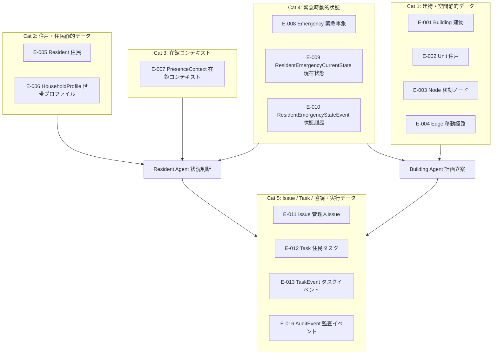
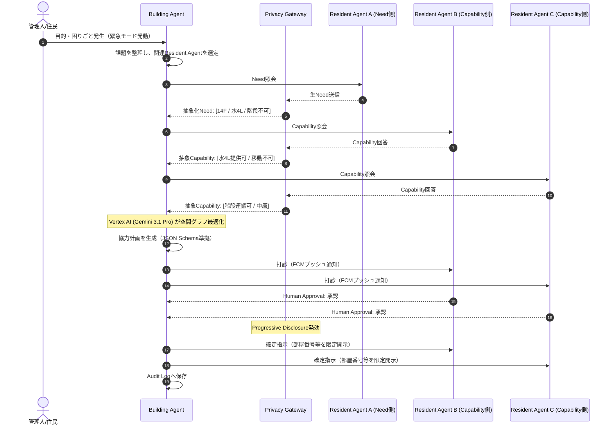
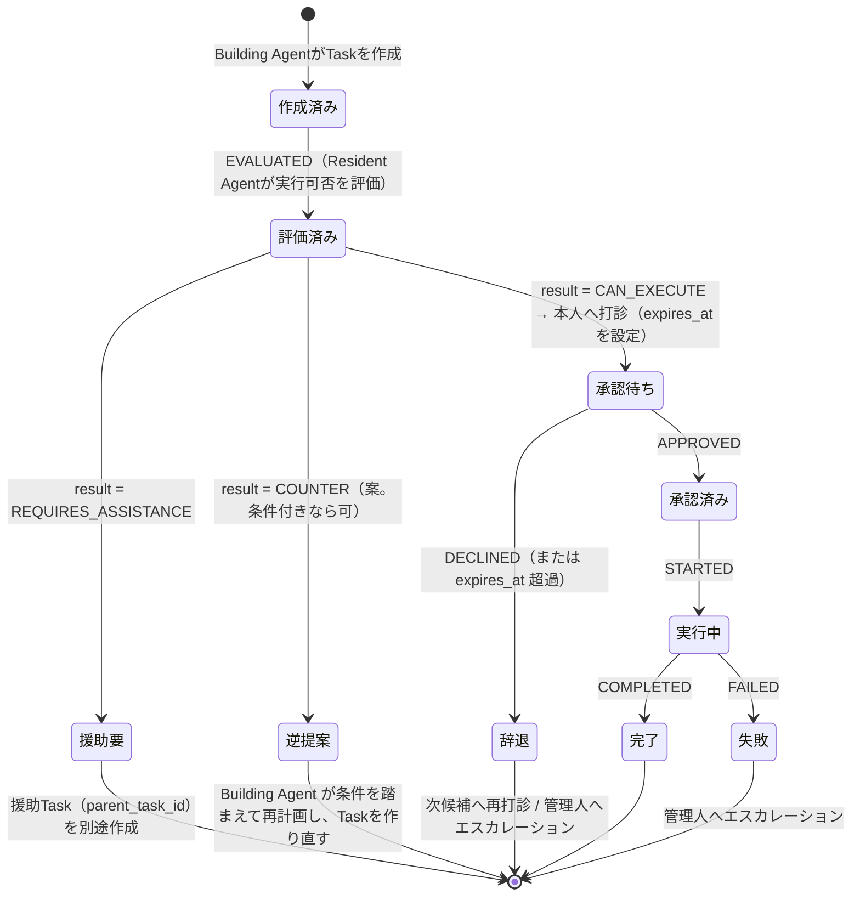
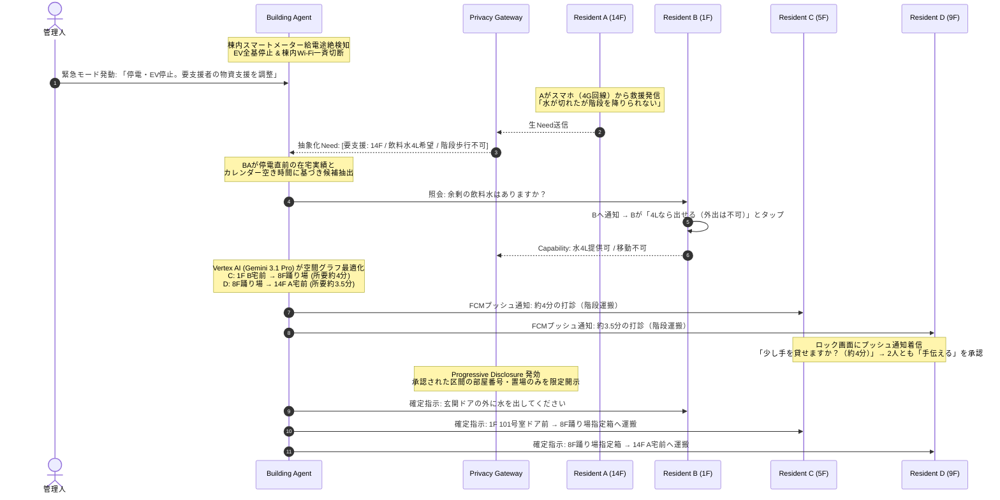
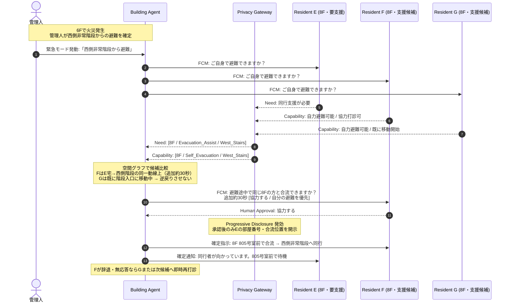
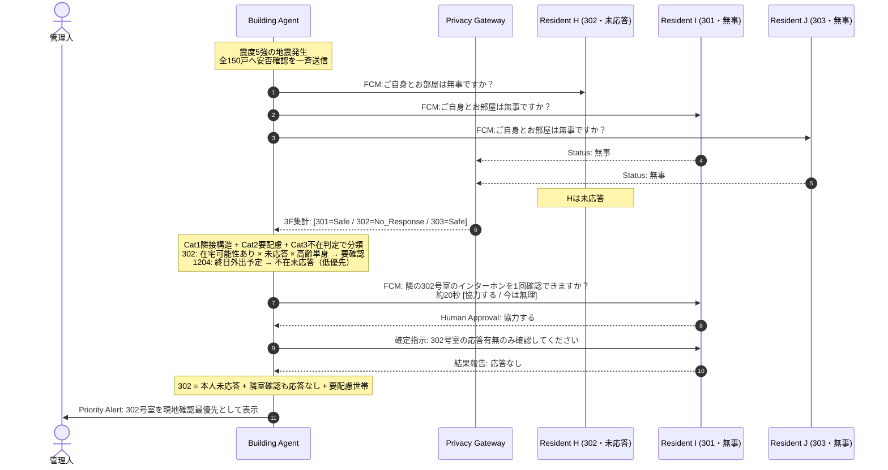
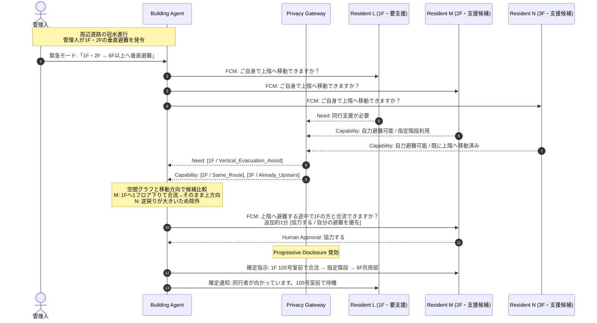

# Zashikiwarashi — API・データモデル・エージェント設計書

*Version 1.0 / Hackathon MVP*
*SPEC.mdの要件に基づく、データ定義・Agent構成・協調プロトコルの詳細設計*

> **データモデルの正**: エンティティ・属性・関係は ER図（`diagrams/Zashikiwarashi_ER図_v1.0.drawio`、図中表記 v1.1 / L2）を正とする。本書のエンティティID（E-001〜E-016）はER図のIDと同一。ER図に無い項目は「ER未収容」と明記し、[§7.4](#74-er未収容の項目未決) で扱いを管理する。

---

## 1. データ設計の基本方針

1. **平時の手入力ゼロ（Zero Routine Input）**:
   - 住民へ日常的なアンケート、ステータス更新、所持品登録などを要求しない。
   - 平常時に保持するのは、初期登録された客観的属性（世帯プロファイル E-006）と、自動シグナルから判定した現在の在館状態（在館コンテキスト E-007）のみ。生活リズム・在宅傾向は蓄積しない。
2. **嗜好・人物学習の完全排除（No Preference Profiling）**:
   - 性格、趣味、価値観、ボランティア協力度などの人物プロファイリングは一切作成しない。
   - 意思決定・協調計画は、空間距離、時間的空き状況、身体的制約などの「客観的事実データ」のみに基づく。
3. **段階的プライバシー開示（Progressive Disclosure）**:
   - 生データ（Raw Data）は他Agentへ渡さず、抽象化されたトークンとしてのみやり取りする。
   - 部屋番号などの高識別情報は、実世界の支援行動が確定し、本人が承認（Human Approval）した瞬間にのみ開示。
4. **LLMには知能を与えるが権限は与えない（Policy Enforcement）**:
   - データのアクセス権、開示制限、児童保護ルール（私室連れ込み禁止等）はLLMではなくシステムコード側で決定論的に強制する。

---

## 2. 全データカテゴリー体系

システムに必要なすべてのデータを、ライフサイクルと性質に応じて**5つのカテゴリー**に分類する。各カテゴリーに属するエンティティはER図のとおり。



---

## 3. カテゴリー別データ詳細仕様

各エンティティの主要属性はER図（L2）を正とする。物理インデックス・Firestoreのコレクション分割・詳細制約はL3で別途定義する（[§7.3](#73-firestore物理設計l3未決)）。

### 3.1 Cat 1: 建物・空間静的データ（E-001〜E-004）

マンションの物理構造をAgentが理解し、「無理のない移動経路」「所要時間」「安全な待ち合わせ場所」を決定論的に計算するための基盤データ。**住戸（Unit）と移動ノード（Node）は分離**し、住戸はentrance_node_idで玄関前のノードに接続する。

| ID | エンティティ | 主要属性 | 取得元・取得方法 | Agentの活用方法 |
| :--- | :--- | :--- | :--- | :--- |
| E-001 | **Building（建物）** | building_id, name, floor_count, created_at | 管理会社・管理組合の初期データ（CSV/JSON → Firestore） | 緊急事象・住戸・空間グラフの起点 |
| E-002 | **Unit（住戸）** | unit_id, building_id, entrance_node_id, room_number, floor | 同上。公知の図面情報 | 同フロア隣室の特定（地震時の隣室確認タスク）。room_number は Progressive Disclosure の開示対象 |
| E-003 | **Node（移動ノード）** | node_id, building_id, node_type, floor | 建物設計図面からグラフ構造を構築 | 玄関前・階段・踊り場・共用部などの位置。踊り場を中継デポに選定、合流位置・退避先の指定 |
| E-004 | **Edge（移動経路）** | edge_id, building_id, from_node_id, to_node_id, movement_type, distance_meters, standard_travel_seconds | 同上（1フロア≈30秒を標準値とする） | 荷物運搬タスクの区間分割、所要時間の事前算出（「所要約4分」の明示）、逆方向移動の判定 |

> 共用部の性質（防犯カメラ画角内のラウンジ、管理人室など）は Node の node_type で表す。**Child Safety Policy**（子どもの見守り場所として他人の私室を排除し、カメラのあるラウンジを指定）は node_type を参照して Policy Engine が強制する。node_type の値の一覧はER未定義（[§7.4](#74-er未収容の項目未決)）。

---

### 3.2 Cat 2: 住戸・住民静的データ（E-005〜E-006）

「誰が助けを必要としうるか」「誰に重労働を依頼してはならないか」を把握するための客観的属性。**入居時の初回登録1回のみ。平時の追加入力ゼロ。**

| ID | エンティティ | 主要属性 | 取得元・取得方法 | プライバシー制約 | Agentの活用方法 |
| :--- | :--- | :--- | :--- | :--- | :--- |
| E-005 | **Resident（住民）** | resident_id, unit_id, created_at | 初回アカウント開設時（Firebase Authのユーザーと1対1） | 氏名・電話番号はERに持たない（最大公開ライン外） | 住戸への所属。タスクの担当者（assignee）・援助対象（target） |
| E-006 | **HouseholdProfile（世帯プロファイル）** | unit_id（PK/FK）, member_count, elderly_count, infant_count, other_support_required_count, additional_non_helper_count, mobility_difficulty_count, stair_assistance_required_count | 初回登録時の明示設定（1回のみ。病名ではなく人数として保持） | **高機密情報**。他Agentへは非公開。世帯（住戸）単位の人数であり、個人を特定する属性は持たない | 要配慮世帯の優先トリアージ（応答がない高齢世帯を管理人へ優先通報）、階段運搬タスクの候補から除外 |

> 世帯プロファイルは住戸単位の**人数**で保持する。「世帯の中の誰が階段不可か」は保持しない。個人の実行可否は、緊急時に本人（Resident Agent）がタスクを評価した結果（E-013 の result）で判断する。

---

### 3.3 Cat 3: 在館コンテキスト（E-007 PresenceContext）

日常の手入力を要求せず、自動シグナルから「今、建物内にいるか」を判定して保持する。**生活リズム・在宅傾向などの長期的な生活文脈（Lifestyle Memory）は保持しない**。保持するのは現在の在館状態と、その鮮度・根拠だけである。

| ID | エンティティ | 主要属性 | 説明 |
| :--- | :--- | :--- | :--- |
| E-007 | **PresenceContext（在館コンテキスト）** | resident_id（PK/FK）, presence_state, observed_at, expires_at, source_type | presence_state は `IN_BUILDING` / `OUTSIDE_BUILDING` / `UNKNOWN`。expires_at を過ぎた値は `UNKNOWN` として扱う。source_type は判定の根拠となった入力ソース |

判定の入力ソース（source_type の候補）は以下。source_type の値の一覧・expires_at の長さはER未定義（[§7.4](#74-er未収容の項目未決)）。

#### 3.3.1 Google Calendar連携（サーバーサイド自動取得）

| 入力 | 取得方法 | プライバシー制約 | 在館コンテキストへの反映 |
| :--- | :--- | :--- | :--- |
| **不在・拘束スケジュール** | **Google Calendar API v3**（OAuth 2.0、スコープ: `calendar.events.readonly`）。`freeBusy:query` で「Busy/Free」のみ取得。勤務場所（`eventTypes=workingLocation`）も参照 | **予定のタイトルや同席者などの生データは即時破棄**。在宅勤務傾向などの長期傾向も保持しない | 終日外出・出張・オフィス勤務の時間帯は `OUTSIDE_BUILDING`、在宅勤務は `IN_BUILDING`。地震時の「外出予定ありの未応答（Likely Away）」の判定に使う |

#### 3.3.2 端末在宅シグナル（クライアントサイド自動取得）

住民のスマートフォンから、住民の操作なしでバックグラウンド取得可能な在宅・活動シグナル。いずれも**SSIDの文字列やGPS座標などの位置特定データは端末外に送信しない**。Cloud Runへは1ビット値のみPOSTする。

| シグナル | iOS実装 | Android実装 | OS制約と対応策 | 出力・判定 |
| :--- | :--- | :--- | :--- | :--- |
| **自宅Wi-Fi接続状態（在宅判定）** | `NWPathMonitor`（Network.framework）でWi-Fi接続/切断のPath変化を検出。フォアグラウンドで検出し、バックグラウンド復帰時に`queryPedometerData`と組み合わせて最終状態を補完 | `ConnectivityManager.NetworkCallback` + `FLAG_INCLUDE_LOCATION_INFO`。Foreground Service（`connectedDevice`タイプ）または`WorkManager`で定期チェック | **iOS**: バックグラウンド停止中は`NWPathMonitor`コールバック停止。フォアグラウンド復帰時に直近状態を取得。**Android**: `ACCESS_FINE_LOCATION`権限必須。Foreground Service表示が必要 | 帰宅・外出時のWi-Fi接続/切断 → `presence: true/false` を送信。**SSID文字列は端末外に出さない** |
| **夜間充電状態（就寝・起床判定）** | `UIDevice.batteryStateDidChangeNotification`。フォアグラウンド中のみリアルタイム。バックグラウンドでは`BGTaskScheduler`で日次チェック | `WorkManager` の `Constraints.setRequiresCharging(true)` で充電開始時にWorker起動 | **iOS**: バックグラウンドでは通知がキューされ、復帰時に配信。`BGAppRefreshTask`で1日数回のチェックが現実的。**Android**: `ACTION_POWER_CONNECTED`のマニフェスト登録は不可。WorkManager必須 | 深夜帯の充電接続→「就寝モード」、朝の取り外し→「起床モード」。有事の不要な叩き起こしを防止 |
| **直近歩行活動（可動性判定）** | `CMPedometer.queryPedometerData`（CoreMotion、直近15分間の歩数）。バックグラウンド常時監視不可のため、`HKObserverQuery` + `enableBackgroundDelivery`でHealthKit経由の通知をトリガーに取得 | `ActivityRecognitionClient`（Google Play Services）。`PendingIntent`でバックグラウンド受信→ `WorkManager`でサーバー送信 | **iOS**: `NSMotionUsageDescription`必須。HealthKit背景配信はバッチ処理（即時性なし）。**Android**: `ACTIVITY_RECOGNITION`ランタイム権限必須。Foreground Service型制約あり | 直近15分以内に歩行あり →「現在活動中（打診可能）」を判定 |
| **敷地内ジオフェンス（停電フォールバック）** | `CLCircularRegion`（CoreLocation）。マンション敷地半径50mを登録。`Always Allow`位置権限で背景動作可能。最大20リージョン制限 | `GeofencingClient`（Google Play Services）。バックグラウンドで`PendingIntent`経由の入退場通知 | **iOS**: 「常に許可」位置権限が必要（ユーザーに理由説明必須）。精度は100-300m推奨。**Android**: `ACCESS_BACKGROUND_LOCATION`権限必須 | Wi-Fi喪失時（停電時）も敷地内に留まっているかを判定 |

> **プライバシー保護の設計原則**: 上記4つのシグナルは、すべて「端末上で判定→ `true/false` の1ビットのみサーバーへ送信」する設計である。GPS座標、SSID文字列、歩行軌跡などの生データは端末から外に出さない。住民にはアプリ初回セットアップ時にOS権限を要求し、各権限の用途を明示的に説明する（Privacy Manifest / `NSMotionUsageDescription` / Play Console審査対応）。

> **ERへの収容範囲**: 在館コンテキストに反映されるのは「自宅Wi-Fi接続状態」と「敷地内ジオフェンス」（在館/不在）のみ。「夜間充電状態（就寝判定）」と「直近歩行活動（活動中判定）」は在館ではなく打診可否の判断材料であり、ERに保持先が無い（[§7.4](#74-er未収容の項目未決)）。

> **MVPでの段階的導入**: Wi-Fi在宅判定とジオフェンスは位置情報権限への心理的抵抗が高いため、MVPでは**Google Calendar連携のみを必須**とし、端末シグナルは**オプトイン（任意有効化）**とする。MVPデモではダミーデータで代替可能。

---

### 3.4 Cat 4: 緊急時動的状態（E-008〜E-010）

災害が発生したその瞬間から動くデータ。緊急事象は**建物単位**でのみ発生する（住民個人のセルフ緊急モードは設けない）。

| ID | エンティティ | 主要属性 | 取得元・取得方法 | Agentの活用方法 |
| :--- | :--- | :--- | :--- | :--- |
| E-008 | **Emergency（緊急事象）** | emergency_id, building_id, emergency_type, status, triggered_by, triggered_at, closed_at | 管理人Webコンソールからの発令（API-01） | システム全体を「平時モード」から「協調モード」へ切り替え。closed_at で終了 |
| E-009 | **ResidentEmergencyCurrentState（現在状態）** | (emergency_id, resident_id)（複合PK）, current_node_id, safety_status, observed_at | 安否確認への住民の1タップ応答、タスク実行に伴う位置更新 | safety_status は `SAFE` / `NEED_HELP` / `UNKNOWN`。「SAFE」の住民を隣室確認の担当候補に、「UNKNOWN」を未応答として抽出 |
| E-010 | **ResidentEmergencyStateEvent（状態履歴）** | event_id, emergency_id, resident_id, current_node_id, safety_status, occurred_at, source | E-009 を更新するたびに追記 | 安否・位置の変化の時系列。事後の説明責任 |

> 端末到達性（FCMトークンの有効性・配信成否）はERに保持先が無い（[§7.4](#74-er未収容の項目未決)）。

---

### 3.5 Cat 5: Issue / Task / 協調・実行データ（E-011〜E-013, E-016）

管理人の指示を住民ごとのタスクに分解し、本人の評価・承認・実行の経緯を記録するデータ。**Taskは現在状態だけを持ち、実行可否の評価・本人の承認/辞退・開始・完了・失敗はすべてTaskEventとして追記する。**

| ID | エンティティ | 主要属性 | 説明 |
| :--- | :--- | :--- | :--- |
| E-011 | **Issue（管理人Issue）** | issue_id, emergency_id, issue_type, instruction, route_constraint（nullable）, status, created_by_admin_id, created_at | 管理人が自然言語で出す目的・避難方針。instruction は Building Agent への制約として使う（例:「西側非常階段から避難」→ route_constraint） |
| E-012 | **Task（住民タスク）** | task_id, issue_id, parent_task_id（nullable）, resident_id, target_resident_id（nullable）, start_node_id（nullable）, destination_node_id（nullable）, task_type, estimated_seconds, status, created_at | 住民1人に割り当てる極小タスク。resident_id が担当者、target_resident_id が援助対象。**援助Taskは parent_task_id で元のTaskを自己参照**する（例: Eの避難Taskに対するFの同行Task） |
| E-013 | **TaskEvent（タスクイベント）** | event_id, task_id, actor_resident_id（nullable）, event_type, result（nullable）, reason_code（nullable）, actor_type, occurred_at, expires_at（nullable） | event_type は `EVALUATED` / `APPROVED` / `DECLINED` / `STARTED` / `COMPLETED` / `FAILED`。result は `CAN_EXECUTE` / `REQUIRES_ASSISTANCE` / `CANNOT_EXECUTE` / `UNKNOWN` / `NOT_APPLICABLE`。expires_at は打診の応答期限 |
| E-016 | **AuditEvent（監査イベント）** | audit_event_id, emergency_id, actor_type, actor_id, action, target_type, target_id, data_used[], data_disclosed[], occurred_at | 誰が・何を利用し・何を開示したか。追記専用。住民本人が事後に確認できる |

**旧設計（Need / Capability / Coordination Plan / Human Approval）との対応:**

| 旧概念 | ERでの表現 |
| :--- | :--- |
| 緊急Need（困りごと） | 本人のTaskに対する TaskEvent（`EVALUATED`, result=`REQUIRES_ASSISTANCE`, reason_code） |
| 即時Capability（提供能力） | TaskEvent（`EVALUATED`, result=`CAN_EXECUTE`） |
| 協力計画（Coordination Plan） | 1つのIssueに属するTaskの集合と、parent_task_id による援助Taskの木構造 |
| Human Approval | TaskEvent（`APPROVED` / `DECLINED`）。expires_at までに応答が無ければ辞退扱い |
| 監査ログ（Audit Trail） | AuditEvent（E-016）と TaskEvent・状態履歴（E-010）の追記ログ |

> 物資の品目・数量（例: 水4L）の保持先はERに無い（[§7.4](#74-er未収容の項目未決)）。

---

## 4. データ抽象化パイプライン（Progressive Disclosureの実装）

データは以下の5段階の抽象化パイプラインを経て他Agentへ開示される。

```
[Raw Data] 生データ（Calendar予定名、氏名、部屋番号、契約情報）
   │
   ▼ ※自室Resident Agent内のみで処理（外部非公開）
[住民の事実データ] 世帯プロファイル E-006（階段支援が必要な人数など）＋ 在館コンテキスト E-007（IN_BUILDING 等）
   │
   ▼ ※有事発生、自室Agent内でタスクを評価
[Emergency Context] 有事動的文脈（タスク評価結果 E-013: REQUIRES_ASSISTANCE / 水4L希望 / 階段不可）
   │
   ▼ ※Privacy Gateway：Resident Agent のコードで抽象トークン化し、Agent Gateway 上の Model Armor（SDP フィルタ）で漏れを検査
[Shared Context] Agent間共有文脈（[14F / 水4L / 階段不可] などの抽象トークン）
   │
   ▼ ※Building Agentによる計画生成 & 本人によるHuman Approval
[Execution Token] 実世界アクション（承認者のみに「1402号室玄関前」を開示）
```

---

## 5. Agent構成と協調プロトコル

### 5.1 Agent一覧

| ID | Agent | 役割 | 実行方式（MVP） |
| :--- | :--- | :--- | :--- |
| AG-01 | **Resident Agent** | 各住民の世帯プロファイル・在館コンテキストを参照し、割り当てられたTaskを評価（E-013 `EVALUATED`）して応答する。住民のプライバシー代理人として、逆提案・開示の最小化・本人との対話を自分で判断する（§5.8） | Agent Runtime上の単一デプロイで全住民を扱い、セッションを `user_id=resident_id` で分けてContext切替。論理上は住民ごとに独立したAgentとして振る舞う。Agent Identity を持ち、Firestore へは直接アクセスせず、自分の住民のデータもツールサービス経由で読む。呼び出し・外向き通信はすべて Agent Gateway を通る |
| AG-02 | **Building Agent** | 建物全体の空間グラフ・全Resident Agentの抽象状態を俯瞰し、全体最適の協力計画（Issue配下のTask・援助Task）を策定するCoordinator | Agent Runtime上の単一インスタンス。Agent Identity を持ち、外への呼び出しはすべて Agent Gateway を通る |
| AG-03 | **Privacy Gateway** | すべてのAgent外向き通信を検査・抽象化するアウトバウンドフィルタ | 抽象化は Resident Agent に内蔵するコード（抽象トークンだけを返す）。漏れの検出は Agent Gateway 上の Model Armor の SDP フィルタ（Sensitive Data Protection の検査テンプレート）が行い、検出したら遮断する（ARCHITECTURE.md §3.4.3 G2） |
| AG-04 | **Policy Engine** | 児童保護・未承認アクション遮断などの安全ルールを決定論的に強制 | ツールサービス（Cloud Run、MCP サーバー）と API の書き込み経路に内蔵するコード |
| AG-05 | **Agent Gateway** | Agent への入力と、Agent から他の Agent・ツールへの呼び出しをすべて通す関所。Agent Identity ごとに呼べる宛先・ツールを制限し、Model Armor で入出力を検査する | Agent Gateway（Ingress / Egress）＋ Agent Registry ＋ Agent Identity ＋ Model Armor。構成は ARCHITECTURE.md §3.4 |

> Agent 単位の権限（どの Agent が何を呼べるか）は AG-05、データ単位のルール（承認・開示・Child Safety）は AG-04 が強制する。どちらも LLM の判断に依存しない（§1 原則4）。

### 5.2 平常時と緊急時の動作モード

#### 平常時 — 理解する期間

許可されたGoogle Calendar連携や端末シグナルから、在館コンテキスト（E-007）だけを更新する。ユーザーへ日常的な手入力を要求しない。

- 住民間の支援仲介は原則行わない。
- 生データは保持せず、`IN_BUILDING / OUTSIDE_BUILDING / UNKNOWN` と観測時刻・有効期限・根拠だけに変換する。生活リズム・在宅傾向は蓄積しない。
- 具体的なCalendar内容・移動履歴等を他Agentへ直接共有しない。

#### 緊急モード — 協調する期間

緊急モードは、管理人が建物全体に対して発令する（緊急事象 E-008 を作成）。住民個人のセルフ緊急モードは設けない（災害以外を対象外としたため。FUCHIUE_REVIEW 指摘3）。

緊急モード中のみ、緊急時許可情報を利用し、Resident Agent間の照会・複数ラウンド協議・協力計画作成を行う。終了時は E-008 の closed_at を記録し、通常状態へ戻す。

### 5.3 Multi-Agent協議フロー



1. 管理人または住民から目的・困りごとが発生。
2. Building Agentが課題を整理し、関連Resident Agentを選定。
3. 各Resident Agentが自分のContextだけを参照してNeed / Capabilityを返す。答える粒度は最小限に絞り（§5.8 R2）、判断に足りない情報は本人に聞き返す（§5.8 R3）。
4. （拡張候補 R6）Resident Agent同士が必要に応じて数ラウンド直接会話し、条件を確認する。
5. すべてのAgent外向きメッセージをPrivacy Gatewayで検査・抽象化する。
6. Building Agentが協力計画をLLM主体で生成する。
7. Resident Agent から逆提案（Counter。§5.8 R1）や辞退を受けたら、Building Agent が再計画する。この往復が REQ-04 の「複数ラウンド協議」にあたる（上限は NFR-04）。
8. 実世界のアクションを行う対象者へHuman Approvalを求める。
9. 承認済みのTaskのみCommitし、経緯をTaskEvent（E-013）と監査イベント（E-016）へ保存する。

### 5.4 協力計画で考慮する情報

- 緊急度
- 支援内容との適合性
- 距離・移動負荷（空間距離グラフベース）
- 現在対応可能か（在館コンテキスト E-007、現在状態 E-009）
- 所要時間
- 支援負担の偏り（Load Fairness）
- 情報開示量の少なさ
- 本人の明示設定・制約

> 協力計画の生成自体はLLMに広く任せるが、情報アクセス権、公開可否、Human Approvalの有無はコード/Policy側で強制する。「LLMには知能を与えるが、権限は与えない」を原則とする。

### 5.5 Human Approval

Human Approval は TaskEvent（E-013）の `APPROVED` / `DECLINED` として記録する。Policy Engine（AG-04）は、`APPROVED` が無いTaskの実行と、承認前の部屋番号（E-002 room_number）の開示を遮断する。

`APPROVED` / `DECLINED` を書き込めるのは住民本人の操作（API Ingestion）だけで、Agent には書き込むツールを渡さない（IAP ポリシーでも禁止する。ARCHITECTURE.md §3.4.3 G4）。

原則: 「考える・相談する・候補を作るのはAgent、実際に動くのは人間が承認してから」。

**Agentだけで進めてよいこと:**
- 依頼内容の分類・構造化
- 匿名/抽象化した支援可能性の照会
- 候補者の抽出
- Agent同士の条件調整
- 協力案の作成・再調整
- 管理人への状況集約

**Human Approvalが必要なこと:**
- 別住戸へ支援に行く
- 物資を渡す・受け取る
- 部屋番号など識別度の高い情報を開示する
- 訪問・対面・受け渡しを確定する

### 5.6 管理人の役割

管理人は全問い合わせを確認できる。ただし価値の中心は「個人事情をすべて見る」ことではなく、目的や優先事項を指示すると、Agent群が住民の個人情報を必要以上に見せずに協力案へ落とし込むことである。

管理人の指示は Issue（E-011）として登録する。instruction は Building Agent のプロンプトへ制約条件として渡し、避難経路などの確定事項は route_constraint として保持する。

### 5.7 タスクのライフサイクル（Task / TaskEvent）

Taskの状態はTaskEventの追記で進める。Task.status は最新のTaskEventから導出する現在値として持つ。



- `APPROVED` を経ずに `STARTED` へ進むことはできない（Policy Engine が強制）。
- 部屋番号などの開示は `APPROVED` の時点で行い、開示内容を AuditEvent（E-016）の data_disclosed[] に記録する。
- 応答期限（expires_at）の具体値、再打診の上限回数、エスカレーション条件、Task.status の値の一覧は未決（[§7.4](#74-er未収容の項目未決)、各フロー図の TBD）。
- FUCHIUE_REVIEW_RESPONSE.txt 指摘10 の状態遷移案（`REQUESTED` / `ACCEPTED` / `TIMEOUT_REJECTED` など）は、本節の TaskEvent モデルに置き換える。
- `result = COUNTER` と、逆提案の条件（例: 「8Fまでなら可」）の保持先は案（[§7.4](#74-er未収容の項目未決) #8）。

### 5.8 Resident Agent の判断（住民の代理人としての役割）

Resident Agent は、Building Agent の問い合わせにデータを返すだけの中継ではなく、住民の代理人として次の判断を自分で行う（FN-03）。判断の材料は、その住民の世帯プロファイル（E-006）・在館コンテキスト（E-007）と、今回の緊急事象の中での本人の回答だけ。緊急事象をまたいで記憶せず、人物評価もしない（原則2）。

| # | 役割 | Resident Agent が判断すること | SC-1 での例 | MVP |
| :--- | :--- | :--- | :--- | :--- |
| R1 | **逆提案（交渉役）** | 打診されたTaskを「はい／いいえ」で返さず、本人の制約から実行可能な代案を出す | 住民Cの Agent が「14Fまでは無理、8Fまでなら可」と返し、Building Agent がリレーの中継点を組み直す | 実装する |
| R2 | **開示の番人** | Building Agent から情報を求められたとき、目的を満たす最小の粒度で答える（PRV-02）。必要以上の問い合わせには答えない | 承認前に「何号室か」を聞かれても「中層階」とだけ答える | 実装する |
| R3 | **本人との対話の代行** | 本人に聞くべきか・何を聞くかを決め、自由文の回答を構造化した Need / Capability に変換する。足りない情報は聞き返す | 住民Aが「水がない、足が悪い」と入力すると、Agent が「何人分ですか？」と聞き返し、`[14F / 水4L / 階段不可]` を組み立てる | 実装する |
| R6 | **Resident Agent 同士の直接調整** | 身元を明かさずに、受け渡しのタイミングなどを Agent 同士で合わせる。通信は Agent Gateway を通す | 住民Cが8F踊り場に置いたら、住民Dの Agent に知らせる | 拡張候補（余力があれば実装。EXT-06） |

- R2 の「最大でもここまで」という上限は、Privacy Gateway（AG-03）と Policy Engine（AG-04）がコードで決める。Resident Agent はその範囲内で、より粗い粒度を選ぶ。
- R3 で受け付ける住民の自由文は、Resident Agent に渡す前に Agent Gateway（Ingress）上の Model Armor で検査する（ARCHITECTURE.md §3.4.3 G1・G2）。
- R1 の逆提案は Human Approval ではない。代案で Task が作り直されたら、改めて本人の承認を得る（§5.5）。

---

## 6. デモシナリオ詳細設計

各シナリオをERで表すと次のとおり。issue_type / task_type の値はER未定義のため、下表の英字名は例（[§7.4](#74-er未収容の項目未決)）。

| ID | Issue（E-011） | 本人のTask（E-012） | 援助Task（parent_task_id で本人Taskを参照） | 業務フロー図 |
| :--- | :--- | :--- | :--- | :--- |
| SC-1 | 停電・EV停止時の物資支援 | 困りごとの確認（Aが `REQUIRES_ASSISTANCE`） | 水の提供（B）、区間運搬（C: 1F→8F踊り場、D: 8F→14F）。start/destination_node_id で区間を表す | 緊急時の物資支援フロー |
| SC-2 | 西側非常階段からの避難（route_constraint） | 避難（Eが `REQUIRES_ASSISTANCE`、F/Gが `CAN_EXECUTE`） | 同行（F → target_resident_id = E） | 火災時の避難同行フロー |
| SC-3 | 全館安否確認 | 安否応答（E-009 safety_status を更新。Hは `UNKNOWN`） | 隣室確認（I → target_resident_id = H）。1住戸につき担当1名 | 地震直後の安否確認分散フロー |
| SC-4 | 1F・2F → 6F以上への垂直避難（route_constraint） | 上階への避難（Lが `REQUIRES_ASSISTANCE`） | 同行（M → target_resident_id = L）。destination_node_id = 6F共用部 | 洪水時の垂直避難同行フロー |

### 6.1 SC-1: 大規模停電 × EV停止 — 物資の階段バケツリレー（基幹デモ）

#### A. 状況・課題
落雷によりマンション全体が停電し、エレベーターが全基停止。商用電源途絶により**棟内の全戸Wi-Fiは一斉オフライン**となる。
14階の高齢単身世帯（住民A）が自力で階段を下りられず、飲料水が枯渇。
1階から14階への運搬を1人に頼むと、階段280段（約15分）の重労働となり承諾率がゼロになるため、空間距離グラフに基づき複数人でのリレー分割が必要。

#### B. 活用データ設計
| 住民 | Cat 1/2: 空間・属性 | Cat 3: 在館コンテキストの根拠 | Cat 4: 有事シグナル | 判定 |
| :--- | :--- | :--- | :--- | :--- |
| **住民A (14F)** | 78歳単身、階段不可、14階最奥 | 終日外出予定なし | 停電発生、4G接続、Need発信 | **Need発生**: 水がない。階段が降りられない |
| **住民B (1F)** | 乳幼児同居、移動不可 | 終日在宅 | 4G接続、Capability回答 | **Resource**: 未開封水4Lなら玄関前に置ける |
| **住民C (5F)** | 一般単身、階段良好 | テレワーク在宅、**直近拘束なし** | 停電前Wi-Fi在宅実績、4G FCM到達可能 | **Availability: HIGH** |
| **住民D (9F)** | 一般単身、階段良好 | 在宅、**直近拘束なし** | 停電前Wi-Fi在宅実績、4G FCM到達可能 | **Availability: HIGH** |

#### C. Agent協調プロセス



1. **物理異常検知と抽象化Needの受領**: 棟内スマートメーター途絶により、EV全基停止および全戸Wi-Fi切断を検知。各端末は自動的に4G/5Gセルラー回線にフォールバック。
2. **空間グラフに基づく極小タスク分割（Vertex AI Gemini 3.1 Pro）**: 1F〜14Fの全運搬（所要15分）を1人に頼むと拒否されると推論。8階踊り場を中継デポに設定し、タスクを2分割。
3. **候補選定と打診（Human Approval）**: 停電直前の在宅実績があり、かつGoogle Calendarに直近の拘束予定がない住民C・Dを抽出。FCM高優先度プッシュ通知により通知。
4. **計画の確定とProgressive Disclosure**: C・Dが「手伝える」をタップして承認した瞬間にのみ、具体的な受け渡し部屋番号と手順が開示される。

---

### 6.2 SC-2: 火災発生 × 避難同行 — 要支援者と避難可能住民の即時マッチング

#### A. 状況・課題
マンション6階の一室で火災が発生。火災報知器が作動し、管理人が防災設備および現場確認に基づいて**西側非常階段からの全館避難**を指示する。
8階には階段移動に不安がある住民Eがおり、単独では迅速な避難が難しい。同じ8階には自力避難可能な住民F・Gが存在する。

火災時は、支援可能な住民も数分以内に非常階段へ移動し、そのフロアを離れてしまう。管理人が要支援住戸を1件ずつ確認して近隣住民へ電話している間に、**その場で成立し得た支援可能な組み合わせが消滅する**。

Building Agentは、管理人が確定した避難方針のもと、「**今この瞬間に同じ避難動線上にいる支援可能者**」と「**同行支援が必要な住民**」を数十秒単位でマッチングする。

| 要素 | 火災で起きること |
| :--- | :--- |
| **時間制約** | 数分単位で避難開始が必要。支援可能者も短時間でそのフロアから離れる |
| **同時多発** | 複数住戸が同時に避難し、複数の同行支援Needが並行発生する |
| **組み合わせ問題** | 「誰が誰を支援するか」をフロア・避難方向・移動能力から即座に決める必要がある |
| **中央管理の限界** | 管理人が一人ずつ電話・確認・割当する時間がない |

#### B. 活用データ設計
| 住民 | Cat 1/2: 空間・属性 | Cat 3: 在館コンテキストの根拠 | Cat 4: 有事シグナル | 判定 |
| :--- | :--- | :--- | :--- | :--- |
| **住民E (8F)** | 高齢単身、階段移動不安、8F東側住戸 | 終日外出予定なし | FCM到達可能、「同行支援が必要」と回答 | **Need**: 単独では迅速な階段避難が難しい |
| **住民F (8F)** | 一般成人、階段良好、E宅→西側階段の動線上 | 在宅、直近拘束なし | FCM到達可能、「自力避難可能」と回答 | **Availability: HIGH**: 同一階・同一方向・追加約30秒 |
| **住民G (8F)** | 一般成人、西側階段近傍 | 在宅 | FCM到達、自力避難開始済み | **Availability: MEDIUM**: 既に階段入口へ移動中 |
| **管理人** | 非常階段・フロア構造を把握 | ― | 火災緊急モード発令、西側階段を避難経路に指定 | **Verified Route** |

#### C. Agent協調プロセス



1. **避難方針の確定と緊急モード発動**: 火災報知設備・現場状況を確認した管理人が西側非常階段からの避難を決定。Building Agentは避難経路そのものを推論せず、管理人が確定した `[Route: West_Stairs]` を制約条件として利用する。
2. **Need/Capabilityの同時収集**: 全住民へFCM高優先度通知「*火災が発生しています。西側非常階段から避難してください。ご自身で避難できますか？ [避難できる / 同行支援が必要]*」。Eの回答はPrivacy Gatewayを通じて `[8F, Evacuation_Assist, West_Stairs]` に抽象化。
3. **空間グラフによる支援候補選定（Vertex AI Gemini 3.1 Pro）**: 同一階・同一避難方向・追加移動時間を比較。Gは既に階段入口へ移動しているため、**「救助のために逆方向へ戻らせない」**制約を適用し、動線上のFを第一候補に選定。
4. **極小タスクとしてのHuman Approval**: Fへ「*避難途中で同じ8階の方と合流して非常階段まで同行できますか？ 追加約30秒です。 [協力する / 自分の避難を優先する]*」。辞退しても理由は不要で、即時に次候補へ再打診。
5. **Progressive Disclosureと同行開始**: Fの承認後にのみ、Eの部屋番号と合流位置を開示。Eが高齢単身であること等、支援に不要な属性は開示しない。
6. **未解決ケースの例外集約**: 同行者が確保できない住戸、未応答住戸のみを管理人コンソールへ表示。管理人は全150戸のマッチングではなく、**Agentで解けなかった例外だけ**に対応する。

---

### 6.3 SC-3: 地震直後 × 初動5分トリアージ — 未応答住戸確認の分散化

#### A. 状況・課題
震度5強の地震が発生。家具転倒・ドア枠歪み・室内負傷などが複数住戸で同時に起きる。
全150戸について管理人が1戸ずつ電話・インターホン・巡回で確認すると2〜3時間。余震や火災などの二次災害が発生すれば、**本当に救助が必要な住戸の特定が致命的に遅れる**。

一方、発災直後には「無事で動ける住民」が各フロアに多数存在する。Building Agentがそれぞれへ**自分のすぐ隣だけを確認する20〜60秒の極小タスク**を重複なく割り当てれば、150戸の確認を並列化できる。

| 要素 | 地震直後に起きること |
| :--- | :--- |
| **時間制約** | 余震・火災等の二次災害前に、初動5〜10分で未応答住戸を絞り込む必要がある |
| **同時多発** | 負傷、閉じ込め、未応答が複数フロア・複数住戸で同時発生する |
| **組み合わせ問題** | 無事な住民へ「最も近い未確認住戸」を重複なく割り当てる必要がある |
| **中央管理の限界** | 管理人が150戸を逐次確認すると数時間かかり、初期救助対象の特定が遅れる |

#### B. 活用データ設計
| 住民 | Cat 1/2: 空間・属性 | Cat 3: 在館コンテキストの根拠 | Cat 4: 有事シグナル | 判定 |
| :--- | :--- | :--- | :--- | :--- |
| **住民H (302号室)** | 高齢単身、自力脱出に不安、3F中央 | 外出予定なし | 安否通知に**未応答**、FCM到達あり | **Priority Check**: 在宅可能性あり × 未応答 × 要配慮 |
| **住民I (301号室)** | 一般成人、Hの隣室 | 在宅、直近拘束なし | 「無事」と回答、FCM到達可能 | **Availability: HIGH**: 隣室確認が約20秒 |
| **住民J (303号室)** | 一般成人、Hの隣室 | 在宅 | 「無事」と回答、既に別住戸確認を承認 | **Assigned**: 重複割当を回避 |
| **住民K (1204号室)** | 12F住戸 | **終日外出予定** | 安否通知に未応答 | **Likely Away**: 在宅未応答と同列に扱わない |

#### C. Agent協調プロセス



1. **全戸への即時安否確認**: 地震発生後、全住民へFCM通知「*ご自身とお部屋は無事ですか？ [無事 / 被害あり]*」。回答をCat 4の即時安否応答フラグとして集約。
2. **未応答世帯の一次分類**: Cat 3のカレンダー不在判定により、「外出予定ありの未応答（Likely Away）」と「在宅可能性ありの未応答（要確認）」を分離。Cat 2の高齢単身・自力脱出困難フラグは管理側トリアージにのみ使用し、確認を依頼される住民には開示しない。
3. **隣接構造に基づく確認タスク生成**: Cat 1の住戸配置から、未応答住戸に最も近い「無事」と回答した住民を抽出。1住戸につき1担当を割り当て、重複派遣しない。
4. **Human Approvalによる20秒確認**: Iへ「*ご自身の安全確保後、隣の302号室のインターホンを1回だけ鳴らして応答有無を確認できますか？ 約20秒です。 [協力する / 今は無理]*」。承認後にのみ確認対象の部屋番号を開示。
5. **結果の自動集計と優先度更新**: 「本人未応答」＋「近隣住民確認でも応答なし」の場合、管理人向け現地確認対象へ昇格。Cat 2で要配慮世帯なら管理人コンソール上で優先表示。
6. **管理人を"全戸確認"から"例外対応"へ**: 住民による並列確認で150戸の大半を数分で分類。管理人は「未応答かつ現地確認が必要な数戸」だけに直行できる。

---

### 6.4 SC-4: 洪水・内水氾濫 × 垂直避難 — 低層階要支援者と上方向避難者の即時マッチング

#### A. 状況・課題
記録的豪雨によりマンション周辺道路の冠水が急速に進行。行政情報および現場状況をもとに、管理人が1階・2階住民へ**上層階への垂直避難**を指示する。
1階には階段移動に不安がある住民Lがいる。2階・3階には自力で上階へ避難できる住民M・Nが存在する。

上層階から新たに救助者を派遣すると逆方向移動が発生し避難を遅らせる。最も効率的なのは、**すでに同じ上方向へ避難している住民の動線に、短い同行支援を組み込む**ことである。

しかし冠水が進行すると、低層階を通過する支援可能者は数分以内に上階へ移動してしまい、管理人が個別に電話して同行者を探している間に組み合わせが消失する。

| 要素 | 洪水・垂直避難で起きること |
| :--- | :--- |
| **時間制約** | 水位上昇前の10〜20分で低層階から離れる必要がある |
| **同時多発** | 1F・2Fの複数世帯が一斉に上階へ避難を開始する |
| **組み合わせ問題** | 「同じ避難方向」「近い位置」「追加負担が小さい」住民と要支援者を即座に組み合わせる必要がある |
| **中央管理の限界** | 管理人が低層階全世帯へ個別連絡し同行者を探す間に避難可能時間が失われる |

#### B. 活用データ設計
| 住民 | Cat 1/2: 空間・属性 | Cat 3: 在館コンテキストの根拠 | Cat 4: 有事シグナル | 判定 |
| :--- | :--- | :--- | :--- | :--- |
| **住民L (1F)** | 高齢単身、階段移動に不安、1F東側 | 在宅 | FCM到達、「同行支援が必要」と回答 | **Need**: 上層階への垂直避難に同行希望 |
| **住民M (2F)** | 一般成人、階段良好、L宅→指定階段の近接動線 | 在宅、直近拘束なし | 「自力避難可能」、FCM到達 | **Availability: HIGH**: 同方向移動・追加約1分 |
| **住民N (3F)** | 一般成人、同一階段利用 | 在宅 | 自力避難可能、既に5Fまで移動 | **Availability: LOW**: 逆戻りが必要なため候補外 |
| **管理人** | 指定階段・上層共用部を把握 | ― | 垂直避難モード発令 | **Verified Policy**: 1F・2F → 6F以上へ退避 |

#### C. Agent協調プロセス



1. **垂直避難方針の確定**: 行政情報・現場状況をもとに管理人が1F・2F住民の垂直避難を決定。Building Agentは独自に洪水危険度を判断せず、 `[Target_Floor: 1F-2F, Safe_Area: 6F+]` を制約条件として利用する。
2. **移動可否の即時確認**: 対象住民へFCM「*上階への一時退避が必要です。ご自身で階段移動できますか？ [移動できる / 同行支援が必要]*」。Lの回答はPrivacy Gatewayを通じて `[1F, Vertical_Evacuation_Assist]` に抽象化。
3. **同一方向の支援候補抽出（Vertex AI Gemini 3.1 Pro）**: Cat 1の空間距離グラフと避難状態から、Mは「1フロア下りてLと合流し、その後同じ上方向へ避難できる」と判定。既に5Fまで避難済みのNは、**逆戻りにより本人の安全を損なう**ため候補から除外。
4. **追加負担を明示したHuman Approval**: Mへ「*上階へ避難する途中で、1階の方と合流して6階まで一緒に移動できますか？ 追加約1分です。 [協力する / 自分の避難を優先する]*」。辞退した場合は別の同方向候補へ即時再打診。
5. **Progressive Disclosureによる合流情報開示**: Mの承認後にのみ、Lの部屋番号・合流位置・退避先を開示。Lが高齢単身であること等の属性は開示しない。
6. **避難進捗の全館集約**: Building Agentが「自力避難中 / 同行者確保済み / 同行者未確保 / 未応答」をリアルタイム集計。管理人は全低層住戸へ個別電話するのではなく、**同行者未確保・未応答の例外だけ**に対応する。

---

## 7. データモデル（ER図準拠）

### 7.1 エンティティ一覧

ER図（L2）を正とする。詳細属性は [§3](#3-カテゴリー別データ詳細仕様) を参照。E-014・E-015 はER図上で欠番。

| ID | エンティティ | Cat | 主キー | 主な関係 |
| :--- | :--- | :--- | :--- | :--- |
| E-001 | Building 建物 | 1 | building_id | Unit・Node・Edge・Emergency を 1..N で持つ |
| E-002 | Unit 住戸 | 1 | unit_id | Building に属す。entrance_node_id → Node。Resident を 1..N、HouseholdProfile を 1..1 で持つ |
| E-003 | Node 移動ノード | 1 | node_id | Building に属す。Edge の from / to |
| E-004 | Edge 移動経路 | 1 | edge_id | from_node_id / to_node_id → Node |
| E-005 | Resident 住民 | 2 | resident_id | Unit に属す。PresenceContext を 1..1 で持つ |
| E-006 | HouseholdProfile 世帯プロファイル | 2 | unit_id（PK/FK） | Unit と 1対1 |
| E-007 | PresenceContext 在館コンテキスト | 3 | resident_id（PK/FK） | Resident と 1対1 |
| E-008 | Emergency 緊急事象 | 4 | emergency_id | Building に属す。現在状態・状態履歴・Issue・AuditEvent を 1..N で持つ |
| E-009 | ResidentEmergencyCurrentState 現在状態 | 4 | (emergency_id, resident_id) | current_node_id → Node |
| E-010 | ResidentEmergencyStateEvent 状態履歴 | 4 | event_id | emergency_id・resident_id・current_node_id を参照 |
| E-011 | Issue 管理人Issue | 5 | issue_id | Emergency に属す。Task を 1..N で持つ |
| E-012 | Task 住民タスク | 5 | task_id | Issue に属す。resident_id（担当）/ target_resident_id（援助対象）/ start・destination_node_id / parent_task_id（自己参照） |
| E-013 | TaskEvent タスクイベント | 5 | event_id | Task に属す。actor_resident_id → Resident |
| E-016 | AuditEvent 監査イベント | 5 | audit_event_id | Emergency に属す |

### 7.2 設計ルール

- **UnitとNodeは分離する**。住戸は entrance_node_id で空間グラフに接続する。
- **Taskは現在状態のみ保持**し、実行可否の評価・本人承認/辞退・開始・完了・失敗は TaskEvent へ追記する（[§5.7](#57-タスクのライフサイクルtask--taskevent)）。
- **援助Taskは parent_task_id による自己参照**で表す（1対1に限定されない協力計画は、この木構造で表現する）。
- **現在状態（E-009）と履歴（E-010）を分ける**。現在状態は上書き、履歴は追記のみ。
- **生活文脈は保持しない**。Cat 3 は在館状態の鮮度（observed_at / expires_at）と根拠（source_type）だけを管理する。

### 7.3 Firestore物理設計（L3・未決）

ERは論理設計（L2）であり、Firestoreのコレクション分割・サブコレクション化・インデックス・セキュリティルールは対象外。L3として別途定義する（[PLAN.md §6](PLAN.md)）。L3で満たすべき制約は以下。

- 他住民の HouseholdProfile（E-006）・PresenceContext（E-007）を、Resident Agent・クライアントから直接読めないこと（SPEC PRV-04）。
- TaskEvent（E-013）・状態履歴（E-010）・AuditEvent（E-016）は追記専用であること。
- 緊急時に150戸分の現在状態（E-009）と在館コンテキスト（E-007）を少ないクエリで取得できること。

### 7.4 ER未収容の項目（未決）

設計書・シナリオで使っているが、ER図に保持先が無い、または値が定義されていない項目。ERを拡張するか、MVPでは扱わないかを決める必要がある。

| # | 項目 | 使っている箇所 | 状態 |
| :--- | :--- | :--- | :--- |
| 1 | 物資の品目・数量（例: 水4L） | SC-1 | ERに保持先なし |
| 2 | 端末到達性（FCMトークン・配信成否） | §3.4、SC-3 | ERに保持先なし |
| 3 | 夜間充電状態・直近歩行活動（打診可否の判定材料） | §3.3.2 | ERに保持先なし（在館ではないため E-007 に入らない） |
| 4 | Agent間の協議メッセージ（複数ラウンドの会話内容）、Resident Agent と本人との対話（聞き返しと回答。§5.8 R3） | §5.3、§5.8、SPEC REQ-04 | ERに保持先なし（要約を AuditEvent に残すかを含め未決） |
| 5 | 値の一覧: node_type / movement_type / source_type / emergency_type / issue_type / task_type / reason_code / actor_type / Emergency.status / Issue.status / Task.status | 全般 | ER未定義 |
| 6 | 打診の応答期限（expires_at）の長さ、再打診の上限回数、エスカレーション条件 | §5.7、各フロー図 TBD | 未合意 |
| 7 | 在館コンテキストの有効期限（expires_at）の長さ | §3.3 | 未定義 |
| 8 | 逆提案（§5.8 R1）: TaskEvent `EVALUATED` の result 値 `COUNTER` と、条件（例: 「8Fまでなら可」）の保持先 | §5.7、§5.8 | 案・要確認（ERに保持先なし） |

---

## 8. API一覧

機能（[PLAN.md §2](PLAN.md) の FN-xx）から参照するためにIDを振る。現時点で設計書に登場するAPIのみ記載し、追加するときは本表に追記する。

| ID | メソッド・パス | 目的 | 呼び出し元 | 主に更新・参照するエンティティ |
| :--- | :--- | :--- | :--- | :--- |
| API-01 | `POST /emergency/trigger` | 緊急モード発令（管理人の指示を含む） | 管理人Webコンソール | E-008 作成、E-011 作成 |
| API-02 | `POST /emergency/confirm-presence` | 在館・安否の1タップ応答 | 住民アプリ | E-007（source_type = 本人応答）、E-009 更新、E-010 追記 |
| API-03 | `GET /issues/{issueId}` | Issueと配下のTask・進行状況の取得（旧 `GET /plans/{planId}`） | 管理人Webコンソール・住民アプリ | E-011、E-012、E-013 |

> 打診への回答（承認/辞退）、タスクの開始・完了・失敗の報告、監査ログの閲覧のAPIは未定義。実装時に本表へ API-04 以降として追加する。

---

## 相互参照

- **課題・ユーザー・要件** → [SPEC.md](SPEC.md)
- **システム構成** → [ARCHITECTURE.md](ARCHITECTURE.md)
- **タスク分解・マイルストーン** → [PLAN.md](PLAN.md)
- **ID一覧・対応表** → [TRACEABILITY.md](TRACEABILITY.md)
