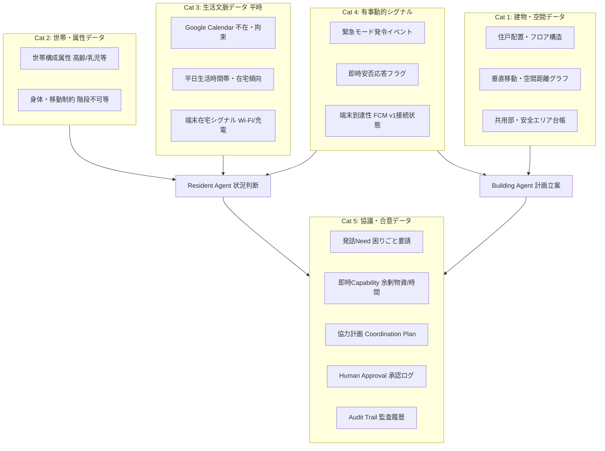
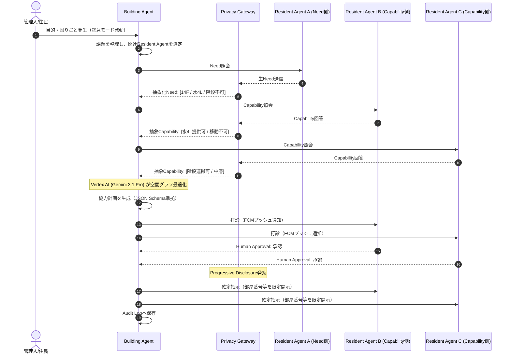
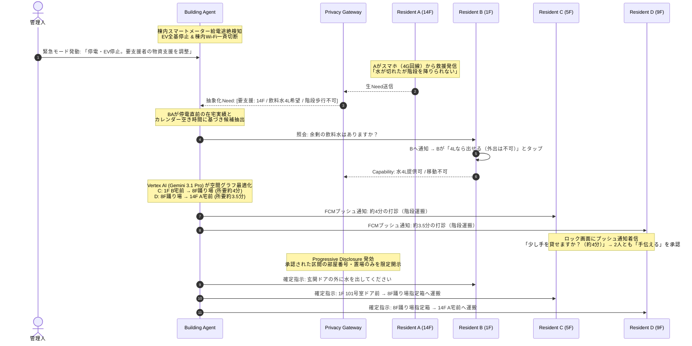
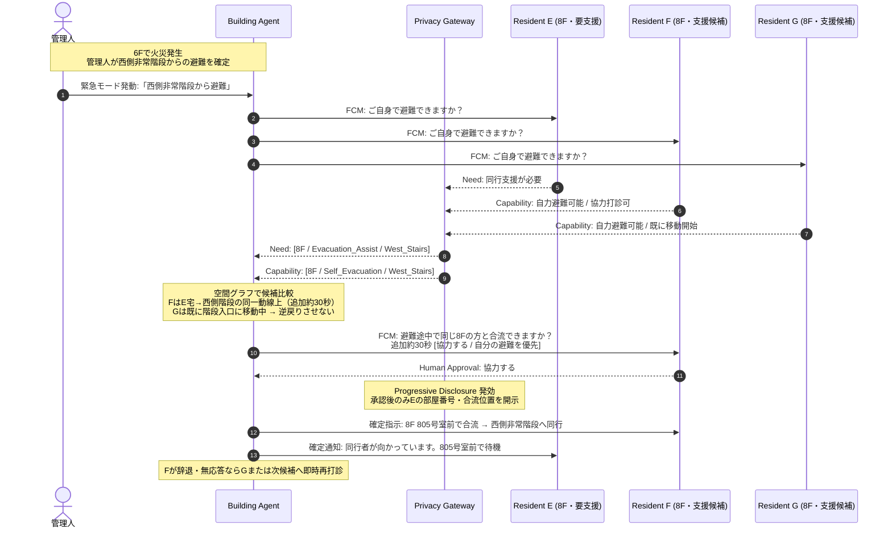
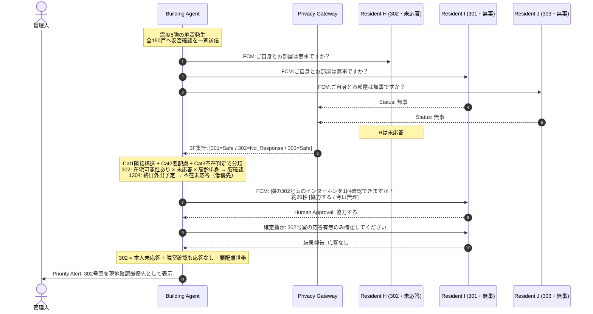
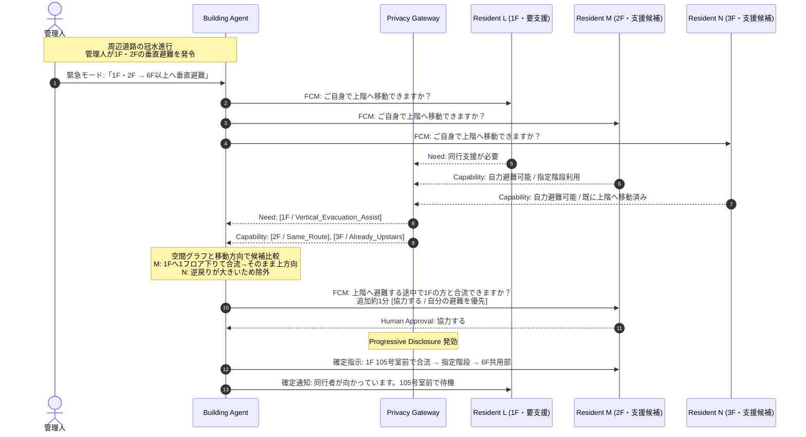

# Zashikiwarashi — API・データモデル・エージェント設計書

*Version 1.0 / Hackathon MVP*
*SPEC.mdの要件に基づく、データ定義・Agent構成・協調プロトコルの詳細設計*

---

## 1. データ設計の基本方針

1. **平時の手入力ゼロ（Zero Routine Input）**:
   - 住民へ日常的なアンケート、ステータス更新、所持品登録などを要求しない。
   - 平常時に取得・抽象化されるのは、Google連携等の自動シグナルと初期登録された客観的属性のみ。
2. **嗜好・人物学習の完全排除（No Preference Profiling）**:
   - 性格、趣味、価値観、ボランティア協力度などの人物プロファイリングは一切作成しない。
   - 意思決定・協調計画は、空間距離、時間的空き状況、身体的制約などの「客観的事実データ」のみに基づく。
3. **段階的プライバシー開示（Progressive Disclosure）**:
   - 生データ（Raw Data）は他Agentへ渡さず、抽象化されたトークンとしてのみやり取りする。
   - 部屋番号などの高識別情報は、実世界の支援行動が確定し、本人が承認（Human Approval）した瞬間にのみ開示。
4. **LLMには知能を与えるが権限は与えない（Policy Enforcement）**:
   - データのアクセス権、開示制限、児童保護ルール（私室連れ込み禁止等）はLLMではなくシステムコード側で決定論的に強制する。

---

## 2. 全データカテゴリー体系

システムに必要なすべてのデータを、ライフサイクルと性質に応じて**5つのカテゴリー**に分類する。



---

## 3. カテゴリー別データ詳細仕様

### 3.1 Cat 1: 建物・空間・設備データ（Static Building Data）

マンションの物理構造をAgentが理解し、「無理のない移動経路」「所要時間」「安全な待ち合わせ場所」を決定論的に計算するための基盤データ。

| データ項目 | 具体的データ内容 | 取得元・取得方法 | プライバシー制約 | Agentの活用方法 |
| :--- | :--- | :--- | :--- | :--- |
| **住戸配置・フロア構造** | 部屋番号、階数、各フロアの住戸並び（隣接関係） | 管理会社・管理組合の初期データ（CSV/JSON → Firestore） | 公知の図面情報。個人のプライバシーは含まない | 地震時の同フロア隣室インターホン確認タスクの自動割り当て |
| **垂直移動・空間距離グラフ** | 非常階段・EVの位置、階層間の標準歩行所要時間（1フロア≈30秒）、踊り場の位置 | 建物設計図面からグラフ構造（Node/Edge）を構築 | 建物設備データ | 荷物運搬タスクの分割立案（8F踊り場を中継デポに選定）、移動所要時間の事前算出（「所要約4分」の明示） |
| **共用部設備台帳** | エントランスラウンジの位置、防犯カメラ画角エリア、管理人室の位置 | 建物設備台帳から登録 | 建物設備データ | **Child Safety Policyの強制**（子どもの見守り場所として他人の私室を排除し、防犯カメラのあるラウンジを指定） |

---

### 3.2 Cat 2: 住民・世帯の基本属性データ（Static Resident Profile）

「誰が助けを必要としているか」「誰に重労働を依頼してはならないか」を平時から把握しておくための客観的属性。**入居時の初回登録1回のみ。平時の追加入力ゼロ。**

| データ項目 | 具体的データ内容 | 取得元・取得方法 | プライバシー制約 | Agentの活用方法 |
| :--- | :--- | :--- | :--- | :--- |
| **世帯構成属性** | 世帯タイプ（高齢単身、乳幼児同居、一般単身、ファミリー等） | 初回アカウント開設時の基本登録（1回のみ。契約情報と突合） | **高機密情報**。他Agentへは一切非公開。自室のResident Agentのみが参照 | 要援護者の自動推定（EV停止時に高齢単身・乳児世帯を優先トリアージ）、応答がない高齢世帯を管理人へ優先通報 |
| **身体・移動制約** | 階段歩行困難、車椅子利用フラグ | 初回登録時の明示設定（病名ではなく「事実制約」として保持） | **高機密情報**。病名等は保持せず「階段不可」等の抽象トークンに限定 | 階段運搬タスクの候補から即座に自動除外、搬送支援が必要な対象（Need）として判定 |

---

### 3.3 Cat 3: 生活文脈データ（Lifestyle Memory: Dynamic & Continuous）

日常の手入力を要求せず、Google連携や端末の自動シグナルから「今、在宅で動ける可能性が高いか」を裏側で把握するデータ。

#### 3.3.1 Google Calendar連携（サーバーサイド自動取得）

| データ項目 | 具体的データ内容 | 取得元・取得方法 | プライバシー制約 | Agentの活用方法 |
| :--- | :--- | :--- | :--- | :--- |
| **不在・拘束スケジュール** | 終日外出/出張/旅行の有無、直近の拘束フラグ、予定の空白時間帯 | **Google Calendar API v3**（OAuth 2.0認可、スコープ: `calendar.events.readonly`）。`freeBusy:query` で時間枠の「Busy/Free」のみ取得 | **予定のタイトルや同席者などの生データは即時破棄**。「不在」「拘束中」「空き」の3ステータスのみ保持 | 外出中・拘束中の住民を支援打診候補から事前除外。突発支援（3分）にピンポイントで空いている住民を抽出 |
| **平日在宅傾向・生活リズム** | 平日の日中在宅傾向（テレワーク層か否か）、通常生活時間帯（就寝時間帯の配慮） | Google Calendarの勤務場所（`WorkingLocation` イベント `eventTypes=workingLocation`）および過去の在宅実績から抽象化 | 趣味や性格の推定（Preference Profile）は作らず、時間帯傾向のみ保持 | 昼間の災害時、在宅勤務傾向の高い住民を優先的にスクリーニング |

#### 3.3.2 端末在宅シグナル（クライアントサイド自動取得）

住民のスマートフォンから、住民の操作なしでバックグラウンド取得可能な在宅・活動シグナル。いずれも**SSIDの文字列やGPS座標などの位置特定データは端末外に送信しない**。Cloud Runへは`presence: true/false` の1ビット値のみPOSTする。

| シグナル | iOS実装 | Android実装 | OS制約と対応策 | 出力・判定 |
| :--- | :--- | :--- | :--- | :--- |
| **自宅Wi-Fi接続状態（在宅判定）** | `NWPathMonitor`（Network.framework）でWi-Fi接続/切断のPath変化を検出。フォアグラウンドで検出し、バックグラウンド復帰時に`queryPedometerData`と組み合わせて最終状態を補完 | `ConnectivityManager.NetworkCallback` + `FLAG_INCLUDE_LOCATION_INFO`。Foreground Service（`connectedDevice`タイプ）または`WorkManager`で定期チェック | **iOS**: バックグラウンド停止中は`NWPathMonitor`コールバック停止。フォアグラウンド復帰時に直近状態を取得。**Android**: `ACCESS_FINE_LOCATION`権限必須。Foreground Service表示が必要 | 帰宅・外出時のWi-Fi接続/切断 → `presence: true/false` を送信。**SSID文字列は端末外に出さない** |
| **夜間充電状態（就寝・起床判定）** | `UIDevice.batteryStateDidChangeNotification`。フォアグラウンド中のみリアルタイム。バックグラウンドでは`BGTaskScheduler`で日次チェック | `WorkManager` の `Constraints.setRequiresCharging(true)` で充電開始時にWorker起動 | **iOS**: バックグラウンドでは通知がキューされ、復帰時に配信。`BGAppRefreshTask`で1日数回のチェックが現実的。**Android**: `ACTION_POWER_CONNECTED`のマニフェスト登録は不可。WorkManager必須 | 深夜帯の充電接続→「就寝モード」、朝の取り外し→「起床モード」。有事の不要な叩き起こしを防止 |
| **直近歩行活動（可動性判定）** | `CMPedometer.queryPedometerData`（CoreMotion、直近15分間の歩数）。バックグラウンド常時監視不可のため、`HKObserverQuery` + `enableBackgroundDelivery`でHealthKit経由の通知をトリガーに取得 | `ActivityRecognitionClient`（Google Play Services）。`PendingIntent`でバックグラウンド受信→ `WorkManager`でサーバー送信 | **iOS**: `NSMotionUsageDescription`必須。HealthKit背景配信はバッチ処理（即時性なし）。**Android**: `ACTIVITY_RECOGNITION`ランタイム権限必須。Foreground Service型制約あり | 直近15分以内に歩行あり →「現在活動中（打診可能）」を判定 |
| **敷地内ジオフェンス（停電フォールバック）** | `CLCircularRegion`（CoreLocation）。マンション敷地半径50mを登録。`Always Allow`位置権限で背景動作可能。最大20リージョン制限 | `GeofencingClient`（Google Play Services）。バックグラウンドで`PendingIntent`経由の入退場通知 | **iOS**: 「常に許可」位置権限が必要（ユーザーに理由説明必須）。精度は100-300m推奨。**Android**: `ACCESS_BACKGROUND_LOCATION`権限必須 | Wi-Fi喪失時（停電時）も敷地内に留まっているかを判定 |

> **プライバシー保護の設計原則**: 上記4つのシグナルは、すべて「端末上で判定→ `true/false` の1ビットのみサーバーへ送信」する設計である。GPS座標、SSID文字列、歩行軌跡などの生データは端末から外に出さない。住民にはアプリ初回セットアップ時にOS権限を要求し、各権限の用途を明示的に説明する（Privacy Manifest / `NSMotionUsageDescription` / Play Console審査対応）。

> **MVPでの段階的導入**: Wi-Fi在宅判定とジオフェンスは位置情報権限への心理的抵抗が高いため、MVPでは**Google Calendar連携のみを必須**とし、端末シグナルは**オプトイン（任意有効化）**とする。MVPデモではダミーデータで代替可能。

---

### 3.4 Cat 4: 有事動的シグナル（Emergency Signals: Real-time）

災害やアクシデントが発生したその瞬間に動くデータ。

| データ項目 | 具体的データ内容 | 取得元・取得方法 | プライバシー制約 | Agentの活用方法 |
| :--- | :--- | :--- | :--- | :--- |
| **緊急モード発動状態** | 全館緊急モードフラグ、個人緊急モードフラグ、発動理由（停電、地震、帰宅困難等） | 管理者Webコンソール、または住民アプリからのAPIトリガー（Cloud Run → Firestore） | 全館モードは全住民Agentへ配信。個人モードは本人Resident AgentとBuilding Agentのみ | システム全体を「平時モード（理解）」から「協調モード（協議・計画作成）」へ切り替え |
| **即時安否応答** | 「無事である」「被害あり」のステータス | 地震直後のFCMプッシュ通知に対する住民の1タップ応答 | 住民の自発的アクション | 「無事」と回答した住民のみを、周囲の安否確認協力者（一次トリアージ）として選定 |
| **端末のリアルタイム到達性** | プッシュ通知配信成功フラグ、オンライン接続状態 | **Firebase Cloud Messaging (FCM HTTP v1 API)** トークンステータス | 端末の通信疎通状態のみ | 通信途絶している世帯を「安否未確認・要直接訪問」として管理人のダッシュボードに抽出 |

---

### 3.5 Cat 5: 協議・合意・実行データ（Coordination & Audit Trail）

Multi-Agentが協議し、人間が承認して行動に移すためのデータ。

| データ項目 | 具体的データ内容 | 取得元・取得方法 | プライバシー制約 | Agentの活用方法 |
| :--- | :--- | :--- | :--- | :--- |
| **緊急Need（救援要請）** | 「水が足りない」「階段を降りられない」「子どもが締め出された」等 | 有事発生時に住民がスマホから入力（テキストまたは音声） | **Privacy Gateway通過義務**。個人特定情報・感情・病歴を排除し抽象化 | Building Agentが課題を構造化し、タスク分解して協議を開始 |
| **即時Capability（提供能力）** | 「水4Lなら出せる」「10分なら階段を運べる」等の動的リソース | Agentからの照会に対する住民のリアルタイム回答 | その場限りの動的情報（平時からの私物リストは作らない） | 物資提供者・階段運搬中継者・見守り担当者のマッチング |
| **協力計画（Coordination Plan）** | 実行タスク（誰が何時どこで何をするか）、所要時間目安、受け渡し場所 | **Vertex AI (Gemini 3.1 Pro)** による構造化出力（JSON Schema準拠） | 実行確定前は部屋番号などの識別情報をマスキング | 住民全員に「極小タスク（所要時間・負担内容）」として提示し、承認を求める |
| **Human Approval（人間承認）** | 「手伝える（承認）」「今は無理（スキップ）」の判定結果 | 住民のスマホ画面でのボタンタップ | 決定論的検証（1人でも未承認なら実世界アクションは不成立） | 承認された瞬間にのみ、受け渡し場所の詳細（部屋番号等）を開示 |
| **監査ログ（Audit Trail）** | 協議に参加したAgent、参照した抽象文脈、開示した情報、承認日時 | **Cloud Firestore / Cloud Logging** に追記専用（Append-only）で記録 | 住民本人が事後に自分のデータ利用・開示経緯を確認可能 | 事後説明責任（Explainability）の担保 |

---

## 4. データ抽象化パイプライン（Progressive Disclosureの実装）

データは以下の5段階の抽象化パイプラインを経て他Agentへ開示される。

```
[Raw Data] 生データ（Calendar予定名、氏名、部屋番号、契約情報）
   │
   ▼ ※自室Resident Agent内のみで処理（外部非公開）
[Lifestyle Memory] 平時生活文脈（テレワーク傾向、生活時間帯、階段不可）
   │
   ▼ ※有事発生、自室Agent内で評価
[Emergency Context] 有事動的文脈（カレンダー空き時間、水4L希望、階段不可）
   │
   ▼ ※Privacy Gatewayによるマスキング・検査
[Shared Context] Agent間共有文脈（[14F / 水4L / 階段不可] などの抽象トークン）
   │
   ▼ ※Building Agentによる計画生成 & 本人によるHuman Approval
[Execution Token] 実世界アクション（承認者のみに「1402号室玄関前」を開示）
```

---

## 5. Agent構成と協調プロトコル

### 5.1 Agent一覧

| Agent | 役割 | 実行方式（MVP） |
| :--- | :--- | :--- |
| **Resident Agent** | 各住民の生活文脈を保持し、Need/Capabilityの判断・応答を行う。住民のプライバシー代理人として機能 | 共通Agent Runtime（Cloud Run）へ`resident_id`を渡してContext切替。論理上は住民ごとに独立したAgentとして振る舞う |
| **Building Agent** | 建物全体の空間グラフ・全Resident Agentの抽象状態を俯瞰し、全体最適の協力計画を策定するCoordinator | Cloud Run上の単一インスタンス |
| **Privacy Gateway** | すべてのAgent外向き通信を検査・抽象化するアウトバウンドフィルタ | Sensitive Data Protection (旧Cloud DLP) + 決定論的ルールエンジン |
| **Policy Engine** | 児童保護・未承認アクション遮断などの安全ルールを決定論的に強制 | Cloud Run上のガードレールサービス |

### 5.2 平常時と緊急時の動作モード

#### 平常時 — 理解する期間

許可されたGoogle Calendar連携や端末シグナルから、自動取得できる情報をもとに生活文脈を抽象化して保持する。ユーザーへ日常的な手入力を要求しない。

- 住民間の支援仲介は原則行わない。
- 生データをそのままLifestyle Memoryにせず、緊急時の判断に必要な抽象情報へ変換する。
- 具体的なCalendar内容・移動履歴等を他Agentへ直接共有しない。

#### 緊急モード — 協調する期間

緊急モードの開始経路は2つ:

1. 管理人が建物全体を緊急モードにする。
2. 各住民が自分自身を緊急モードにする（セルフ緊急モード）。

緊急モード中のみ、緊急時許可情報を利用し、Resident Agent間の照会・複数ラウンド協議・協力計画作成を行う。終了後は通常状態へ戻す。

### 5.3 Multi-Agent協議フロー



1. 管理人または住民から目的・困りごとが発生。
2. Building Agentが課題を整理し、関連Resident Agentを選定。
3. 各Resident Agentが自分のContextだけを参照してNeed / Capabilityを返す。
4. Resident Agent同士が必要に応じて数ラウンド直接会話し、条件を確認する。
5. すべてのAgent外向きメッセージをPrivacy Gatewayで検査・抽象化する。
6. Building Agentが協力計画をLLM主体で生成する。
7. 必要に応じてReject / Counterを受け、再調整する。
8. 実世界のアクションを行う対象者へHuman Approvalを求める。
9. 承認済みPlanのみCommitし、経緯をAudit Logへ保存する。

### 5.4 協力計画で考慮する情報

- 緊急度
- 支援内容との適合性
- 距離・移動負荷（空間距離グラフベース）
- 現在対応可能か（カレンダー空き / 端末在宅シグナル）
- 所要時間
- 支援負担の偏り（Load Fairness）
- 情報開示量の少なさ
- 本人の明示設定・制約

> 協力計画の生成自体はLLMに広く任せるが、情報アクセス権、公開可否、Human Approvalの有無はコード/Policy側で強制する。「LLMには知能を与えるが、権限は与えない」を原則とする。

### 5.5 Human Approval

原則: 「考える・相談する・候補を作るのはAgent、実際に動くのは人間が承認してから」。

**Agentだけで進めてよいこと:**
- 依頼内容の分類・構造化
- 匿名/抽象化した支援可能性の照会
- 候補者の抽出
- Agent同士の条件調整
- 協力案の作成・再調整
- 管理人への状況集約

**Human Approvalが必要なこと:**
- 別住戸へ支援に行く
- 物資を渡す・受け取る
- 部屋番号など識別度の高い情報を開示する
- 訪問・対面・受け渡しを確定する

### 5.6 管理人の役割

管理人は全問い合わせを確認できる。ただし価値の中心は「個人事情をすべて見る」ことではなく、目的や優先事項を指示すると、Agent群が住民の個人情報を必要以上に見せずに協力案へ落とし込むことである。

---

## 6. デモシナリオ詳細設計

### 6.1 シナリオ1: 大規模停電 × EV停止 — 物資の階段バケツリレー（基幹デモ）

#### A. 状況・課題
落雷によりマンション全体が停電し、エレベーターが全基停止。商用電源途絶により**棟内の全戸Wi-Fiは一斉オフライン**となる。
14階の高齢単身世帯（住民A）が自力で階段を下りられず、飲料水が枯渇。
1階から14階への運搬を1人に頼むと、階段280段（約15分）の重労働となり承諾率がゼロになるため、空間距離グラフに基づき複数人でのリレー分割が必要。

#### B. 活用データ設計
| 住民 | Cat 1/2: 空間・属性 | Cat 3: 生活文脈 | Cat 4: 有事シグナル | 判定 |
| :--- | :--- | :--- | :--- | :--- |
| **住民A (14F)** | 78歳単身、階段不可、14階最奥 | 終日外出予定なし | 停電発生、4G接続、Need発信 | **Need発生**: 水がない。階段が降りられない |
| **住民B (1F)** | 乳幼児同居、移動不可 | 終日在宅 | 4G接続、Capability回答 | **Resource**: 未開封水4Lなら玄関前に置ける |
| **住民C (5F)** | 一般単身、階段良好 | テレワーク在宅、**直近拘束なし** | 停電前Wi-Fi在宅実績、4G FCM到達可能 | **Availability: HIGH** |
| **住民D (9F)** | 一般単身、階段良好 | 在宅、**直近拘束なし** | 停電前Wi-Fi在宅実績、4G FCM到達可能 | **Availability: HIGH** |

#### C. Agent協調プロセス



1. **物理異常検知と抽象化Needの受領**: 棟内スマートメーター途絶により、EV全基停止および全戸Wi-Fi切断を検知。各端末は自動的に4G/5Gセルラー回線にフォールバック。
2. **空間グラフに基づく極小タスク分割（Vertex AI Gemini 3.1 Pro）**: 1F〜14Fの全運搬（所要15分）を1人に頼むと拒否されると推論。8階踊り場を中継デポに設定し、タスクを2分割。
3. **候補選定と打診（Human Approval）**: 停電直前の在宅実績があり、かつGoogle Calendarに直近の拘束予定がない住民C・Dを抽出。FCM高優先度プッシュ通知により通知。
4. **計画の確定とProgressive Disclosure**: C・Dが「手伝える」をタップして承認した瞬間にのみ、具体的な受け渡し部屋番号と手順が開示される。

---

### 6.2 シナリオ2: 火災発生 × 避難同行 — 要支援者と避難可能住民の即時マッチング

#### A. 状況・課題
マンション6階の一室で火災が発生。火災報知器が作動し、管理人が防災設備および現場確認に基づいて**西側非常階段からの全館避難**を指示する。
8階には階段移動に不安がある住民Eがおり、単独では迅速な避難が難しい。同じ8階には自力避難可能な住民F・Gが存在する。

火災時は、支援可能な住民も数分以内に非常階段へ移動し、そのフロアを離れてしまう。管理人が要支援住戸を1件ずつ確認して近隣住民へ電話している間に、**その場で成立し得た支援可能な組み合わせが消滅する**。

Building Agentは、管理人が確定した避難方針のもと、「**今この瞬間に同じ避難動線上にいる支援可能者**」と「**同行支援が必要な住民**」を数十秒単位でマッチングする。

| 要素 | 火災で起きること |
| :--- | :--- |
| **時間制約** | 数分単位で避難開始が必要。支援可能者も短時間でそのフロアから離れる |
| **同時多発** | 複数住戸が同時に避難し、複数の同行支援Needが並行発生する |
| **組み合わせ問題** | 「誰が誰を支援するか」をフロア・避難方向・移動能力から即座に決める必要がある |
| **中央管理の限界** | 管理人が一人ずつ電話・確認・割当する時間がない |

#### B. 活用データ設計
| 住民 | Cat 1/2: 空間・属性 | Cat 3: 生活文脈 | Cat 4: 有事シグナル | 判定 |
| :--- | :--- | :--- | :--- | :--- |
| **住民E (8F)** | 高齢単身、階段移動不安、8F東側住戸 | 終日外出予定なし | FCM到達可能、「同行支援が必要」と回答 | **Need**: 単独では迅速な階段避難が難しい |
| **住民F (8F)** | 一般成人、階段良好、E宅→西側階段の動線上 | 在宅、直近拘束なし | FCM到達可能、「自力避難可能」と回答 | **Availability: HIGH**: 同一階・同一方向・追加約30秒 |
| **住民G (8F)** | 一般成人、西側階段近傍 | 在宅 | FCM到達、自力避難開始済み | **Availability: MEDIUM**: 既に階段入口へ移動中 |
| **管理人** | 非常階段・フロア構造を把握 | ― | 火災緊急モード発令、西側階段を避難経路に指定 | **Verified Route** |

#### C. Agent協調プロセス



1. **避難方針の確定と緊急モード発動**: 火災報知設備・現場状況を確認した管理人が西側非常階段からの避難を決定。Building Agentは避難経路そのものを推論せず、管理人が確定した `[Route: West_Stairs]` を制約条件として利用する。
2. **Need/Capabilityの同時収集**: 全住民へFCM高優先度通知「*火災が発生しています。西側非常階段から避難してください。ご自身で避難できますか？ [避難できる / 同行支援が必要]*」。Eの回答はPrivacy Gatewayを通じて `[8F, Evacuation_Assist, West_Stairs]` に抽象化。
3. **空間グラフによる支援候補選定（Vertex AI Gemini 3.1 Pro）**: 同一階・同一避難方向・追加移動時間を比較。Gは既に階段入口へ移動しているため、**「救助のために逆方向へ戻らせない」**制約を適用し、動線上のFを第一候補に選定。
4. **極小タスクとしてのHuman Approval**: Fへ「*避難途中で同じ8階の方と合流して非常階段まで同行できますか？ 追加約30秒です。 [協力する / 自分の避難を優先する]*」。辞退しても理由は不要で、即時に次候補へ再打診。
5. **Progressive Disclosureと同行開始**: Fの承認後にのみ、Eの部屋番号と合流位置を開示。Eが高齢単身であること等、支援に不要な属性は開示しない。
6. **未解決ケースの例外集約**: 同行者が確保できない住戸、未応答住戸のみを管理人コンソールへ表示。管理人は全150戸のマッチングではなく、**Agentで解けなかった例外だけ**に対応する。

---

### 6.3 シナリオ3: 地震直後 × 初動5分トリアージ — 未応答住戸確認の分散化

#### A. 状況・課題
震度5強の地震が発生。家具転倒・ドア枠歪み・室内負傷などが複数住戸で同時に起きる。
全150戸について管理人が1戸ずつ電話・インターホン・巡回で確認すると2〜3時間。余震や火災などの二次災害が発生すれば、**本当に救助が必要な住戸の特定が致命的に遅れる**。

一方、発災直後には「無事で動ける住民」が各フロアに多数存在する。Building Agentがそれぞれへ**自分のすぐ隣だけを確認する20〜60秒の極小タスク**を重複なく割り当てれば、150戸の確認を並列化できる。

| 要素 | 地震直後に起きること |
| :--- | :--- |
| **時間制約** | 余震・火災等の二次災害前に、初動5〜10分で未応答住戸を絞り込む必要がある |
| **同時多発** | 負傷、閉じ込め、未応答が複数フロア・複数住戸で同時発生する |
| **組み合わせ問題** | 無事な住民へ「最も近い未確認住戸」を重複なく割り当てる必要がある |
| **中央管理の限界** | 管理人が150戸を逐次確認すると数時間かかり、初期救助対象の特定が遅れる |

#### B. 活用データ設計
| 住民 | Cat 1/2: 空間・属性 | Cat 3: 生活文脈 | Cat 4: 有事シグナル | 判定 |
| :--- | :--- | :--- | :--- | :--- |
| **住民H (302号室)** | 高齢単身、自力脱出に不安、3F中央 | 外出予定なし | 安否通知に**未応答**、FCM到達あり | **Priority Check**: 在宅可能性あり × 未応答 × 要配慮 |
| **住民I (301号室)** | 一般成人、Hの隣室 | 在宅、直近拘束なし | 「無事」と回答、FCM到達可能 | **Availability: HIGH**: 隣室確認が約20秒 |
| **住民J (303号室)** | 一般成人、Hの隣室 | 在宅 | 「無事」と回答、既に別住戸確認を承認 | **Assigned**: 重複割当を回避 |
| **住民K (1204号室)** | 12F住戸 | **終日外出予定** | 安否通知に未応答 | **Likely Away**: 在宅未応答と同列に扱わない |

#### C. Agent協調プロセス



1. **全戸への即時安否確認**: 地震発生後、全住民へFCM通知「*ご自身とお部屋は無事ですか？ [無事 / 被害あり]*」。回答をCat 4の即時安否応答フラグとして集約。
2. **未応答世帯の一次分類**: Cat 3のカレンダー不在判定により、「外出予定ありの未応答（Likely Away）」と「在宅可能性ありの未応答（要確認）」を分離。Cat 2の高齢単身・自力脱出困難フラグは管理側トリアージにのみ使用し、確認を依頼される住民には開示しない。
3. **隣接構造に基づく確認タスク生成**: Cat 1の住戸配置から、未応答住戸に最も近い「無事」と回答した住民を抽出。1住戸につき1担当を割り当て、重複派遣しない。
4. **Human Approvalによる20秒確認**: Iへ「*ご自身の安全確保後、隣の302号室のインターホンを1回だけ鳴らして応答有無を確認できますか？ 約20秒です。 [協力する / 今は無理]*」。承認後にのみ確認対象の部屋番号を開示。
5. **結果の自動集計と優先度更新**: 「本人未応答」＋「近隣住民確認でも応答なし」の場合、管理人向け現地確認対象へ昇格。Cat 2で要配慮世帯なら管理人コンソール上で優先表示。
6. **管理人を"全戸確認"から"例外対応"へ**: 住民による並列確認で150戸の大半を数分で分類。管理人は「未応答かつ現地確認が必要な数戸」だけに直行できる。

---

### 6.4 シナリオ4: 洪水・内水氾濫 × 垂直避難 — 低層階要支援者と上方向避難者の即時マッチング

#### A. 状況・課題
記録的豪雨によりマンション周辺道路の冠水が急速に進行。行政情報および現場状況をもとに、管理人が1階・2階住民へ**上層階への垂直避難**を指示する。
1階には階段移動に不安がある住民Lがいる。2階・3階には自力で上階へ避難できる住民M・Nが存在する。

上層階から新たに救助者を派遣すると逆方向移動が発生し避難を遅らせる。最も効率的なのは、**すでに同じ上方向へ避難している住民の動線に、短い同行支援を組み込む**ことである。

しかし冠水が進行すると、低層階を通過する支援可能者は数分以内に上階へ移動してしまい、管理人が個別に電話して同行者を探している間に組み合わせが消失する。

| 要素 | 洪水・垂直避難で起きること |
| :--- | :--- |
| **時間制約** | 水位上昇前の10〜20分で低層階から離れる必要がある |
| **同時多発** | 1F・2Fの複数世帯が一斉に上階へ避難を開始する |
| **組み合わせ問題** | 「同じ避難方向」「近い位置」「追加負担が小さい」住民と要支援者を即座に組み合わせる必要がある |
| **中央管理の限界** | 管理人が低層階全世帯へ個別連絡し同行者を探す間に避難可能時間が失われる |

#### B. 活用データ設計
| 住民 | Cat 1/2: 空間・属性 | Cat 3: 生活文脈 | Cat 4: 有事シグナル | 判定 |
| :--- | :--- | :--- | :--- | :--- |
| **住民L (1F)** | 高齢単身、階段移動に不安、1F東側 | 在宅 | FCM到達、「同行支援が必要」と回答 | **Need**: 上層階への垂直避難に同行希望 |
| **住民M (2F)** | 一般成人、階段良好、L宅→指定階段の近接動線 | 在宅、直近拘束なし | 「自力避難可能」、FCM到達 | **Availability: HIGH**: 同方向移動・追加約1分 |
| **住民N (3F)** | 一般成人、同一階段利用 | 在宅 | 自力避難可能、既に5Fまで移動 | **Availability: LOW**: 逆戻りが必要なため候補外 |
| **管理人** | 指定階段・上層共用部を把握 | ― | 垂直避難モード発令 | **Verified Policy**: 1F・2F → 6F以上へ退避 |

#### C. Agent協調プロセス



1. **垂直避難方針の確定**: 行政情報・現場状況をもとに管理人が1F・2F住民の垂直避難を決定。Building Agentは独自に洪水危険度を判断せず、 `[Target_Floor: 1F-2F, Safe_Area: 6F+]` を制約条件として利用する。
2. **移動可否の即時確認**: 対象住民へFCM「*上階への一時退避が必要です。ご自身で階段移動できますか？ [移動できる / 同行支援が必要]*」。Lの回答はPrivacy Gatewayを通じて `[1F, Vertical_Evacuation_Assist]` に抽象化。
3. **同一方向の支援候補抽出（Vertex AI Gemini 3.1 Pro）**: Cat 1の空間距離グラフと避難状態から、Mは「1フロア下りてLと合流し、その後同じ上方向へ避難できる」と判定。既に5Fまで避難済みのNは、**逆戻りにより本人の安全を損なう**ため候補から除外。
4. **追加負担を明示したHuman Approval**: Mへ「*上階へ避難する途中で、1階の方と合流して6階まで一緒に移動できますか？ 追加約1分です。 [協力する / 自分の避難を優先する]*」。辞退した場合は別の同方向候補へ即時再打診。
5. **Progressive Disclosureによる合流情報開示**: Mの承認後にのみ、Lの部屋番号・合流位置・退避先を開示。Lが高齢単身であること等の属性は開示しない。
6. **避難進捗の全館集約**: Building Agentが「自力避難中 / 同行者確保済み / 同行者未確保 / 未応答」をリアルタイム集計。管理人は全低層住戸へ個別電話するのではなく、**同行者未確保・未応答の例外だけ**に対応する。

---

## 7. Firestore データモデル（論理設計）

### 7.1 Cat 1〜5とテーブル（コレクション）の対応関係

> **【最重要】Cat 1〜4はそれぞれ別テーブル（コレクション）ではありません。**  
> Cat 1〜4は「情報の性質・プライバシー保護レベル」を表す論理カテゴリ区分です。データベース構造を複雑にしないため、Firestoreのベストプラクティス（同一ドキュメントへのEmbedded Map集約）に基づき、**実質3つの基本コレクション**だけで極めてシンプルに構成されています。

| データ分類（論理カテゴリ） | 保持する情報 | 格納先Firestoreコレクション | 理由（なぜ分けないのか） |
| :--- | :--- | :--- | :--- |
| **Cat 1: 建物・空間** | マンション階数、部屋配置、階段グラフ | `/buildings/{buildingId}` | 建物全体で共通の静的マスタ情報 |
| **Cat 2: 世帯・属性** | 部屋番号、高齢単身/乳児、移動制約 | `/residents/{residentId}` | **住民1人につき1ドキュメント**に集約。<br>有事に「1回のDB取得」で属性・在宅・安否が判定できないと遅延するため、Cat 2・3・4を1ドキュメント内のマップとして保持する。 |
| **Cat 3: 生活文脈** | Google Calendar不在判定、直近空き時間 | `/residents/{residentId}` | ↑同上 |
| **Cat 4: 有時シグナル** | FCM接続状態、即時安否（無事/要支援） | `/residents/{residentId}` | ↑同上（有事発災時にフラグを更新） |
| **Cat 5: 協議・合意** | 協力タスク、Human Approval、監査ログ | `/active_plans/{planId}` | 災害発生時に動的に生成され、完了後にアーカイブされるタスク単位のコレクション |

### 7.2 コレクション構成（実質3階層）

```
/buildings/{buildingId}                          ← Cat 1（建物空間マスタ）
  ├── spatial_graph          # 空間グラフ（階段所要時間、踊り場位置、非常階段動線）
  └── equipment_registry     # 防災設備台帳（非常階段、消火器、管理人室）

/residents/{residentId}                          ← Cat 1(自室位置) + Cat 2 + Cat 3 + Cat 4（住民台帳: 1人1ドキュメント）
  ├── private/
  │   ├── lifestyle_memory   # Cat 2+3: 世帯属性・身体制約 ＋ 在宅傾向・カレンダー空き（Embedded Map）
  │   └── raw_calendar       # Cat 3: 生Calendar一時バッファ（予定名・時刻を抽象化後に即時破棄）
  └── public/
      └── abstract_state     # Cat 4: 他Agent・Building Agentが参照する最小抽象トークン（availability, 安否, 到達性）

/active_plans/{planId}                           ← Cat 5（災害時アクティブタスク）
  ├── coordination_plan      # Building Agentが策定した協力タスク（区間、推定所要時間）
  ├── approvals/             # 住民のHuman Approval状態（承認/辞退/未応答）
  └── audit_trail/           # 協議履歴・開示情報・タイムスタンプ（追記専用ログ）
```

- **なぜテーブルをCatごとに分けないのか？**:
  RDBMSのようにテーブルを4つに正規化（分離）すると、発災時に150世帯のマッチングを行う際、数百回のJOINや複数クエリが飛び交い、遅延やタイムアウトを引き起こします。Firestoreではドキュメント指向を活かし、**「1住民＝1ドキュメント」**に属性（Cat 2）・スケジュール状態（Cat 3）・安否（Cat 4）をまとめることで、**1回の読み込みで即座に判定が完了**し、コードも極限までシンプルに保てます。

---

## 相互参照

- **課題・ユーザー・要件** → [SPEC.md](SPEC.md)
- **システム構成** → [ARCHITECTURE.md](ARCHITECTURE.md)
- **タスク分解・マイルストーン** → [PLAN.md](PLAN.md)
