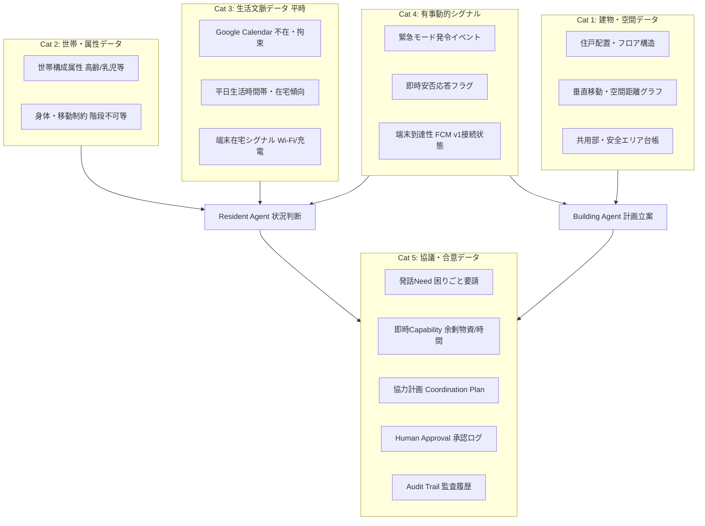
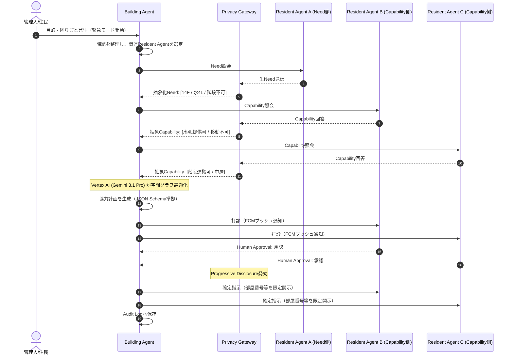
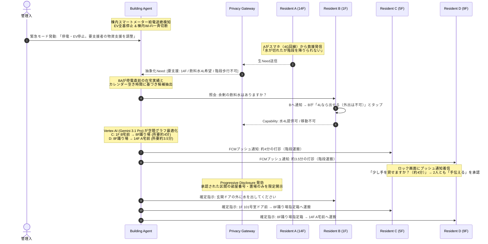

# Zashikiwarashi — API・データモデル・エージェント設計書

*Version 1.0 / Hackathon MVP*
*SPEC.mdの要件に基づく、データ定義・Agent構成・協調プロトコルの詳細設計*

---

## 1. データ設計の基本方針

1. **平時の手入力ゼロ（Zero Routine Input）**:
   - 住民へ日常的なアンケート、ステータス更新、所持品登録などを要求しない。
   - 平常時に取得・抽象化されるのは、Google連携等の自動シグナルと初期登録された客観的属性のみ。
2. **嗜好・人物学習の完全排除（No Preference Profiling）**:
   - 性格、趣味、価値観、ボランティア協力度などの人物プロファイリングは一切作成しない。
   - 意思決定・協調計画は、空間距離、時間的空き状況、身体的制約などの「客観的事実データ」のみに基づく。
3. **段階的プライバシー開示（Progressive Disclosure）**:
   - 生データ（Raw Data）は他Agentへ渡さず、抽象化されたトークンとしてのみやり取りする。
   - 部屋番号などの高識別情報は、実世界の支援行動が確定し、本人が承認（Human Approval）した瞬間にのみ開示。
4. **LLMには知能を与えるが権限は与えない（Policy Enforcement）**:
   - データのアクセス権、開示制限、児童保護ルール（私室連れ込み禁止等）はLLMではなくシステムコード側で決定論的に強制する。

---

## 2. 全データカテゴリー体系

システムに必要なすべてのデータを、ライフサイクルと性質に応じて**5つのカテゴリー**に分類する。



---

## 3. カテゴリー別データ詳細仕様

### 3.1 Cat 1: 建物・空間・設備データ（Static Building Data）

マンションの物理構造をAgentが理解し、「無理のない移動経路」「所要時間」「安全な待ち合わせ場所」を決定論的に計算するための基盤データ。

| データ項目 | 具体的データ内容 | 取得元・取得方法 | プライバシー制約 | Agentの活用方法 |
| :--- | :--- | :--- | :--- | :--- |
| **住戸配置・フロア構造** | 部屋番号、階数、各フロアの住戸並び（隣接関係） | 管理会社・管理組合の初期データ（CSV/JSON → Firestore） | 公知の図面情報。個人のプライバシーは含まない | 地震時の同フロア隣室インターホン確認タスクの自動割り当て |
| **垂直移動・空間距離グラフ** | 非常階段・EVの位置、階層間の標準歩行所要時間（1フロア≈30秒）、踊り場の位置 | 建物設計図面からグラフ構造（Node/Edge）を構築 | 建物設備データ | 荷物運搬タスクの分割立案（8F踊り場を中継デポに選定）、移動所要時間の事前算出（「所要約4分」の明示） |
| **共用部設備台帳** | エントランスラウンジの位置、防犯カメラ画角エリア、管理人室の位置 | 建物設備台帳から登録 | 建物設備データ | **Child Safety Policyの強制**（子どもの見守り場所として他人の私室を排除し、防犯カメラのあるラウンジを指定） |

---

### 3.2 Cat 2: 住民・世帯の基本属性データ（Static Resident Profile）

「誰が助けを必要としているか」「誰に重労働を依頼してはならないか」を平時から把握しておくための客観的属性。**入居時の初回登録1回のみ。平時の追加入力ゼロ。**

| データ項目 | 具体的データ内容 | 取得元・取得方法 | プライバシー制約 | Agentの活用方法 |
| :--- | :--- | :--- | :--- | :--- |
| **世帯構成属性** | 世帯タイプ（高齢単身、乳幼児同居、一般単身、ファミリー等） | 初回アカウント開設時の基本登録（1回のみ。契約情報と突合） | **高機密情報**。他Agentへは一切非公開。自室のResident Agentのみが参照 | 要援護者の自動推定（EV停止時に高齢単身・乳児世帯を優先トリアージ）、応答がない高齢世帯を管理人へ優先通報 |
| **身体・移動制約** | 階段歩行困難、車椅子利用フラグ | 初回登録時の明示設定（病名ではなく「事実制約」として保持） | **高機密情報**。病名等は保持せず「階段不可」等の抽象トークンに限定 | 階段運搬タスクの候補から即座に自動除外、搬送支援が必要な対象（Need）として判定 |

---

### 3.3 Cat 3: 生活文脈データ（Lifestyle Memory: Dynamic & Continuous）

日常の手入力を要求せず、Google連携や端末の自動シグナルから「今、在宅で動ける可能性が高いか」を裏側で把握するデータ。

#### 3.3.1 Google Calendar連携（サーバーサイド自動取得）

| データ項目 | 具体的データ内容 | 取得元・取得方法 | プライバシー制約 | Agentの活用方法 |
| :--- | :--- | :--- | :--- | :--- |
| **不在・拘束スケジュール** | 終日外出/出張/旅行の有無、直近の拘束フラグ、予定の空白時間帯 | **Google Calendar API v3**（OAuth 2.0認可、スコープ: `calendar.events.readonly`）。`freeBusy:query` で時間枠の「Busy/Free」のみ取得 | **予定のタイトルや同席者などの生データは即時破棄**。「不在」「拘束中」「空き」の3ステータスのみ保持 | 外出中・拘束中の住民を支援打診候補から事前除外。突発支援（3分）にピンポイントで空いている住民を抽出 |
| **平日在宅傾向・生活リズム** | 平日の日中在宅傾向（テレワーク層か否か）、通常生活時間帯（就寝時間帯の配慮） | Google Calendarの勤務場所（`WorkingLocation` イベント `eventTypes=workingLocation`）および過去の在宅実績から抽象化 | 趣味や性格の推定（Preference Profile）は作らず、時間帯傾向のみ保持 | 昼間の災害時、在宅勤務傾向の高い住民を優先的にスクリーニング |

#### 3.3.2 端末在宅シグナル（クライアントサイド自動取得）

住民のスマートフォンから、住民の操作なしでバックグラウンド取得可能な在宅・活動シグナル。いずれも**SSIDの文字列やGPS座標などの位置特定データは端末外に送信しない**。Cloud Runへは`presence: true/false` の1ビット値のみPOSTする。

| シグナル | iOS実装 | Android実装 | OS制約と対応策 | 出力・判定 |
| :--- | :--- | :--- | :--- | :--- |
| **自宅Wi-Fi接続状態（在宅判定）** | `NWPathMonitor`（Network.framework）でWi-Fi接続/切断のPath変化を検出。フォアグラウンドで検出し、バックグラウンド復帰時に`queryPedometerData`と組み合わせて最終状態を補完 | `ConnectivityManager.NetworkCallback` + `FLAG_INCLUDE_LOCATION_INFO`。Foreground Service（`connectedDevice`タイプ）または`WorkManager`で定期チェック | **iOS**: バックグラウンド停止中は`NWPathMonitor`コールバック停止。フォアグラウンド復帰時に直近状態を取得。**Android**: `ACCESS_FINE_LOCATION`権限必須。Foreground Service表示が必要 | 帰宅・外出時のWi-Fi接続/切断 → `presence: true/false` を送信。**SSID文字列は端末外に出さない** |
| **夜間充電状態（就寝・起床判定）** | `UIDevice.batteryStateDidChangeNotification`。フォアグラウンド中のみリアルタイム。バックグラウンドでは`BGTaskScheduler`で日次チェック | `WorkManager` の `Constraints.setRequiresCharging(true)` で充電開始時にWorker起動 | **iOS**: バックグラウンドでは通知がキューされ、復帰時に配信。`BGAppRefreshTask`で1日数回のチェックが現実的。**Android**: `ACTION_POWER_CONNECTED`のマニフェスト登録は不可。WorkManager必須 | 深夜帯の充電接続→「就寝モード」、朝の取り外し→「起床モード」。有事の不要な叩き起こしを防止 |
| **直近歩行活動（可動性判定）** | `CMPedometer.queryPedometerData`（CoreMotion、直近15分間の歩数）。バックグラウンド常時監視不可のため、`HKObserverQuery` + `enableBackgroundDelivery`でHealthKit経由の通知をトリガーに取得 | `ActivityRecognitionClient`（Google Play Services）。`PendingIntent`でバックグラウンド受信→ `WorkManager`でサーバー送信 | **iOS**: `NSMotionUsageDescription`必須。HealthKit背景配信はバッチ処理（即時性なし）。**Android**: `ACTIVITY_RECOGNITION`ランタイム権限必須。Foreground Service型制約あり | 直近15分以内に歩行あり →「現在活動中（打診可能）」を判定 |
| **敷地内ジオフェンス（停電フォールバック）** | `CLCircularRegion`（CoreLocation）。マンション敷地半径50mを登録。`Always Allow`位置権限で背景動作可能。最大20リージョン制限 | `GeofencingClient`（Google Play Services）。バックグラウンドで`PendingIntent`経由の入退場通知 | **iOS**: 「常に許可」位置権限が必要（ユーザーに理由説明必須）。精度は100-300m推奨。**Android**: `ACCESS_BACKGROUND_LOCATION`権限必須 | Wi-Fi喪失時（停電時）も敷地内に留まっているかを判定 |

> **プライバシー保護の設計原則**: 上記4つのシグナルは、すべて「端末上で判定→ `true/false` の1ビットのみサーバーへ送信」する設計である。GPS座標、SSID文字列、歩行軌跡などの生データは端末から外に出さない。住民にはアプリ初回セットアップ時にOS権限を要求し、各権限の用途を明示的に説明する（Privacy Manifest / `NSMotionUsageDescription` / Play Console審査対応）。

> **MVPでの段階的導入**: Wi-Fi在宅判定とジオフェンスは位置情報権限への心理的抵抗が高いため、MVPでは**Google Calendar連携のみを必須**とし、端末シグナルは**オプトイン（任意有効化）**とする。MVPデモではダミーデータで代替可能。

---

### 3.4 Cat 4: 有事動的シグナル（Emergency Signals: Real-time）

災害やアクシデントが発生したその瞬間に動くデータ。

| データ項目 | 具体的データ内容 | 取得元・取得方法 | プライバシー制約 | Agentの活用方法 |
| :--- | :--- | :--- | :--- | :--- |
| **緊急モード発動状態** | 全館緊急モードフラグ、個人緊急モードフラグ、発動理由（停電、地震、帰宅困難等） | 管理者Webコンソール、または住民アプリからのAPIトリガー（Cloud Run → Firestore） | 全館モードは全住民Agentへ配信。個人モードは本人Resident AgentとBuilding Agentのみ | システム全体を「平時モード（理解）」から「協調モード（協議・計画作成）」へ切り替え |
| **即時安否応答** | 「無事である」「被害あり」のステータス | 地震直後のFCMプッシュ通知に対する住民の1タップ応答 | 住民の自発的アクション | 「無事」と回答した住民のみを、周囲の安否確認協力者（一次トリアージ）として選定 |
| **端末のリアルタイム到達性** | プッシュ通知配信成功フラグ、オンライン接続状態 | **Firebase Cloud Messaging (FCM HTTP v1 API)** トークンステータス | 端末の通信疎通状態のみ | 通信途絶している世帯を「安否未確認・要直接訪問」として管理人のダッシュボードに抽出 |

---

### 3.5 Cat 5: 協議・合意・実行データ（Coordination & Audit Trail）

Multi-Agentが協議し、人間が承認して行動に移すためのデータ。

| データ項目 | 具体的データ内容 | 取得元・取得方法 | プライバシー制約 | Agentの活用方法 |
| :--- | :--- | :--- | :--- | :--- |
| **緊急Need（救援要請）** | 「水が足りない」「階段を降りられない」「子どもが締め出された」等 | 有事発生時に住民がスマホから入力（テキストまたは音声） | **Privacy Gateway通過義務**。個人特定情報・感情・病歴を排除し抽象化 | Building Agentが課題を構造化し、タスク分解して協議を開始 |
| **即時Capability（提供能力）** | 「水4Lなら出せる」「10分なら階段を運べる」等の動的リソース | Agentからの照会に対する住民のリアルタイム回答 | その場限りの動的情報（平時からの私物リストは作らない） | 物資提供者・階段運搬中継者・見守り担当者のマッチング |
| **協力計画（Coordination Plan）** | 実行タスク（誰が何時どこで何をするか）、所要時間目安、受け渡し場所 | **Vertex AI (Gemini 3.1 Pro)** による構造化出力（JSON Schema準拠） | 実行確定前は部屋番号などの識別情報をマスキング | 住民全員に「極小タスク（所要時間・負担内容）」として提示し、承認を求める |
| **Human Approval（人間承認）** | 「手伝える（承認）」「今は無理（スキップ）」の判定結果 | 住民のスマホ画面でのボタンタップ | 決定論的検証（1人でも未承認なら実世界アクションは不成立） | 承認された瞬間にのみ、受け渡し場所の詳細（部屋番号等）を開示 |
| **監査ログ（Audit Trail）** | 協議に参加したAgent、参照した抽象文脈、開示した情報、承認日時 | **Cloud Firestore / Cloud Logging** に追記専用（Append-only）で記録 | 住民本人が事後に自分のデータ利用・開示経緯を確認可能 | 事後説明責任（Explainability）の担保 |

---

## 4. データ抽象化パイプライン（Progressive Disclosureの実装）

データは以下の5段階の抽象化パイプラインを経て他Agentへ開示される。

```
[Raw Data] 生データ（Calendar予定名、氏名、部屋番号、契約情報）
   │
   ▼ ※自室Resident Agent内のみで処理（外部非公開）
[Lifestyle Memory] 平時生活文脈（テレワーク傾向、生活時間帯、階段不可）
   │
   ▼ ※有事発生、自室Agent内で評価
[Emergency Context] 有事動的文脈（カレンダー空き時間、水4L希望、階段不可）
   │
   ▼ ※Privacy Gatewayによるマスキング・検査
[Shared Context] Agent間共有文脈（[14F / 水4L / 階段不可] などの抽象トークン）
   │
   ▼ ※Building Agentによる計画生成 & 本人によるHuman Approval
[Execution Token] 実世界アクション（承認者のみに「1402号室玄関前」を開示）
```

---

## 5. Agent構成と協調プロトコル

### 5.1 Agent一覧

| Agent | 役割 | 実行方式（MVP） |
| :--- | :--- | :--- |
| **Resident Agent** | 各住民の生活文脈を保持し、Need/Capabilityの判断・応答を行う。住民のプライバシー代理人として機能 | 共通Agent Runtime（Cloud Run）へ`resident_id`を渡してContext切替。論理上は住民ごとに独立したAgentとして振る舞う |
| **Building Agent** | 建物全体の空間グラフ・全Resident Agentの抽象状態を俯瞰し、全体最適の協力計画を策定するCoordinator | Cloud Run上の単一インスタンス |
| **Privacy Gateway** | すべてのAgent外向き通信を検査・抽象化するアウトバウンドフィルタ | Sensitive Data Protection (旧Cloud DLP) + 決定論的ルールエンジン |
| **Policy Engine** | 児童保護・未承認アクション遮断などの安全ルールを決定論的に強制 | Cloud Run上のガードレールサービス |

### 5.2 平常時と緊急時の動作モード

#### 平常時 — 理解する期間

許可されたGoogle Calendar連携や端末シグナルから、自動取得できる情報をもとに生活文脈を抽象化して保持する。ユーザーへ日常的な手入力を要求しない。

- 住民間の支援仲介は原則行わない。
- 生データをそのままLifestyle Memoryにせず、緊急時の判断に必要な抽象情報へ変換する。
- 具体的なCalendar内容・移動履歴等を他Agentへ直接共有しない。

#### 緊急モード — 協調する期間

緊急モードの開始経路は2つ:

1. 管理人が建物全体を緊急モードにする。
2. 各住民が自分自身を緊急モードにする（セルフ緊急モード）。

緊急モード中のみ、緊急時許可情報を利用し、Resident Agent間の照会・複数ラウンド協議・協力計画作成を行う。終了後は通常状態へ戻す。

### 5.3 Multi-Agent協議フロー



1. 管理人または住民から目的・困りごとが発生。
2. Building Agentが課題を整理し、関連Resident Agentを選定。
3. 各Resident Agentが自分のContextだけを参照してNeed / Capabilityを返す。
4. Resident Agent同士が必要に応じて数ラウンド直接会話し、条件を確認する。
5. すべてのAgent外向きメッセージをPrivacy Gatewayで検査・抽象化する。
6. Building Agentが協力計画をLLM主体で生成する。
7. 必要に応じてReject / Counterを受け、再調整する。
8. 実世界のアクションを行う対象者へHuman Approvalを求める。
9. 承認済みPlanのみCommitし、経緯をAudit Logへ保存する。

### 5.4 協力計画で考慮する情報

- 緊急度
- 支援内容との適合性
- 距離・移動負荷（空間距離グラフベース）
- 現在対応可能か（カレンダー空き / 端末在宅シグナル）
- 所要時間
- 支援負担の偏り（Load Fairness）
- 情報開示量の少なさ
- 本人の明示設定・制約

> 協力計画の生成自体はLLMに広く任せるが、情報アクセス権、公開可否、Human Approvalの有無はコード/Policy側で強制する。「LLMには知能を与えるが、権限は与えない」を原則とする。

### 5.5 Human Approval

原則: 「考える・相談する・候補を作るのはAgent、実際に動くのは人間が承認してから」。

**Agentだけで進めてよいこと:**
- 依頼内容の分類・構造化
- 匿名/抽象化した支援可能性の照会
- 候補者の抽出
- Agent同士の条件調整
- 協力案の作成・再調整
- 管理人への状況集約

**Human Approvalが必要なこと:**
- 別住戸へ支援に行く
- 物資を渡す・受け取る
- 部屋番号など識別度の高い情報を開示する
- 訪問・対面・受け渡しを確定する

### 5.6 管理人の役割

管理人は全問い合わせを確認できる。ただし価値の中心は「個人事情をすべて見る」ことではなく、目的や優先事項を指示すると、Agent群が住民の個人情報を必要以上に見せずに協力案へ落とし込むことである。

---

## 6. デモシナリオ詳細設計

### 6.1 シナリオ1: 大規模停電 × EV停止 — 物資の階段バケツリレー（基幹デモ）

#### A. 状況・課題
落雷によりマンション全体が停電し、エレベーターが全基停止。商用電源途絶により**棟内の全戸Wi-Fiは一斉オフライン**となる。
14階の高齢単身世帯（住民A）が自力で階段を下りられず、飲料水が枯渇。
1階から14階への運搬を1人に頼むと、階段280段（約15分）の重労働となり承諾率がゼロになるため、空間距離グラフに基づき複数人でのリレー分割が必要。

#### B. 活用データ設計
| 住民 | Cat 1/2: 空間・属性 | Cat 3: 生活文脈 | Cat 4: 有事シグナル | 判定 |
| :--- | :--- | :--- | :--- | :--- |
| **住民A (14F)** | 78歳単身、階段不可、14階最奥 | 終日外出予定なし | 停電発生、4G接続、Need発信 | **Need発生**: 水がない。階段が降りられない |
| **住民B (1F)** | 乳幼児同居、移動不可 | 終日在宅 | 4G接続、Capability回答 | **Resource**: 未開封水4Lなら玄関前に置ける |
| **住民C (5F)** | 一般単身、階段良好 | テレワーク在宅、**直近拘束なし** | 停電前Wi-Fi在宅実績、4G FCM到達可能 | **Availability: HIGH** |
| **住民D (9F)** | 一般単身、階段良好 | 在宅、**直近拘束なし** | 停電前Wi-Fi在宅実績、4G FCM到達可能 | **Availability: HIGH** |

#### C. Agent協調プロセス



1. **物理異常検知と抽象化Needの受領**: 棟内スマートメーター途絶により、EV全基停止および全戸Wi-Fi切断を検知。各端末は自動的に4G/5Gセルラー回線にフォールバック。
2. **空間グラフに基づく極小タスク分割（Vertex AI Gemini 3.1 Pro）**: 1F〜14Fの全運搬（所要15分）を1人に頼むと拒否されると推論。8階踊り場を中継デポに設定し、タスクを2分割。
3. **候補選定と打診（Human Approval）**: 停電直前の在宅実績があり、かつGoogle Calendarに直近の拘束予定がない住民C・Dを抽出。FCM高優先度プッシュ通知により通知。
4. **計画の確定とProgressive Disclosure**: C・Dが「手伝える」をタップして承認した瞬間にのみ、具体的な受け渡し部屋番号と手順が開示される。

---

### 6.2 シナリオ2: 地震直後 — 一次トリアージ

#### A. 状況・課題
震度5強の地震が発生。全150戸の安否を管理人が1人で回ると2〜3時間。

#### B. 解決プロセス
1. 地震直後、全住民へFCMプッシュ通知: *「ご自身とお部屋は無事ですか？ [無事 / 被害あり]」*
2. 「無事」と回答した在宅住民に対し、Cat 1の隣接構造に基づき同フロアの左右隣室へのインターホン確認タスクを生成（所要約1分）。
3. 住民たちの1分のアクションにより、150戸中120戸の安全がわずか5分で確認完了。
4. 管理人のコンソールには「応答なし ＋ Cat 2で高齢単身世帯」の残り4戸だけが赤色でトリアージ抽出。

---

### 6.3 シナリオ3: 帰宅困難 × 子どもの締め出され（Child Safety）

#### A. 状況・課題
大雪で鉄道運休。親が帰宅困難（2時間遅延）。鍵を持たない子どもがエントランスで締め出される。

#### B. 解決プロセス
1. **Policy Engine**: LLMが「誰かの私室に子どもを招き入れる」計画を生成することをシステムコード側で厳格に遮断。Cat 1の共用部台帳から防犯カメラ付きラウンジを見守り場所として決定論的に強制指定。
2. 2階で手空きの住民Eに通知: *「ラウンジで20分程度見守り・付き添いは可能ですか？ [見守り可能 / 今は無理]」*
3. 住民Eが承認し、ラウンジへ降りて子どもと合流。親へリアルタイム通知。

---

### 6.4 シナリオ4: EV一時停止 × ベビーカー外出

#### A. 状況・課題
点検でEVが一時停止。5階の住民Fが小児科予約のため14:00に外出必須。ベビーカーを抱えて階段は転落の危険。

#### B. 解決プロセス
1. Cat 3のカレンダー空き判定で、4階の住民Gが13:50〜14:15に予定なしと判定。
2. 住民Gに通知: *「5階玄関前で空のベビーカーを受け取り、1階エントランスへ階段で降ろすお手伝い（所要約3分）は可能ですか？」*
3. 住民Gが承認。所要時間3分で安全に外出完了。お礼の品や金銭のやり取りは発生させない。

---

## 7. Firestore データモデル（論理設計）

```
/buildings/{buildingId}
  ├── spatial_graph          # 空間グラフ（階段所要時間、踊り場位置、共用部安全エリア）
  └── equipment_registry     # 設備台帳（防犯カメラ位置、管理人室等）

/residents/{residentId}
  ├── private/
  │   ├── lifestyle_memory   # Cat 2/3: 在宅傾向、睡眠時間帯、身体制約（他住民は完全読み取り不可）
  │   └── raw_calendar       # Cat 3: 生Calendar情報（即時破棄するための一時バッファ）
  └── public/
      └── abstract_state     # 他Agentが見てよい最小抽象トークン（availability等）

/active_plans/{planId}
  ├── coordination_plan      # Building Agentが策定中の協力計画
  ├── approvals/             # 各住民のHuman Approval状態
  └── audit_trail/           # 協議履歴・参照データ・開示情報の追記専用ログ
```

---

## 相互参照

- **課題・ユーザー・要件** → [SPEC.md](SPEC.md)
- **システム構成** → [ARCHITECTURE.md](ARCHITECTURE.md)
- **タスク分解・マイルストーン** → [PLAN.md](PLAN.md)
