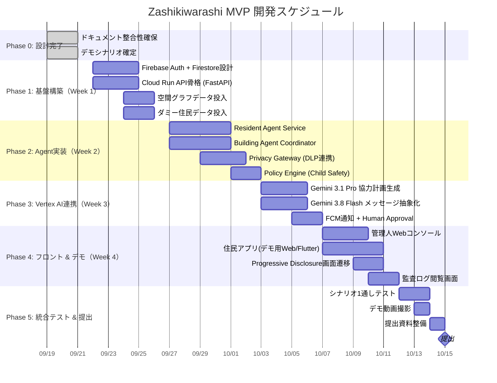

# Zashikiwarashi — マイルストーン・タスク分解

*Version 1.0 / Hackathon MVP*
*提出締切 2026-10-15 23:59*

---

## 1. ハッカソン概要と制約

| 項目 | 内容 |
| :--- | :--- |
| **ハッカソン名** | Google Cloud Japan AI Hackathon Vol.5 |
| **提出締切** | 2026-10-15 23:59 |
| **必須技術要件** | Google Cloudの「実行プロダクト」1つ以上 ＋ 「AI技術」1つ以上 |
| **審査基準** | ① 課題の新規性と解決策の有効性 ② 自律性・エージェントらしさ ③ 実装品質と拡張性 |

### 1.1 MVP実装方針

ガバナンス設計（Privacy Gateway、Human Approval、Policy Engine等）の完成度が高い一方、実装面の記載が不足している（PLAN_review.md指摘事項）。残り25日で全機能を実装するのは困難なため、**デモの再現性・説得力を最大化する最小構成**に集中する。

> **原則**: 「動くデモ ＋ 設計済み拡張候補の明示」の二層構成で提出する。

---

## 2. 実装する機能と「設計済み・拡張予定」の線引き

### 2.1 MVPで実装する（デモで動かす）

| # | 機能 | 技術要素 | SPEC.md 受け入れ基準 |
| :--- | :--- | :--- | :--- |
| M1 | 管理人Webコンソール（緊急モード発令） | Cloud Run + Next.js/React | ✅ 管理人が全館緊急モードにできる |
| M2 | Resident Agent × 3名以上のContext分離実行 | Cloud Run + Firestore | ✅ 3名以上が異なるNeed/Capabilityで協議 |
| M3 | Building Agentによる空間グラフベースの協力計画生成 | Vertex AI (Gemini 3.1 Pro) + Firestore空間グラフ | ✅ 1対1に限定されない協力計画を生成 |
| M4 | Privacy Gatewayによるメッセージ検査・抽象化 | Sensitive Data Protection (旧Cloud DLP) | ✅ 外向きメッセージがGatewayを通る |
| M5 | FCMプッシュ通知による打診 → Human Approval | FCM HTTP v1 + Cloud Run | ✅ 本人未承認のアクションがCommitされない |
| M6 | Progressive Disclosureの画面遷移デモ | Flutter / Web Mock | ✅ 承認後に初めて部屋番号が開示される |
| M7 | 監査ログの事後閲覧 | Cloud Logging / Firestore | ✅ 住民が後から協議要約を確認できる |

### 2.2 設計済み・拡張予定（提出資料で明示するが、デモでは動かさない）

| # | 機能 | 設計済み文書 | 理由 |
| :--- | :--- | :--- | :--- |
| E1 | Google Calendar API実連携 | DESIGN.md §3.3.1 | OAuth認可フローの実装・テストに時間がかかる。MVPではダミーデータで代替 |
| E2 | 端末在宅シグナル（Wi-Fi/充電/歩行/ジオフェンス） | DESIGN.md §3.3.2 | OS権限審査・Foreground Service対応が複雑。MVPではダミーデータで代替 |
| E3 | 電力スマートメーターAPI実連携 | ARCHITECTURE.md §2.3 | 電力データ管理協会との契約が必要。MVPではダミーデータで代替 |
| E4 | インターホン盤Webhook連携 | ARCHITECTURE.md §2.4 | 設備アクセスが必要。MVPではダミーデータで代替 |
| E5 | 住民がセルフ緊急モードにする（個人単位） | SPEC.md §3.1 | 管理人発令の全館モードに集中 |
| E6 | Cloud KMS / VPC Service Controls | SPEC.md §4.4 | 本番拡張候補 |

---

## 3. マイルストーン

---

## 4. フェーズ別タスク詳細

### Phase 0: 設計完了 ✅

- [x] 全仕様書の整合性確保（SPEC.md / DESIGN.md / ARCHITECTURE.md / PLAN.md）
- [x] デモシナリオ4種の確定
- [x] Webモック（Studio Architecture）の構築・検証

### Phase 1: 基盤構築（9/22 - 9/26）

- [ ] Firebase Authenticationのセットアップ（Google OAuth + カスタムクレーム）
- [ ] Cloud Firestoreのコレクション設計・セキュリティルール実装
  - `/buildings/{buildingId}` 空間グラフ
  - `/residents/{residentId}/private/lifestyle_memory`
  - `/residents/{residentId}/public/abstract_state`
  - `/active_plans/{planId}`
- [ ] Cloud Run API骨格（FastAPI / Python）のデプロイ
  - `POST /emergency/trigger` — 緊急モード発令
  - `POST /emergency/confirm-presence` — 在宅確認応答
  - `GET /plans/{planId}` — 計画詳細取得
- [ ] デモ用ダミーデータの投入
  - 15階建て150戸の空間グラフ（階段所要時間、踊り場位置）
  - 住民A〜D（シナリオ1用）のCat 2/3データ

### Phase 2: Agent実装（9/27 - 10/2）

- [ ] Resident Agent Service
  - `resident_id` によるContext分離
  - Lifestyle Memory読み取り・Need/Capability応答
  - Emergency Context生成
- [ ] Building Agent Coordinator
  - 緊急モード受信 → 関連Resident Agent選定
  - 空間グラフ参照 → タスク分割ロジック
  - 協力計画の生成指示（Vertex AI連携は Phase 3）
- [ ] Privacy Gateway
  - Sensitive Data Protectionとの連携
  - 日本語の住所・電話番号・人名・居室番号のマスキングルール設定
  - Agent外向きメッセージの通過検査
- [ ] Policy Engine
  - Child Safetyルール（私室連れ込み禁止、防犯カメラ付きラウンジ限定）
  - Human Approval未完了時の実世界アクション遮断

### Phase 3: Vertex AI連携（10/3 - 10/6）

- [ ] Gemini 3.1 Pro — 協力計画の構造化生成
  - JSON Schema定義（タスク、担当者、所要時間、受け渡し場所）
  - 空間グラフ + 住民制約のプロンプト設計
  - 出力検証（不可能なタスクの排除）
- [ ] Gemini 3.8 Flash — メッセージ抽象化
  - Resident Agent間メッセージの意図解釈
  - 生Need → 抽象化Needへの変換
- [ ] FCM通知 + Human Approval
  - 高優先度データメッセージの送信
  - 1タップ応答の受信 → Firestoreステータス更新
  - 承認/辞退のフロー完成

### Phase 4: フロントエンド & デモ（10/7 - 10/11）

- [ ] 管理人Webコンソール
  - 緊急モード発令ボタン
  - 進行状況ダッシュボード（住民の応答状況、計画のステータス）
  - トリアージ結果表示（応答なし＋高齢単身の赤色抽出）
- [ ] 住民アプリ（デモ用）
  - ロック画面 → FCMプッシュ通知 → 打診画面 → 承認後手順 → 完了画面
  - Progressive Disclosure（承認後に初めて部屋番号が開示）
  - DESIGN_SPECIFICATION.md準拠のStudio Architecture
- [ ] 監査ログ閲覧画面
  - 住民が事後に自分のデータ利用・開示経緯を確認

### Phase 5: 統合テスト & 提出（10/12 - 10/15）

- [ ] シナリオ1（停電バケツリレー）の通しテスト
  - 管理人発令 → Agent協議 → FCM打診 → Human Approval → 計画確定 → 完了
- [ ] シナリオ2〜4の部分デモ確認
- [ ] デモ動画の撮影・編集
- [ ] 提出資料の最終整備
  - README.md（概要・セットアップ手順）
  - アーキテクチャ図（ARCHITECTURE.md）
  - デモ動画
- [ ] 提出

---

## 5. リスクと対策

| リスク | 影響 | 対策 |
| :--- | :--- | :--- |
| Vertex AI Gemini 3.1 Proの構造化出力が安定しない | 協力計画の品質が不安定 | JSON Schemaでの厳格指定 + 出力検証ループ。最悪の場合はハードコードされたデモデータで代替 |
| Sensitive Data Protectionの日本語マスキング精度 | 居室番号（3桁数字）の誤検知 | カスタムinfoTypeの定義。テスト期間を十分に確保 |
| FCMプッシュ通知のデモ環境での安定性 | デモ中に通知が届かない | ローカル環境ではWebSocket fallbackも用意 |
| 1人チームでの開発リソース不足 | 全Phase完了が困難 | Phase 1-3を最優先。Phase 4は最低限のデモ用UIに絞り、Studio Architecture（既存Webモック）を活用 |

---

## 6. 実装時に残す判断事項

- Firestoreの具体的なCollection/Document設計の詳細（インデックス設計等）
- Google Calendar APIの実連携対象とOAuthスコープの最終決定
- 生活文脈の抽象化ロジックと更新頻度の具体値
- Privacy Gatewayの公開粒度ルールとSensitive Data ProtectionのinfoType設定
- Agent間会話の最大ラウンド数・終了条件の具体値
- Building Agentが会話へ介入する条件
- 高リスク事象を管理人/外部機関へエスカレーションするルール

---

## 相互参照

- **課題・ユーザー・要件** → [SPEC.md](SPEC.md)
- **データモデル・エージェント設計** → [DESIGN.md](DESIGN.md)
- **システム構成** → [ARCHITECTURE.md](ARCHITECTURE.md)
