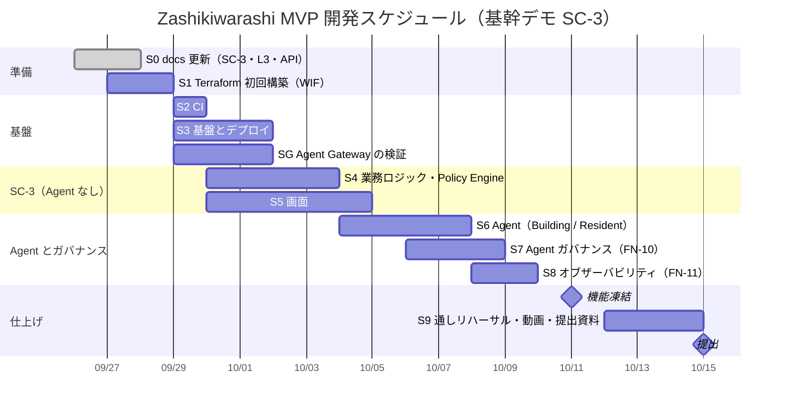

# Zashikiwarashi — マイルストーン・タスク分解

*Version 1.1 / Hackathon MVP（基幹デモ SC-3）*
*提出締切 2026-10-15 23:59*

---

## 1. ハッカソン概要と制約

| 項目 | 内容 |
| :--- | :--- |
| **ハッカソン名** | Google Cloud Japan AI Hackathon Vol.5 |
| **提出締切** | 2026-10-15 23:59 |
| **必須技術要件** | Google Cloudの「実行プロダクト」1つ以上 ＋ 「AI技術」1つ以上 |
| **審査基準** | ① 課題の新規性と解決策の有効性 ② 自律性・エージェントらしさ ③ 実装品質と拡張性 |

### 1.1 MVP実装方針

ガバナンス設計（Privacy Gateway、Human Approval、Policy Engine等）の完成度が高い一方、実装面の記載が不足している。提出までに全機能を実装するのは困難なため、**デモの再現性・説得力を最大化する最小構成**に集中する。

> **原則**: 「動くデモ ＋ 設計済み拡張候補の明示」の二層構成で提出する。

---

## 2. 実装する機能と「設計済み・拡張予定」の線引き

各機能に FN-xx（MVP）/ EXT-xx（拡張）のIDを振る。実装時のブランチ名・コミット・PR・コード内コメントではこのIDを参照する。機能から要件・設計・エンティティ・APIへの対応は [TRACEABILITY.md](TRACEABILITY.md) を参照。

### 2.1 MVPで実装する（デモで動かす）

| ID | 機能 | 技術要素 | 満たす受け入れ基準（SPEC §6） |
| :--- | :--- | :--- | :--- |
| FN-01 | 管理人Webコンソール（緊急モード発令・自然言語の指示） | Cloud Run + Next.js/React | REQ-01, REQ-03 |
| FN-02 | 認証とロール分離（住民は住戸に紐付け） | Firebase Auth カスタムクレーム | REQ-02 |
| FN-03 | Resident Agent × 3名以上のContext分離実行とタスク評価。逆提案・開示の最小化・本人との対話（DESIGN.md §5.8 R1〜R3） | Agent Runtime + Gemini（データはツールサービス経由） | REQ-04, REQ-15 |
| FN-04 | Building Agentによる空間グラフベースの協力計画（援助Task）生成 | Agent Runtime + Vertex AI (Gemini 3.1 Pro) + Firestore空間グラフ | REQ-05 |
| FN-05 | Privacy Gatewayによるメッセージ検査・抽象化 | Resident Agent の抽象化コード + Model Armor の SDP フィルタ（Sensitive Data Protection の検査テンプレート） | REQ-06, REQ-11 |
| FN-06 | 打診 → Human Approval | Cloud Run（API-04）+ Firestore の `onSnapshot`（FCM HTTP v1 は余力） | REQ-07 |
| FN-07 | Progressive Disclosureの画面遷移デモ | Next.js（デモ用Web）+ API-06 | REQ-07, REQ-11 |
| FN-08 | タスクの開始・完了・失敗の報告と進捗ダッシュボード | Cloud Run + Next.js | REQ-08, REQ-09 |
| FN-09 | 監査ログの事後閲覧 | Firestore（AuditEvent）/ Cloud Logging | REQ-10 |
| FN-10 | Agent ガバナンス（Agent への入力・Agent 間通信の統制。制御ポイント G1〜G4・G6） | Agent Gateway + Agent Registry + Agent Identity + IAP ポリシー + Model Armor | REQ-13 |
| FN-11 | Agent Observability と監査ログ（制御ポイント O1・O2・G7） | Cloud Trace（ADK の OpenTelemetry）+ Cloud Logging + 監査ログバケット | REQ-14 |

> REQ-12（嗜好・人格プロフィールを生成しない）は特定の機能ではなく、全機能の制約として守る。

### 2.2 設計済み・拡張予定（提出資料で明示するが、デモでは動かさない）

| ID | 機能 | 設計済み文書 | 理由 |
| :--- | :--- | :--- | :--- |
| EXT-01 | Google Calendar API実連携 | DESIGN.md §3.3.1 | OAuth認可フローの実装・テストに時間がかかる。MVPではダミーデータで代替 |
| EXT-02 | 端末在宅シグナル（Wi-Fi/充電/歩行/ジオフェンス） | DESIGN.md §3.3.2 | OS権限審査・Foreground Service対応が複雑。MVPではダミーデータで代替 |
| EXT-03 | 電力スマートメーターAPI実連携 | ARCHITECTURE.md §2.3 | 電力データ管理協会との契約が必要。MVPではダミーデータで代替 |
| EXT-04 | インターホン盤Webhook連携 | ARCHITECTURE.md §2.4 | 設備アクセスが必要。MVPではダミーデータで代替 |
| EXT-05 | Cloud KMS / VPC Service Controls | SPEC.md §4.4 | 本番拡張候補 |
| EXT-06 | Resident Agent 同士の直接調整（A2A） | DESIGN.md §5.8 R6 | FN-03・FN-10 の完了後、余力があれば MVP で実装する |
| EXT-07 | Agent の評価ゲートとアラート（G8 Gen AI Evaluation・O4 Cloud Monitoring）、Policy Engine の ext_authz 化（G5） | ARCHITECTURE.md §3.4.3 | FN-10・FN-11 の完了後、余力があれば MVP で実装する |
| EXT-08 | BigQuery Agent Analytics（O3）・Online Monitors（O5） | ARCHITECTURE.md §3.4.3 | 本番運用で効く機能。図と提出資料に書くだけ |

> 旧 E5「住民がセルフ緊急モードにする」は、災害以外を対象外としたため廃止した（FUCHIUE_REVIEW 指摘3）。

---

## 3. マイルストーン

基幹デモは **SC-3（地震直後の安否確認分散）**。「Agent なしで SC-3 を最後まで通す → Agent とガバナンスを重ねる」の順で縦に積み上げる。ステップ 5 の時点で Agent なしのデモが成立するので、以降が遅れても提出できる。Agent Gateway は不確実性が高いため、ステップ 1 の直後から検証を並行する（ステップ G）。

---

## 4. ステップ別タスク

### ステップ 0: docs の更新（9/26 - 9/27）✅

- [x] 基幹デモを SC-3 に変更（SPEC §2.3、DESIGN §6.3 D）
- [x] Firestore の物理設計（DESIGN §7.3）、SC-3 で使う値の一覧（§7.4 #5・案）、API-04〜08（§8）
- [x] Terraform と GitHub Actions の運用（ARCHITECTURE §6、`rules/infra.md`）

### ステップ 1: Terraform の初回構築（9/27 - 9/28）✅

GitHub Actions が GCP に認証するための土台だけは、Actions が動く前に人が作る（ARCHITECTURE §6.1）。

- [x] Terraform の state 用 GCS バケットを作り、`provider.tf` の GCS backend を有効化する
- [x] 必要な API の有効化（`google_project_service`）
- [x] Workload Identity Pool / Provider（GitHub リポジトリ `akakura-hackathon/zashikiwarashi` に限定）
- [x] サービスアカウント: Terraform の plan 用（閲覧のみ）・apply 用（必要最小限のロール）・デプロイ用
- [x] オーナー権限を持つ人がローカルで1回 `terraform apply` する（9/26 実施。#9）
- [x] `terraform output` を GitHub の Variables に登録する（9/26 実施）

### ステップ 2: CI（9/29）✅

- [x] `ci.yml`: backend（`ruff check`・`pytest`）、frontend（`lint`・`typecheck`・`build`）、Terraform（`fmt -check`・`validate`・`plan`）。plan の結果を PR にコメントする
- [x] 依存関係のロックファイル（`backend/uv.lock`・`frontend/package-lock.json`）を追加する

### ステップ 3: 基盤とデプロイ（9/29 - 10/1）（FN-02 ほか）

2 つの PR に分ける。

**3a: Artifact Registry・Cloud Run・デプロイ**
- [ ] Terraform: Artifact Registry、実行用サービスアカウント（API・ツールサービス）、Cloud Run（API・ツールサービスとも非公開。初回はプレースホルダーのイメージ）、tf-apply・deployer のロール追加
- [ ] `deploy.yml`: main へのマージで `terraform apply` → backend のイメージをビルドして Artifact Registry へ → Cloud Run（api・tools）を更新 → api の `/health` で動作確認（deployer の ID トークンを付けて呼ぶ）
- [ ] CI でも backend のイメージをビルドする（push はしない）

**3b: Firebase・Firestore・frontend**
- [ ] Terraform（google-beta を併用）: Firestore（`(default)`・us-central1）とセキュリティルール・インデックス（DESIGN §7.3）、Firebase（プロジェクト・Web アプリ・Hosting）、Authentication の Google ログイン（Firebase Console で Google ログインを有効にする操作は手動1回。OAuth クライアントのシークレットを Terraform の state に残さないため）
- [x] 画面（frontend）から非公開の api を呼ぶ方法を決める → **API Gateway**（Firebase の ID トークンを Gateway で検証し、api は非公開のまま。ARCHITECTURE §3.1）
- [ ] API Gateway（API 定義・Gateway 用サービスアカウント）と、api 側でユーザー情報（`X-Apigateway-Api-Userinfo`）とロールを確認する処理
- [ ] `deploy.yml`: Firestore のルール・インデックスと frontend（静的エクスポート）を Firebase にデプロイ
- [ ] カスタムクレーム（`role`・`building_id`・`resident_id`・`unit_id`）を付けるスクリプト（FN-02）
- [ ] 完了の目安: 本番の URL で API の `/health` と空の画面が開き、Google ログインできる

### ステップ 4: SC-3 の業務ロジック（Agent なし）（9/30 - 10/3）✅

- [x] シードスクリプト（[DESIGN.md §7.3.4](DESIGN.md#734-sc-3-のシードデータ)。15階・150戸、住民 H・I・J・K、在館コンテキストはダミー）
- [x] API-01〜08（[DESIGN.md §8](DESIGN.md#8-api一覧)）（FN-01・FN-06・FN-07・FN-08・FN-09）
- [x] ルールベースのトリアージ: 未応答住戸の分類（在宅可能性あり／Likely Away）、同じ階の最寄りの「無事」の住民への割り当て（1住戸1担当・重複なし）、応答期限と再打診（[DESIGN.md §7.4 #6](DESIGN.md#74-er未収容の項目未決)）、管理人への優先表示（§6.3 D）。LLM 失敗時のフォールバックとしても使う（NFR-03）
- [x] Policy Engine（FN-06, FN-07）
  - TaskEvent `APPROVED` が無いTaskの実行・部屋番号開示の遮断
  - 承認（`APPROVED` / `DECLINED`）を書き込めるのは API-04 だけ
  - Child Safetyルール（私室連れ込み禁止、防犯カメラ付きラウンジ限定。SC-3 では使わないがテストは書く）
- [x] 監査イベント（E-016）の記録（FN-09）
- [x] 完了の目安: **API だけで SC-3 が最後まで動く（pytest の通しシナリオテスト `tests/test_sc3_full_scenario.py` 通過）**

### ステップ 5: 画面（9/30 - 10/4）✅

- [x] 管理人Webコンソール（FN-01, FN-08）
  - 緊急モード発令・自然言語の指示入力（Issue）
  - 150戸の状態（`current_states` を表示）、トリアージ開始（API-08）
  - 優先アラート（本人未応答 × 隣室確認も応答なし × 要配慮世帯）
- [x] 住民アプリ PWA / Web Push 基盤（FN-06, FN-07, FN-08, [DESIGN.md §9](DESIGN.md#9-フロントエンド-uiuxpwa-設計studio-architecture--web-push)）
  - PWA（`manifest.json`, Service Worker `firebase-messaging-sw.js`）化
  - Web Push（VAPID認証）＋ FCM HTTP v1 / APNs 連携による iOS 16.4+ スリープ・ロック画面通知（API-10）
  - Studio Architecture（審査員検証卓と住民スマホ画面の分離）および OLED Black / Amber灯火デザインシステム
- [x] 住民アプリ シナリオ画面遷移（FN-06, FN-07, FN-08）
  - 安否回答（無事 / 被害あり、自由文も可）
  - 打診の承認 / 辞退 → 承認後に初めて部屋番号を表示（Progressive Disclosure） → 結果報告（応答あり / なし）
  - Resident Agent からの聞き返しの表示（FN-03 R3）
  - デモ用に住民（H・I・J・K）を切り替えて操作できるようにする
- [x] 監査ログ閲覧画面（FN-09）
- [x] 完了の目安: **Agent なしの SC-3 デモが成立する（Studio Architecture 統合画面完成）**

### ステップ 6: Agent（10/4 - 10/7）（FN-03・FN-04・FN-05）✅

- [x] Building Agent Coordinator（FN-04）
  - トリアージ開始（API-08）を受けて、未応答住戸を分類し、隣室確認 Task を作る
  - Gemini による割り当て案の構造化出力（JSON Schema）と出力検証。失敗・オフライン時はステップ 4 のルールベースへ安全にフォールバック（NFR-03）
- [x] Resident Agent（FN-03）
  - `resident_id` によるContext分離（他住民データへのアクセス遮断）
  - 世帯プロファイル・在館コンテキストの読み取り、Taskの評価（TaskEvent `EVALUATED`）
  - R1 逆提案（移動困難時の援助要・条件付き代案）、R2 開示の番人（承認前の部屋番号秘匿）、R3 本人との対話（自由文の構造化 Need 変換と聞き返し）（DESIGN.md §5.8）
- [x] Privacy Gateway（FN-05）
  - Resident Agent の回答を抽象トークンだけで組み立てるコード
  - Sensitive Data Protection / Model Armor 連携用の PII マスキング（部屋番号・氏名・電話番号・郵便番号のトークン化）
- [x] 完了の目安: **Agent レイヤ（Building Agent, Resident Agent, Privacy Gateway）のユニットテスト（`tests/test_agents.py`）が全件パスする**

### ステップ 7: Agent ガバナンス（10/6 - 10/8）（FN-10。構成は ARCHITECTURE.md §3.4）

- [ ] Building Agent と Resident Agent に Agent Identity を付与する
- [ ] Agent Gateway（Standalone モード）の Ingress（G1: API → Agent）と Egress（G3: Agent → Resident Agent（A2A）/ ツールサービス（MCP）/ Gemini API）を作り、両 Agent をデプロイ時に紐づける
- [ ] ツールサービス（MCP）と Gemini API のエンドポイントを Agent Registry に登録する（G6）
- [ ] IAP ポリシーで Agent Identity ごとに呼べるツールを制限する（G4。Resident Agent は自分の住民のデータの読み取りと評価結果の記録のみ。承認の書き込みと部屋番号の開示はどの Agent も不可）
- [ ] Model Armor テンプレート（プロンプトインジェクション・ジェイルブレイク・SDP フィルタ）を作り、Gateway に付ける（G2）
- [ ] デモ用に、プロンプトインジェクションや部屋番号を含む入出力が遮断されることを確認するテストを用意する
- [ ] Terraform で作れない部分は `infra/gcloud/` のスクリプトにし、`deploy.yml` から実行する

### ステップ 8: Agent Observability と監査ログ（10/8 - 10/9）（FN-11）

- [ ] Agent Runtime・Cloud Run の両方で ADK のトレースを Cloud Trace に出し、plan_id で Agent をまたいで追えるようにする（O1）
- [ ] プロンプトと応答の本文を記録しない設定にする（`OTEL_INSTRUMENTATION_GENAI_CAPTURE_MESSAGE_CONTENT=NO_CONTENT`）
- [ ] Agent Gateway・IAP・Model Armor の判定ログを監査 sink でログバケットへ送る（O2・G7。ハッカソン中は保持ロックをかけない）

### ステップ G: Agent Gateway の検証（9/29 - 10/1。ステップ 1 の直後から並行）

- [ ] Standalone モードで Ingress / Egress を作れるか
- [ ] Gemini API の呼び出しを Egress 経由にできるか（ARCHITECTURE.md §3.4.5 の TBD ①）
- [ ] IAP ポリシーでツール単位の制限ができるか、Terraform で作れる範囲はどこまでか
- [ ] 結果を ARCHITECTURE.md §3.4.5 に反映する。構成が成り立たない場合は、ステップ 7 に入る前に設計を見直す

### ステップ 9: 仕上げと提出（10/12 - 10/15）

- [ ] SC-3 の通しテストとリハーサル（Agent なし版を予備として残す）
- [ ] SC-1・SC-2・SC-4 は設計と図で説明する（余力があれば部分デモ）
- [ ] デモ動画の撮影・編集
- [ ] 提出資料の最終整備（README.md の概要・セットアップ手順、構成図、デモ動画）
- [ ] 提出

### 余力があれば（機能凍結 10/11 まで）

- [ ] FCM プッシュ通知（FN-06。災害時の主要通知基盤にできるかは TBD）
- [ ] EXT-06（Resident Agent 同士の直接調整）、EXT-07（評価ゲート・アラート・ext_authz）

---

## 5. リスクと対策

| リスク | 影響 | 対策 |
| :--- | :--- | :--- |
| Vertex AI Gemini 3.1 Proの構造化出力が安定しない | 協力計画の品質が不安定 | JSON Schemaでの厳格指定 + 出力検証ループ。最悪の場合はハードコードされたデモデータで代替 |
| Model Armor（SDP フィルタ）の日本語の検出精度 | 居室番号（3桁数字）の誤検知・見逃し | カスタムinfoTypeの定義。Agent 間は抽象トークンだけを渡す作りにして、検出は二重の安全網にとどめる。テスト期間を十分に確保 |
| Gemini API を Egress の Agent Gateway 経由にできない（Standalone モード） | G3「外向き通信はすべて Gateway を通る」が崩れる | 最初に確認する。できない場合は直接呼び出し＋Model Armor の floor 設定で補い、docs と図を見直す |
| FCMプッシュ通知のデモ環境での安定性 | デモ中に通知が届かない | MVP は Firestore の `onSnapshot` で画面を更新し、FCM は余力とする |
| 開発期間が短い（9/26 時点で実装ゼロ、提出まで約3週間） | 全ステップ完了が困難 | ステップ 5 までで Agent なしの SC-3 デモを成立させ、以降は積み上げにする。基盤とガバナンス／バックエンドと Agent／フロントで分担して並行する |
| Workload Identity Federation の初回構築でつまずく | CI/CD が動かず全員の作業が止まる | 初回はオーナー権限を持つ人がローカルで apply する（ステップ 1）。それまでの開発はローカルと Firestore エミュレーターで進める |
| Agent Gateway・Agent Runtime の構築に時間がかかる（新しいサービスで手順の情報が少ない） | FN-10 が遅れ、Agent の実装も止まる | Agent 本体はローカル（`adk web`）で Gateway なしでも動くように作り、Gateway は後から前段に挟む |
| Terraform の google provider が未対応のリソースがある | IaC で再現できない | 未対応分は Terraform 化せず、gcloud コマンドを `infra/gcloud/` にスクリプトとして残す（`rules/infra.md`） |

---

## 6. 実装時に残す判断事項

- SC-3 で使う値の一覧（DESIGN.md §7.4 #5）と応答期限・再打診（#6）の案を確定する
- ER図に保持先が無い項目の扱い（DESIGN.md §7.4：物資の品目・数量、端末到達性、協議メッセージ、逆提案の条件）
- Google Calendar APIの実連携対象とOAuthスコープの最終決定
- 在館コンテキストの判定ロジックと有効期限（expires_at）の具体値
- Privacy Gatewayの公開粒度ルールと、SDP 検査テンプレートの infoType 設定
- Agent間会話の最大ラウンド数・終了条件の具体値
- Building Agentが会話へ介入する条件
- 高リスク事象を管理人/外部機関へエスカレーションするルール
- IAP ポリシーで Agent Identity ごとに許可するツールの一覧
- Model Armor の各フィルタの検出しきい値

---

## 相互参照

- **課題・ユーザー・要件** → [SPEC.md](SPEC.md)
- **データモデル・エージェント設計** → [DESIGN.md](DESIGN.md)
- **システム構成** → [ARCHITECTURE.md](ARCHITECTURE.md)
- **ID一覧・対応表** → [TRACEABILITY.md](TRACEABILITY.md)
