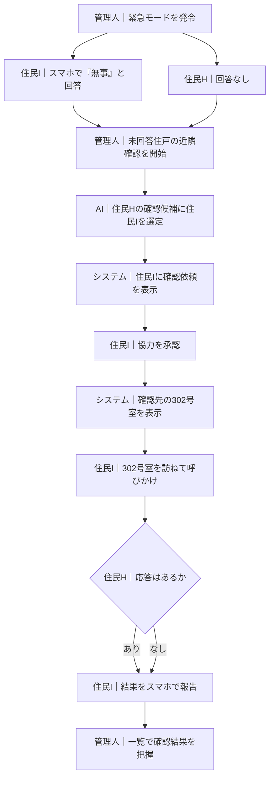

地震のあと、302号室から応答がない。隣の301号室には、無事な住民がいる。

**この二人をつなげられれば、管理人が到着する前に、安否を確認できるかもしれません。**

災害時のマンションにある助け合いの力をつなぐために、「Zashikiwarashi（座敷わらし）」を開発しています。[第5回 Agentic AI Hackathon with Google Cloud](https://zenn.dev/hackathons/google-cloud-japan-ai-hackathon-vol5)への参加作品です。

## 1. 課題：助けが必要な住民と、全戸を見守る管理人

近所付き合いが希薄になり、隣に誰が住んでいるか分からない。そんな暮らしで災害が起きたとき、住民と管理人には、それぞれ困りごとがあります。

### 住民は、困っていても頼み先が分からない

エレベーターが止まり、階段での移動が難しい。近くに協力できる人がいても、知り合いでなければ助けを求めにくい状況です。

スマホに応答できなければ、**困っていること自体が周囲に伝わらない**可能性もあります。

### 管理人は、すべての住戸を同時に確認できない

50戸のマンションなら、確認すべき相手も50戸。個別の連絡や訪問に加えて、協力者を探し、確認結果を集める必要があります。

**近くに人がいても、誰に何を頼むかが決まらなければ、確認作業を分担できません。**

## 2. サービス概要：AIが依頼先を探し、住民が確認を分担する

**Zashikiwarashiは、災害時の安否や困りごとを集め、近隣住民への協力依頼をAIが取り持つサービスです。**

住民はスマホで自分の状況を回答し、管理人は建物全体を一覧で把握します。応答のない住戸については、AIが確認を頼める候補を探します。協力するかどうかは、依頼された住民が決めます。

| 利用者 | 目指す変化 |
| --- | --- |
| **助けが必要な住民** | 親しい相手がいなくても、困りごとや未応答の状態に気づいてもらえる |
| **管理人** | 確認作業を分担し、それでも安否が分からない住戸への対応を判断できる |

目指しているのは、災害時の助け合いを支えることです。その第一歩として、**「応答のない住戸を、近隣住民に確認してもらう」**ところまでを、今回のデモにしました。

## 3. 利用の流れ：302号室の安否を確認する

舞台は5階建て・50戸の架空のマンションです。

- **管理人**：建物全体の安否確認を進める。
- **住民I・301号室**：無事と回答し、近隣確認の依頼を受ける。
- **住民H・302号室**：要配慮世帯。安否回答がない。

以下は住民Iが協力を承認する場合です。各ボックスは、一つの実行者の操作または状態を表します。

ここで管理人に届くのは、単なる「未回答」から一歩進んだ、**「近隣住民が訪ねた結果」**です。

デモ画面では、左に管理人の一覧、右に住民のスマホ画面を配置しました。住民を切り替えながら、一人でも双方の体験を追えます。

## 4. この体験を支える四つの機能

### 安否の集約：回答した人も、回答できない人も把握する

緊急モードの発令後、管理画面では**無事・支援が必要・未回答**を区別して表示します。管理人が、未回答の住戸を探すために個々のメッセージを読み直す必要を減らします。

選択肢で伝えきれない困りごとは、自由文でも受け付けます。住民側の**Resident Agent**が、必要な支援や移動の可否などに整理します。

### 協力候補の選定：建物内の近さと、住民の事情を扱う

建物全体の調整役である**Building Agent**が、安否・在館情報と住戸の位置関係をもとに、Geminiで協力候補を提案します。同じ階や近隣の住戸を考慮するのは、移動の負担を抑えるためです。

一方、近くにいるからといって、必ず協力できるわけではありません。Resident Agentには、移動困難の情報がある場合に「援助が必要」と返すタスク評価を実装しています。

**建物全体の調整と、住民個人の事情を分けて扱う。** これが二種類のエージェントを設けた理由です。候補の重複などはコードで検査し、モデルを利用できない場合にはルールベースの選定へ切り替えます。

### 承認と情報開示：協力は本人が決める

依頼された住民は、協力するか辞退するかを選べます。その判断と、相手の情報をどこまで見せるかを結びつけています。

| タイミング | 住民向けのタスク詳細 |
| --- | --- |
| **承認前** | 確認先の階を示し、部屋番号は表示しない |
| **承認後** | 確認に必要な部屋番号を表示する |

この「段階的開示」と未承認での操作の拒否は、**Policy Engineというコード上のルール**で制御します。AIの提案だけで、確認作業を開始した扱いにはしません。

このデモで承認するのは、依頼された住民Iです。確認される住民H側の事前同意や緊急時の開示条件は、実運用に向けた課題として残っています。

### 結果の集約：次に注意を向ける住戸を示す

報告された確認結果は、管理人の一覧へ反映します。**要配慮世帯が未回答で、訪問時の呼びかけにも応答がなかった場合**は、優先度を上げて表示します。

管理人が、近隣確認で解決した住戸と、引き続き対応が必要な住戸を見分けるための機能です。承認や情報開示の経緯も、監査記録として残します。

## 5. 技術構成：提案はAI、権限の制御はコード

画面はNext.js、APIはCloud Run上のFastAPIで構成し、Firestoreに安否・タスク・監査イベントを保存します。

| 役割 | 主な技術 |
| --- | --- |
| 画面・配信 | Next.js / Firebase Hosting |
| 認証・APIの入口 | Firebase Authentication / API Gateway |
| 業務処理・承認制御 | FastAPI / Cloud Run / Policy Engine |
| 状況の解釈・候補の提案 | Gemini 2.5 Flash / Google ADKによるエージェント定義 |
| データ保存 | Firestore |
| 入力検査・処理の追跡 | Model Armor / OpenTelemetry |
| インフラ・デプロイ | Terraform / GitHub Actions / Workload Identity Federation |

入力検査にはModel Armorとパターン検査を使い、Privacy Gatewayには部屋番号・電話番号などのマスキングを実装しています。承認前後の表示や、担当者以外の操作拒否は自動テストの対象です。

サービスの原則は、**日常的な活動報告を求めないこと**と、**協力・辞退の履歴から住民を評価しないこと**。助けを受ける機会を、普段の付き合いや過去の貢献量に左右させない設計を目指しています。

## 6. 現在できることと、これから

今回の成果は、架空の50戸を使い、発令から確認結果の報告までをつないだプロトタイプです。

| 項目 | 現時点の範囲 |
| --- | --- |
| 災害シナリオ | 地震が中心。停電・火災・洪水の指示・タスク切り替えも実装 |
| 世帯・在館情報 | デモ用データ。カレンダーや建物設備との実連携は今後の拡張 |
| 通知 | 画面内の疑似通知とFCMテスト送信を実装。一斉通知運用は今後検証 |
| 通信断 | 完全通信断には未対応。オフラインキャッシュは拡張候補 |

医療判断や救助隊の自動派遣は行いません。現場での安全性や時間短縮の効果も、まだ検証できていません。

次は訓練を通じて、「無理のない依頼になっているか」「管理人が次の対応を判断しやすいか」を確かめたいと考えています。

**仲良くならなくても、助け合える。** そのための小さな協力を、災害時につなぐサービスに育てていきます。
